# Catalog · 品种目录

456 fruits in 75 families. Traits are short summaries of the linked reference; the models show typical appearance for comparison, not for identifying real fruit.
75 类、456 款。外观要点概括自各条目所附资料；模型用于比较典型外观，不能据此鉴定实物品种。

| Family | 中文 | Scientific | Count |
| --- | --- | --- | --- |
| [Strawberry](#strawberry) | 草莓 | *Fragaria × ananassa* | 6 |
| [Mango](#mango) | 芒果 | *Mangifera indica* | 6 |
| [Apple](#apple) | 苹果 | *Malus domestica* | 6 |
| [Pear](#pear) | 梨 | *Pyrus communis* | 6 |
| [Watermelon](#watermelon) | 西瓜 | *Citrullus lanatus* | 6 |
| [Persimmon](#persimmon) | 柿子 | *Diospyros kaki* | 6 |
| [Fig](#fig) | 无花果 | *Ficus carica* | 6 |
| [Plum](#plum) | 李子 | *Prunus salicina* | 6 |
| [Lemon](#lemon) | 柠檬 | *Citrus limon 及柠檬杂交种* | 6 |
| [Grape](#grape) | 葡萄 | *Vitis vinifera* | 6 |
| [Pineapple](#pineapple) | 菠萝 | *Ananas comosus* | 6 |
| [Banana](#banana) | 香蕉 | *Musa spp. 栽培品种* | 6 |
| [Tomato](#tomato) | 番茄 | *Solanum lycopersicum* | 6 |
| [Mandarin](#mandarin) | 橘子 | *Citrus reticulata、Citrus unshiu 及近缘杂交种* | 6 |
| [Peach](#peach) | 桃子 | *Prunus persica* | 6 |
| [Melon](#melon) | 甜瓜 | *Cucumis melo* | 6 |
| [Pomegranate](#pomegranate) | 石榴 | *Punica granatum* | 6 |
| [Lime & related citrus](#lime) | 青柠与近缘柑橘 | *Citrus spp. 与 Microcitrus australasica；按俗名与用途归组* | 6 |
| [Dragon fruit](#dragonfruit) | 火龙果 | *Hylocereus spp. 与 Selenicereus megalanthus（依资料原称）* | 6 |
| [Passion fruit & Passiflora](#passionfruit) | 百香果与西番莲果 | *Passiflora spp.；本册比较六种代表类型* | 6 |
| [Lychee](#lychee) | 荔枝 | *Litchi chinensis* | 6 |
| [Carambola](#carambola) | 杨桃 | *Averrhoa carambola* | 6 |
| [Cherry](#cherry) | 樱桃 | *Prunus avium（甜樱桃）与 Prunus cerasus（酸樱桃）* | 6 |
| [Loquat](#loquat) | 枇杷 | *Eriobotrya japonica* | 6 |
| [Sapodilla](#sapodilla) | 人心果 | *Manilkara zapota* | 6 |
| [Jackfruit](#jackfruit) | 菠萝蜜 | *Artocarpus heterophyllus* | 6 |
| [Coconut](#coconut) | 椰子 | *Cocos nucifera* | 6 |
| [Raspberry & relatives](#raspberry) | 树莓与近缘类型 | *Rubus idaeus、Rubus occidentalis 及红黑树莓杂交类型* | 6 |
| [Chinese jujube](#jujube) | 中国枣 | *Ziziphus jujuba* | 6 |
| [Kiwifruit & kiwiberry](#kiwifruit) | 猕猴桃与奇异莓 | *Actinidia deliciosa、A. chinensis、A. arguta 等* | 6 |
| [Papaya](#papaya) | 番木瓜 | *Carica papaya* | 6 |
| [Apricot](#apricot) | 杏 | *Prunus armeniaca* | 6 |
| [Gooseberry](#gooseberry) | 醋栗（鹅莓） | *Ribes spp.（欧洲醋栗及相关杂交类型）* | 6 |
| [Date](#date_palm) | 椰枣 | *Phoenix dactylifera* | 6 |
| [Kumquat & relatives](#kumquat) | 金桔与近缘类型 | *Fortunella spp.（亦归入 Citrus，含杂交类型）* | 6 |
| [Sweet orange](#sweet_orange) | 甜橙 | *Citrus sinensis* | 6 |
| [Chinese bayberry (yangmei)](#bayberry) | 杨梅 | *Morella rubra（异名 Myrica rubra）* | 6 |
| [Durian](#durian) | 榴莲 | *Durio zibethinus* | 6 |
| [Sugar apple & relatives](#annona) | 番荔枝与近缘果 | *Annona spp.（含 A. squamosa × A. cherimola 杂交类型）* | 6 |
| [Jaboticaba & relatives](#jaboticaba) | 嘉宝果与近缘类型 | *Plinia spp. 与 Myrciaria spp.（含杂交类型）* | 6 |
| [Longan](#longan) | 龙眼 | *Dimocarpus longan* | 6 |
| [Rambutan](#rambutan) | 红毛丹 | *Nephelium lappaceum* | 6 |
| [Pomelo](#pomelo) | 柚子 | *Citrus maxima* | 6 |
| [Guava](#guava) | 番石榴 | *Psidium guajava* | 6 |
| [Wax apple](#wax_apple) | 莲雾 | *Syzygium samarangense* | 6 |
| [Prickly pear & relatives](#prickly_pear) | 仙人掌果与近缘类型 | *Opuntia spp.* | 6 |
| [Mulberry](#mulberry) | 桑葚（果桑） | *Morus spp.* | 6 |
| [Blueberry](#blueberry) | 蓝莓 | *Vaccinium spp. and hybrids* | 6 |
| [Sea buckthorn](#sea_buckthorn) | 沙棘 | *Hippophae rhamnoides L.* | 6 |
| [Hawthorn](#hawthorn) | 山楂 | *Crataegus pinnatifida Bunge* | 6 |
| [Cranberry](#cranberry) | 蔓越莓 | *Vaccinium macrocarpon Aiton* | 6 |
| [Currant & blackcurrant](#currant) | 穗醋栗与黑加仑 | *Ribes rubrum（红、粉、白）与 Ribes nigrum（黑）* | 6 |
| [Blackberry & hybrid berries](#blackberry) | 黑莓与杂交莓 | *Rubus spp.；含黑莓与红树莓杂交类型* | 6 |
| [Grapefruit & related hybrids](#grapefruit) | 葡萄柚与近缘杂交果 | *Citrus × paradisi；另含其与柚的杂交种* | 6 |
| [Mangosteen & Garcinia](#garcinia) | 山竹与近缘藤黄果 | *Garcinia mangostana 及藤黄属其他近缘物种* | 6 |
| [Pepino melon](#pepino) | 人参果（香瓜茄） | *Solanum muricatum Aiton* | 6 |
| [Tamarillo](#tamarillo) | 树番茄（Tamarillo） | *Solanum betaceum Cav.（旧称 Cyphomandra betacea）* | 6 |
| [Avocado](#avocado) | 牛油果 | *Persea americana* | 12 |
| [Cacao pod](#cacao) | 可可果 | *Theobroma cacao；CATIE 记录的六个克隆系* | 6 |
| [Breadfruit](#breadfruit) | 面包果 | *Artocarpus altilis；六个栽培品种* | 6 |
| [White sapote](#white_sapote) | 白萨波特（白柿） | *Casimiroa edulis 及近缘杂交类型；六个栽培品种* | 6 |
| [Canistel](#canistel) | 蛋黄果 | *Pouteria campechiana；按 UF/IFAS 品种名录归组* | 6 |
| [Feijoa](#feijoa) | 凤梨番石榴（费约果） | *Acca sellowiana；六个栽培品种* | 6 |
| [Quince](#quince) | 木梨（榅桲） | *Cydonia oblonga；六个栽培品种* | 6 |
| [Tamarind](#tamarind) | 罗望子（酸角） | *Tamarindus indica；泰国甜酸角与印度品种试验各三种* | 6 |
| [Citron (incl. Buddha's hand)](#citron) | 香橼（含佛手） | *Citrus medica；六个命名品种与种质，佛手为分指类型* | 6 |
| [Acerola](#acerola) | 针叶樱桃（Acerola） | *Malpighia emarginata；六个栽培品种* | 6 |
| [Cashew apple](#cashew_apple) | 腰果梨（Cashew apple） | *Anacardium occidentale；六个 Embrapa 登记克隆系，肉质果柄连同外露真果* | 6 |
| [Salak](#salak) | 蛇皮果（Salak） | *Salacca zalacca；Pondoh 系与 Sari Intan 系六个命名品种* | 6 |
| [Mamey sapote](#mamey_sapote) | 玛梅果（Mamey sapote） | *Pouteria sapota；六个佛罗里达栽培品种的纵剖面* | 6 |
| [Star apple (caimito)](#star_apple) | 星苹果（Caimito） | *Chrysophyllum cainito；四个越南栽培类型与两个佛罗里达命名品种* | 6 |
| [Cherimoya](#cherimoya_cultivar) | 秘鲁番荔枝（Cherimoya） | *Annona cherimola；UPOV TG/208/1 品种性状示例* | 6 |
| [Tomatillo](#tomatillo) | 墨西哥酸浆（Tomatillo） | *Physalis ixocarpa（同物异名 P. philadelphica）；UPOV TG/236/1 示例品种* | 6 |
| [Coffee cherry](#coffee_cherry) | 咖啡鲜果（Coffee cherry） | *Coffea arabica；六个阿拉比卡栽培品种或品种类型* | 6 |
| [Haskap (honeyberry)](#haskap) | 蓝靛果（Haskap） | *Lonicera caerulea 复合群；萨斯喀彻温大学六个育成品种* | 6 |

## Strawberry · 草莓

*Fragaria × ananassa* · family id `strawberry` · [reference](https://ask.ifas.ufl.edu/publication/CV134)

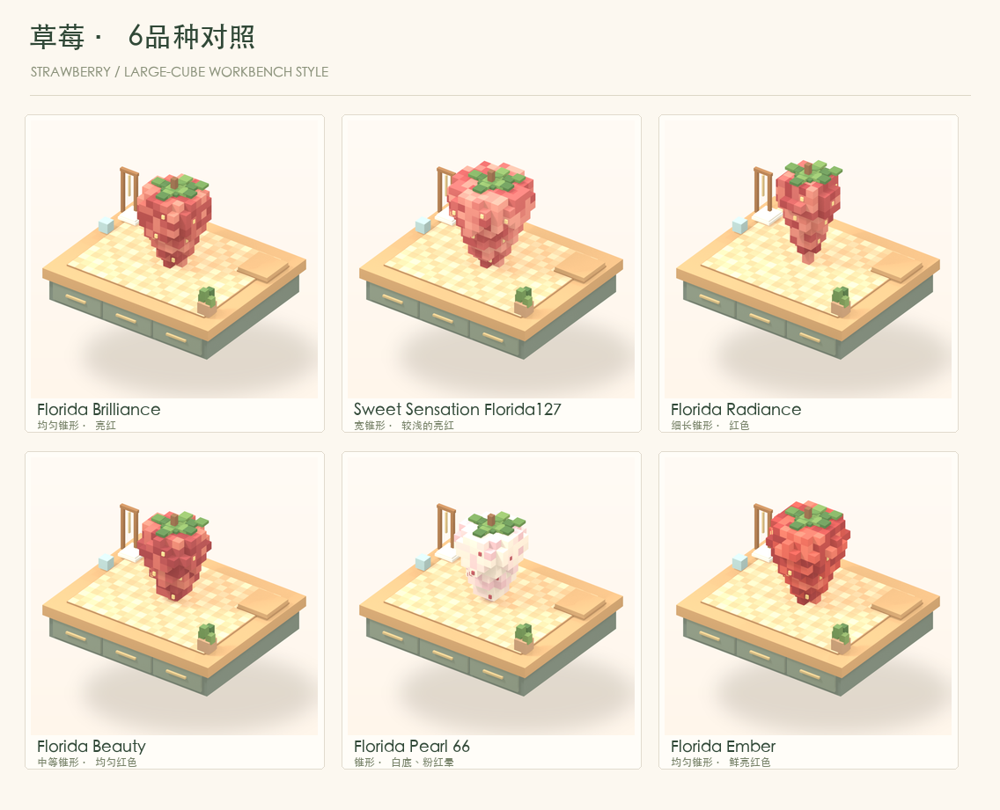

| id | name | shape 形状 | ripe colour 成熟色 | skin 果皮 | model |
| --- | --- | --- | --- | --- | --- |
| `ST-01_florida_brilliance` | [Florida Brilliance](https://ask.ifas.ufl.edu/publication/HS1322) | 均匀锥形 | 亮红 | 有光泽，籽粒略凹 | [glb](models/ST-01_florida_brilliance.glb) · [card](previews/ST-01_florida_brilliance.png) · 10 × 16 × 10 cm |
| `ST-02_florida127` | [Sweet Sensation Florida127](https://ask.ifas.ufl.edu/publication/HS1256) | 宽锥形 | 较浅的亮红 | 较均匀 | [glb](models/ST-02_florida127.glb) · [card](previews/ST-02_florida127.png) · 13 × 18 × 13 cm |
| `ST-03_florida_radiance` | [Florida Radiance](https://ask.ifas.ufl.edu/publication/HS1322) | 细长锥形 | 红色 | 细长果形可能出现在早季 | [glb](models/ST-03_florida_radiance.glb) · [card](previews/ST-03_florida_radiance.png) · 10 × 19 × 10 cm |
| `ST-04_florida_beauty` | [Florida Beauty](https://ask.ifas.ufl.edu/publication/HS1307) | 中等锥形 | 均匀红色 | 细腻果皮 | [glb](models/ST-04_florida_beauty.glb) · [card](previews/ST-04_florida_beauty.png) · 10 × 16 × 10 cm |
| `ST-05_florida_pearl` | [Florida Pearl 66](https://ask.ifas.ufl.edu/publication/CV134) | 锥形 | 白底、粉红晕 | 红色籽粒 | [glb](models/ST-05_florida_pearl.glb) · [card](previews/ST-05_florida_pearl.png) · 10 × 16 × 10 cm |
| `ST-06_florida_ember` | [Florida Ember](https://ask.ifas.ufl.edu/publication/CV134) | 均匀锥形 | 鲜亮红色 | 较平整 | [glb](models/ST-06_florida_ember.glb) · [card](previews/ST-06_florida_ember.png) · 13 × 18 × 13 cm |

## Mango · 芒果

*Mangifera indica* · family id `mango` · [reference](https://www.mango.org/wp-content/uploads/2023/11/mango_variety_availability_2023.pdf)

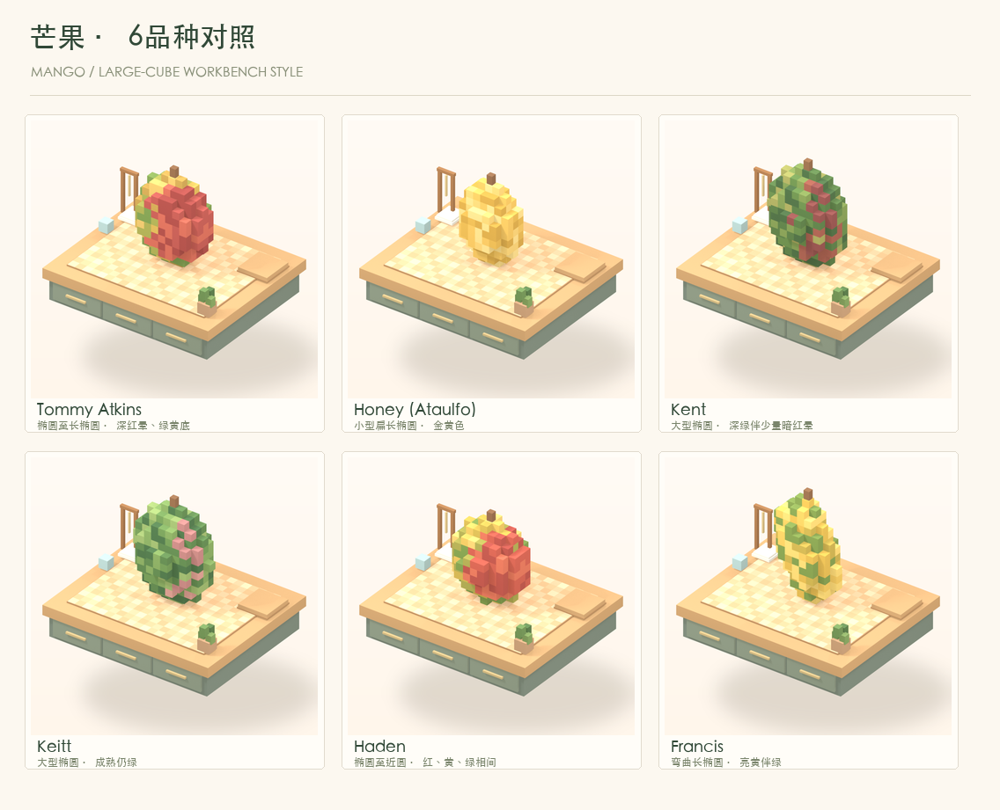

| id | name | shape 形状 | ripe colour 成熟色 | skin 果皮 | model |
| --- | --- | --- | --- | --- | --- |
| `MG-01_tommy_atkins` | [Tommy Atkins](https://www.mango.org/mango-variety/tommy-atkins/) | 椭圆至长椭圆 | 深红晕、绿黄底 | 大片红色晕染 | [glb](models/MG-01_tommy_atkins.glb) · [card](previews/MG-01_tommy_atkins.png) · 13 × 19 × 7 cm |
| `MG-02_honey_ataulfo` | [Honey (Ataulfo)](https://www.mango.org/wp-content/uploads/2023/11/mango_variety_availability_2023.pdf) | 小型扁长椭圆 | 金黄色 | 色彩较统一 | [glb](models/MG-02_honey_ataulfo.glb) · [card](previews/MG-02_honey_ataulfo.png) · 10 × 17 × 7 cm |
| `MG-03_kent` | [Kent](https://www.mango.org/wp-content/uploads/2023/11/mango_variety_availability_2023.pdf) | 大型椭圆 | 深绿伴少量暗红晕 | 成熟可见黄底点 | [glb](models/MG-03_kent.glb) · [card](previews/MG-03_kent.png) · 14 × 20 × 10 cm |
| `MG-04_keitt` | [Keitt](https://www.mango.org/wp-content/uploads/2023/11/mango_variety_availability_2023.pdf) | 大型椭圆 | 成熟仍绿 | 局部可有粉红晕 | [glb](models/MG-04_keitt.glb) · [card](previews/MG-04_keitt.png) · 15 × 20 × 10 cm |
| `MG-05_haden` | [Haden](https://www.mango.org/wp-content/uploads/2023/11/mango_variety_availability_2023.pdf) | 椭圆至近圆 | 红、黄、绿相间 | 少量浅色皮孔 | [glb](models/MG-05_haden.glb) · [card](previews/MG-05_haden.png) · 13 × 17 × 10 cm |
| `MG-06_francis` | [Francis](https://www.mango.org/wp-content/uploads/2023/11/mango_variety_availability_2023.pdf) | 弯曲长椭圆 | 亮黄伴绿 | S 形轮廓可见 | [glb](models/MG-06_francis.glb) · [card](previews/MG-06_francis.png) · 13 × 21 × 7 cm |

## Apple · 苹果

*Malus domestica* · family id `apple` · [reference](https://waapple.org/varieties/all/)

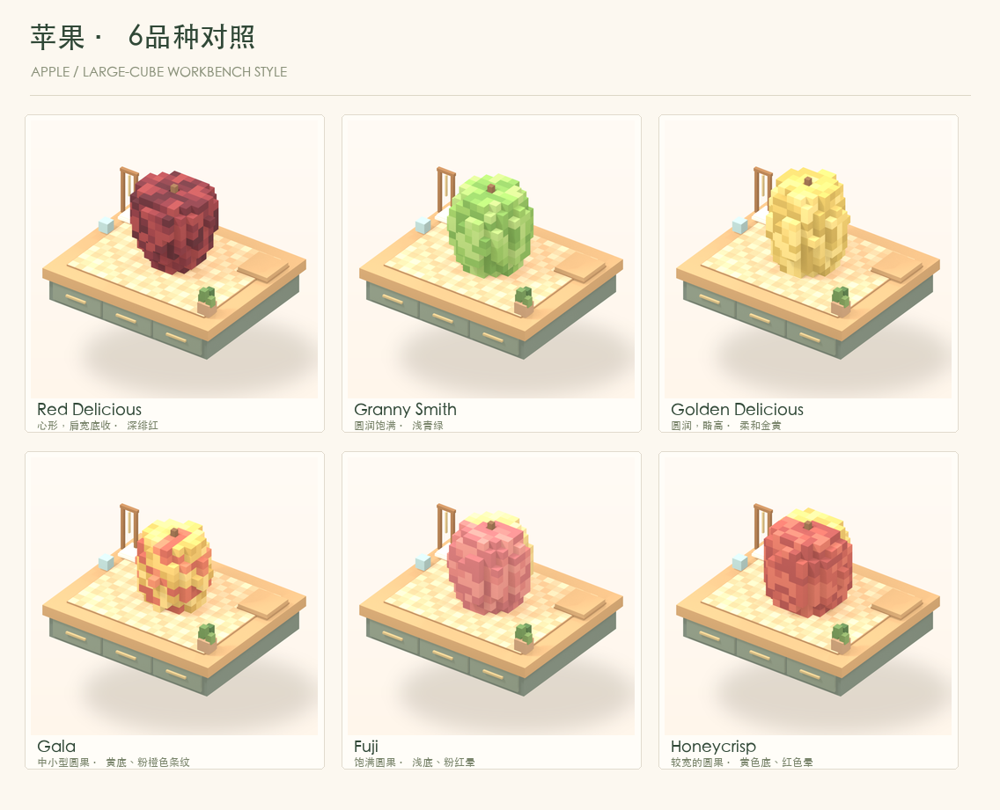

| id | name | shape 形状 | ripe colour 成熟色 | skin 果皮 | model |
| --- | --- | --- | --- | --- | --- |
| `AP-01_red_delicious` | [Red Delicious](https://waapple.org/varieties/red-delicious/) | 心形，肩宽底收 | 深绯红 | 颜色较均匀 | [glb](models/AP-01_red_delicious.glb) · [card](previews/AP-01_red_delicious.png) · 14 × 15 × 13 cm |
| `AP-02_granny_smith` | [Granny Smith](https://waapple.org/varieties/granny-smith/) | 圆润饱满 | 浅青绿 | 绿色较统一 | [glb](models/AP-02_granny_smith.glb) · [card](previews/AP-02_granny_smith.png) · 13 × 15 × 13 cm |
| `AP-03_golden_delicious` | [Golden Delicious](https://waapple.org/varieties/golden-delicious/) | 圆润，略高 | 柔和金黄 | 金黄果皮 | [glb](models/AP-03_golden_delicious.glb) · [card](previews/AP-03_golden_delicious.png) · 13 × 16 × 13 cm |
| `AP-04_gala` | [Gala](https://waapple.org/varieties/gala/) | 中小型圆果 | 黄底、粉橙色条纹 | 条纹晕色 | [glb](models/AP-04_gala.glb) · [card](previews/AP-04_gala.png) · 13 × 14 × 13 cm |
| `AP-05_fuji` | [Fuji](https://waapple.org/varieties/fuji/) | 饱满圆果 | 浅底、粉红晕 | 玫红至绯红色晕 | [glb](models/AP-05_fuji.glb) · [card](previews/AP-05_fuji.png) · 13 × 15 × 13 cm |
| `AP-06_honeycrisp` | [Honeycrisp](https://waapple.org/varieties/honeycrisp/) | 较宽的圆果 | 黄色底、红色晕 | 红晕面积较大 | [glb](models/AP-06_honeycrisp.glb) · [card](previews/AP-06_honeycrisp.png) · 14 × 15 × 13 cm |

## Pear · 梨

*Pyrus communis* · family id `pear` · [reference](https://www.usapears.org/pear-varieties/)

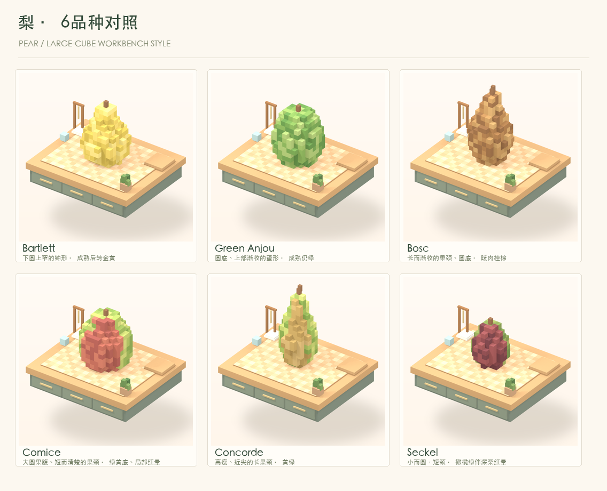

| id | name | shape 形状 | ripe colour 成熟色 | skin 果皮 | model |
| --- | --- | --- | --- | --- | --- |
| `PE-01_bartlett` | [Bartlett](https://www.usapears.org/bartlett/) | 下圆上窄的钟形 | 成熟后转金黄 | 较平滑，颜色随成熟改变 | [glb](models/PE-01_bartlett.glb) · [card](previews/PE-01_bartlett.png) · 13 × 19 × 13 cm |
| `PE-02_green_anjou` | [Green Anjou](https://www.usapears.org/green-anjou/) | 圆底、上部渐收的蛋形 | 成熟仍绿 | 明亮绿皮，可带少量红晕 | [glb](models/PE-02_green_anjou.glb) · [card](previews/PE-02_green_anjou.png) · 13 × 17 × 13 cm |
| `PE-03_bosc` | [Bosc](https://www.usapears.org/bosc/) | 长而渐收的果颈、圆底 | 暖肉桂棕 | 大面积天然锈斑感 | [glb](models/PE-03_bosc.glb) · [card](previews/PE-03_bosc.png) · 13 × 24 × 10 cm |
| `PE-04_comice` | [Comice](https://www.usapears.org/comice/) | 大圆果腹、短而清楚的果颈 | 绿黄底、局部红晕 | 果面可有红色晕染 | [glb](models/PE-04_comice.glb) · [card](previews/PE-04_comice.png) · 13 × 17 × 13 cm |
| `PE-05_concorde` | [Concorde](https://www.usapears.org/concorde/) | 高瘦、近尖的长果颈 | 黄绿 | 局部金棕色锈皮 | [glb](models/PE-05_concorde.glb) · [card](previews/PE-05_concorde.png) · 10 × 25 × 10 cm |
| `PE-06_seckel` | [Seckel](https://www.usapears.org/seckel/) | 小而圆，短颈 | 橄榄绿伴深栗红晕 | 晕色深浅可变 | [glb](models/PE-06_seckel.glb) · [card](previews/PE-06_seckel.png) · 10 × 14 × 10 cm |

## Watermelon · 西瓜

*Citrullus lanatus* · family id `watermelon` · [reference](https://extension.uga.edu/publications/detail.html?number=B996&title=commercial-watermelon-production)

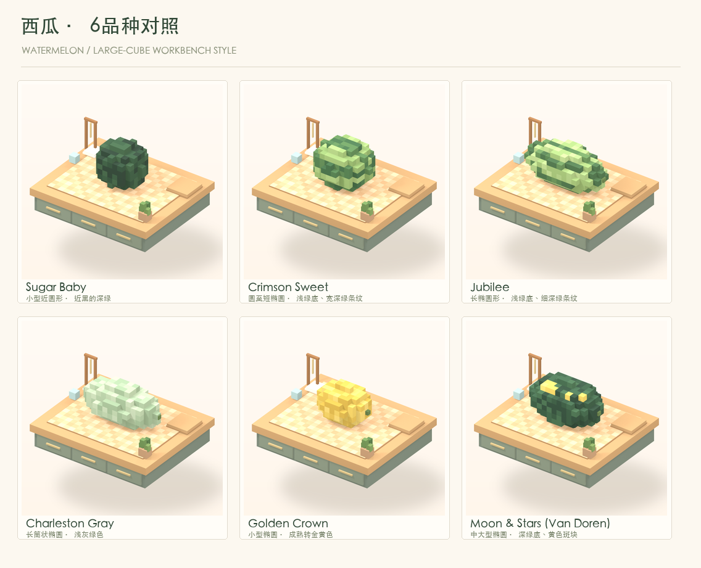

| id | name | shape 形状 | ripe colour 成熟色 | skin 果皮 | model |
| --- | --- | --- | --- | --- | --- |
| `WM-01_sugar_baby` | [Sugar Baby](https://vegvariety.cce.cornell.edu/main/detail.php?filterBy=0&variety_id=1251) | 小型近圆形 | 近黑的深绿 | 几乎无条纹的深色果皮 | [glb](models/WM-01_sugar_baby.glb) · [card](previews/WM-01_sugar_baby.png) · 13 × 11 × 10 cm |
| `WM-02_crimson_sweet` | [Crimson Sweet](https://vegvariety.cce.cornell.edu/main/detail.php?filterBy=0&variety_id=1196) | 圆至短椭圆 | 浅绿底、宽深绿条纹 | 明显的宽条纹 | [glb](models/WM-02_crimson_sweet.glb) · [card](previews/WM-02_crimson_sweet.png) · 15 × 11 × 13 cm |
| `WM-03_jubilee` | [Jubilee](https://extension.uga.edu/publications/detail.html?number=B996&title=commercial-watermelon-production) | 长椭圆形 | 浅绿底、细深绿条纹 | 沿果长延伸的深色条纹 | [glb](models/WM-03_jubilee.glb) · [card](previews/WM-03_jubilee.png) · 21 × 10 × 10 cm |
| `WM-04_charleston_gray` | [Charleston Gray](https://vegvariety.cce.cornell.edu/main/detail.php?filterBy=0&variety_id=2849) | 长筒状椭圆 | 浅灰绿色 | 颜色较统一，条纹不明显 | [glb](models/WM-04_charleston_gray.glb) · [card](previews/WM-04_charleston_gray.png) · 21 × 10 × 10 cm |
| `WM-05_golden_crown` | [Golden Crown](https://vegvariety.cce.cornell.edu/main/detail.php?filterBy=0&variety_id=6212) | 小型椭圆 | 成熟转金黄色 | 明亮金黄果皮 | [glb](models/WM-05_golden_crown.glb) · [card](previews/WM-05_golden_crown.png) · 13 × 10 × 10 cm |
| `WM-06_moon_and_stars` | [Moon & Stars (Van Doren)](https://seedsavers.org/50th-anniversary-heirloom-seed-collection/) | 中大型椭圆 | 深绿底、黄色斑块 | 一块较大的黄斑与少数小黄点 | [glb](models/WM-06_moon_and_stars.glb) · [card](previews/WM-06_moon_and_stars.png) · 19 × 11 × 10 cm |

## Persimmon · 柿子

*Diospyros kaki* · family id `persimmon` · [reference](https://ask.ifas.ufl.edu/publication/MG242)

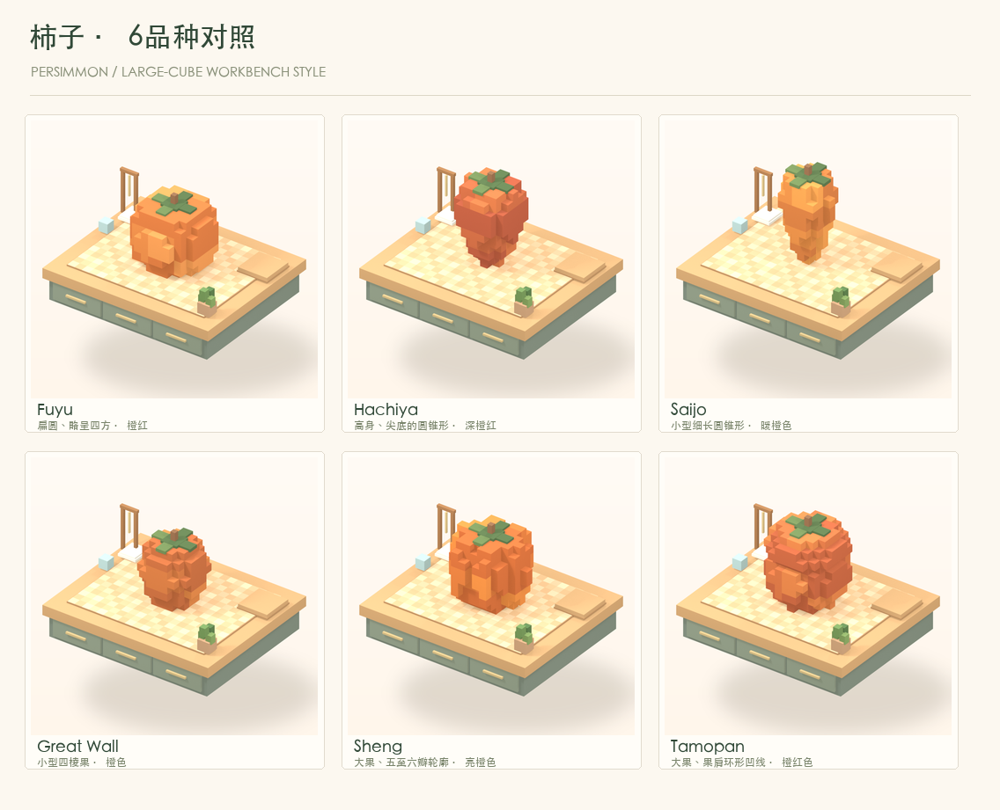

| id | name | shape 形状 | ripe colour 成熟色 | skin 果皮 | model |
| --- | --- | --- | --- | --- | --- |
| `PS-01_fuyu` | [Fuyu](https://fruitsandnuts.ucdavis.edu/persimmon-scion-rooststock-selection) | 扁圆、略呈四方 | 橙红 | 果肩宽，顶部较平 | [glb](models/PS-01_fuyu.glb) · [card](previews/PS-01_fuyu.png) · 13 × 13 × 13 cm |
| `PS-02_hachiya` | [Hachiya](https://fruitsandnuts.ucdavis.edu/persimmon-scion-rooststock-selection) | 高身、尖底的圆锥形 | 深橙红 | 下端尖收，果肩饱满 | [glb](models/PS-02_hachiya.glb) · [card](previews/PS-02_hachiya.png) · 10 × 17 × 10 cm |
| `PS-03_saijo` | [Saijo](https://ask.ifas.ufl.edu/publication/MG242) | 小型细长圆锥形 | 暖橙色 | 较细长，可见轻微棱面 | [glb](models/PS-03_saijo.glb) · [card](previews/PS-03_saijo.png) · 10 × 19 × 8 cm |
| `PS-04_great_wall` | [Great Wall](https://ask.ifas.ufl.edu/publication/MG242) | 小型四棱果 | 橙色 | 果身四面较明显 | [glb](models/PS-04_great_wall.glb) · [card](previews/PS-04_great_wall.png) · 10 × 13 × 10 cm |
| `PS-05_sheng` | [Sheng](https://ask.ifas.ufl.edu/publication/MG242) | 大果、五至六瓣轮廓 | 亮橙色 | 从顶部可见清楚的分瓣 | [glb](models/PS-05_sheng.glb) · [card](previews/PS-05_sheng.png) · 15 × 15 × 13 cm |
| `PS-06_tamopan` | [Tamopan](https://ask.ifas.ufl.edu/publication/MG242) | 大果、果肩环形凹线 | 橙红色 | 靠近果蒂有一圈明显收腰 | [glb](models/PS-06_tamopan.glb) · [card](previews/PS-06_tamopan.png) · 13 × 16 × 13 cm |

## Fig · 无花果

*Ficus carica* · family id `fig` · [reference](https://ask.ifas.ufl.edu/publication/MG214)

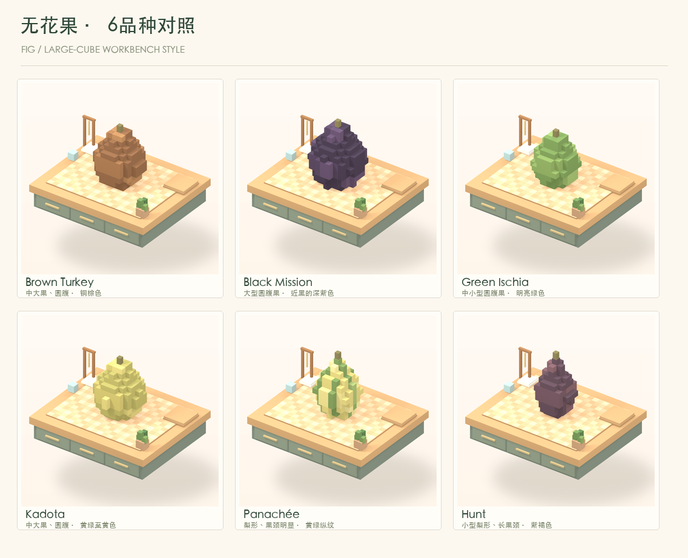

| id | name | shape 形状 | ripe colour 成熟色 | skin 果皮 | model |
| --- | --- | --- | --- | --- | --- |
| `FG-01_brown_turkey` | [Brown Turkey](https://ask.ifas.ufl.edu/publication/MG214) | 中大果、圆腹 | 铜棕色 | 暖铜色果皮 | [glb](models/FG-01_brown_turkey.glb) · [card](previews/FG-01_brown_turkey.png) · 13 × 16 × 10 cm |
| `FG-02_black_mission` | [Black Mission](https://ask.ifas.ufl.edu/publication/MG214) | 大型圆腹果 | 近黑的深紫色 | 深色果皮 | [glb](models/FG-02_black_mission.glb) · [card](previews/FG-02_black_mission.png) · 13 × 17 × 13 cm |
| `FG-03_green_ischia` | [Green Ischia](https://ask.ifas.ufl.edu/publication/MG214) | 中小型圆腹果 | 明亮绿色 | 绿色果皮 | [glb](models/FG-03_green_ischia.glb) · [card](previews/FG-03_green_ischia.png) · 10 × 14 × 10 cm |
| `FG-04_kadota` | [Kadota](https://ask.ifas.ufl.edu/publication/MG214) | 中大果、圆腹 | 黄绿至黄色 | 较统一的浅黄绿果皮 | [glb](models/FG-04_kadota.glb) · [card](previews/FG-04_kadota.png) · 13 × 16 × 13 cm |
| `FG-05_panachee` | [Panachée](https://www.aces.edu/blog/topics/crop-production/fig-production-guide/) | 梨形、果颈明显 | 黄绿纵纹 | 宽条黄绿相间 | [glb](models/FG-05_panachee.glb) · [card](previews/FG-05_panachee.png) · 10 × 17 × 10 cm |
| `FG-06_hunt` | [Hunt](https://ask.ifas.ufl.edu/publication/MG214) | 小型梨形、长果颈 | 紫褐色 | 颜色较深，果颈细长 | [glb](models/FG-06_hunt.glb) · [card](previews/FG-06_hunt.png) · 10 × 17 × 7 cm |

## Plum · 李子

*Prunus salicina* · family id `plum` · [reference](https://ucanr.edu/site/uc-master-gardeners-humboldt-del-norte-counties/plums)

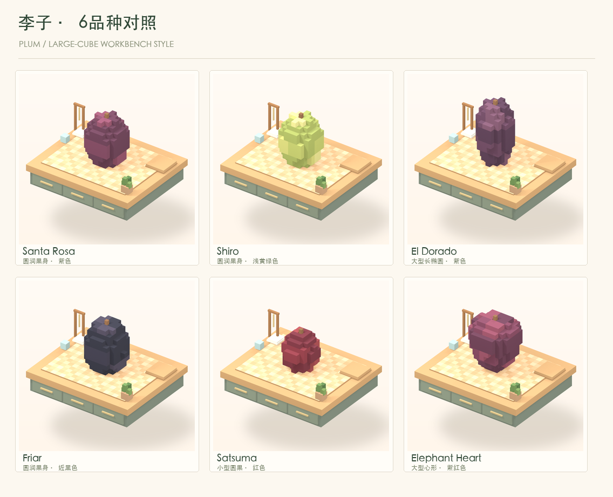

| id | name | shape 形状 | ripe colour 成熟色 | skin 果皮 | model |
| --- | --- | --- | --- | --- | --- |
| `PL-01_santa_rosa` | [Santa Rosa](https://ucanr.edu/site/uc-master-gardeners-humboldt-del-norte-counties/plums) | 圆润果身 | 紫色 | 紫色果皮 | [glb](models/PL-01_santa_rosa.glb) · [card](previews/PL-01_santa_rosa.png) · 10 × 15 × 10 cm |
| `PL-02_shiro` | [Shiro](https://ucanr.edu/site/uc-master-gardeners-humboldt-del-norte-counties/plums) | 圆润果身 | 浅黄绿色 | 浅绿到淡黄的大色面 | [glb](models/PL-02_shiro.glb) · [card](previews/PL-02_shiro.png) · 10 × 15 × 10 cm |
| `PL-03_el_dorado` | [El Dorado](https://ucanr.edu/site/uc-master-gardeners-humboldt-del-norte-counties/plums) | 大型长椭圆 | 紫色 | 饱满紫色果皮 | [glb](models/PL-03_el_dorado.glb) · [card](previews/PL-03_el_dorado.png) · 10 × 19 × 10 cm |
| `PL-04_friar` | [Friar](https://ucanr.edu/site/uc-master-gardeners-humboldt-del-norte-counties/plums) | 圆润果身 | 近黑色 | 深紫黑色果皮 | [glb](models/PL-04_friar.glb) · [card](previews/PL-04_friar.png) · 13 × 15 × 10 cm |
| `PL-05_satsuma` | [Satsuma](https://ucanr.edu/site/uc-master-gardeners-humboldt-del-norte-counties/plums) | 小型圆果 | 红色 | 深红色果皮 | [glb](models/PL-05_satsuma.glb) · [card](previews/PL-05_satsuma.png) · 10 × 12 × 10 cm |
| `PL-06_elephant_heart` | [Elephant Heart](https://ucanr.edu/blog/garden-notes/article/plants-season-10) | 大型心形 | 紫红色 | 成熟果皮呈紫红 | [glb](models/PL-06_elephant_heart.glb) · [card](previews/PL-06_elephant_heart.png) · 13 × 16 × 13 cm |

## Lemon · 柠檬

*Citrus limon 及柠檬杂交种* · family id `lemon` · [reference](https://citrusvariety.ucr.edu/citrus-varieties/category-or-type/lemons)

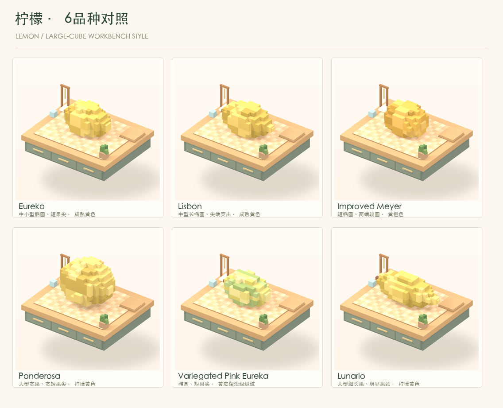

| id | name | shape 形状 | ripe colour 成熟色 | skin 果皮 | model |
| --- | --- | --- | --- | --- | --- |
| `LM-01_eureka` | [Eureka](https://citrusvariety.ucr.edu/crc3005) | 中小型椭圆、短果尖 | 成熟黄色 | 轻微纵棱、浅颈 | [glb](models/LM-01_eureka.glb) · [card](previews/LM-01_eureka.png) · 18 × 10 × 10 cm |
| `LM-02_lisbon` | [Lisbon](https://citrusvariety.ucr.edu/crc3504) | 中型长椭圆、尖端突出 | 成熟黄色 | 较平滑、果尖明显 | [glb](models/LM-02_lisbon.glb) · [card](previews/LM-02_lisbon.png) · 20 × 10 × 10 cm |
| `LM-03_improved_meyer` | [Improved Meyer](https://citrusvariety.ucr.edu/crc3737) | 短椭圆、两端较圆 | 黄橙色 | 表面较平滑 | [glb](models/LM-03_improved_meyer.glb) · [card](previews/LM-03_improved_meyer.png) · 15 × 10 × 10 cm |
| `LM-04_ponderosa` | [Ponderosa](https://citrusvariety.ucr.edu/crc294) | 大型宽果、宽短果尖 | 柠檬黄色 | 大块起伏的厚果皮 | [glb](models/LM-04_ponderosa.glb) · [card](previews/LM-04_ponderosa.png) · 19 × 15 × 15 cm |
| `LM-05_variegated_pink` | [Variegated Pink Eureka](https://citrusvariety.ucr.edu/crc2367) | 椭圆、短果尖 | 黄皮留淡绿纵纹 | 宽而浅的纵向余纹 | [glb](models/LM-05_variegated_pink.glb) · [card](previews/LM-05_variegated_pink.png) · 18 × 10 × 10 cm |
| `LM-06_lunario` | [Lunario](https://citrusvariety.ucr.edu/crc3159) | 大型细长果、明显果颈 | 柠檬黄色 | 长而尖的末端 | [glb](models/LM-06_lunario.glb) · [card](previews/LM-06_lunario.png) · 25 × 10 × 10 cm |

## Grape · 葡萄

*Vitis vinifera* · family id `grape` · [reference](https://www.grapesfromcalifornia.com/explore-california/)

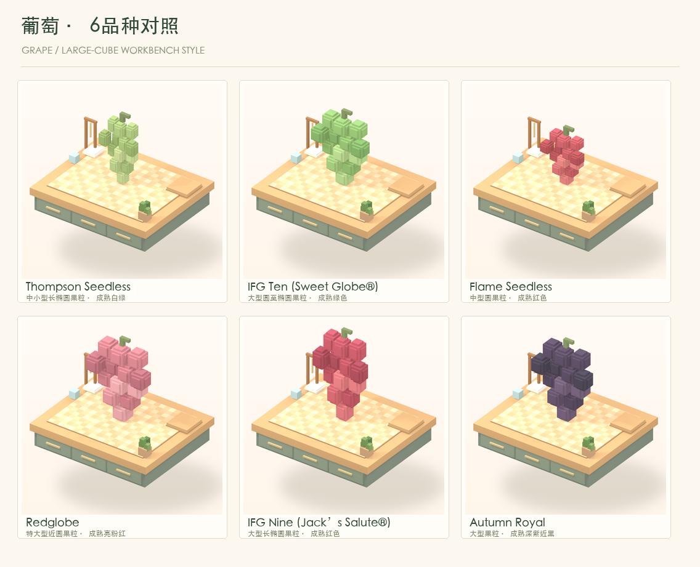

| id | name | shape 形状 | ripe colour 成熟色 | skin 果皮 | model |
| --- | --- | --- | --- | --- | --- |
| `GR-01_thompson_seedless` | [Thompson Seedless](https://ucanr.edu/sites/default/files/2016-03/237197.pdf) | 中小型长椭圆果粒 | 成熟白绿 | 果粒修长、串身较紧凑 | [glb](models/GR-01_thompson_seedless.glb) · [card](previews/GR-01_thompson_seedless.png) · 10 × 20 × 4 cm |
| `GR-02_ifg_ten` | [IFG Ten (Sweet Globe®)](https://www.grapesfromcalifornia.com/explore-california/) | 大型圆至椭圆果粒 | 成熟绿色 | 宽圆的大颗果粒 | [glb](models/GR-02_ifg_ten.glb) · [card](previews/GR-02_ifg_ten.png) · 15 × 21 × 6 cm |
| `GR-03_flame_seedless` | [Flame Seedless](https://www.grapesfromcalifornia.com/explore-california/) | 中型圆果粒 | 成熟红色 | 圆润、果粒偏小 | [glb](models/GR-03_flame_seedless.glb) · [card](previews/GR-03_flame_seedless.png) · 12 × 16 × 5 cm |
| `GR-04_redglobe` | [Redglobe](https://ucanr.edu/sites/default/files/2016-03/237197.pdf) | 特大型近圆果粒 | 成熟亮粉红 | 粒径明显大于 Flame | [glb](models/GR-04_redglobe.glb) · [card](previews/GR-04_redglobe.png) · 17 × 23 × 6 cm |
| `GR-05_ifg_nine` | [IFG Nine (Jack’s Salute®)](https://www.grapesfromcalifornia.com/explore-california/) | 大型长椭圆果粒 | 成熟红色 | 果粒明显纵向拉长 | [glb](models/GR-05_ifg_nine.glb) · [card](previews/GR-05_ifg_nine.png) · 14 × 25 × 5 cm |
| `GR-06_autumn_royal` | [Autumn Royal](https://ucanr.edu/sites/default/files/2016-03/237197.pdf) | 大型果粒 | 成熟深紫近黑 | 深色大果粒 | [glb](models/GR-06_autumn_royal.glb) · [card](previews/GR-06_autumn_royal.png) · 16 × 22 × 6 cm |

## Pineapple · 菠萝

*Ananas comosus* · family id `pineapple` · [reference](https://ask.ifas.ufl.edu/publication/MG055)

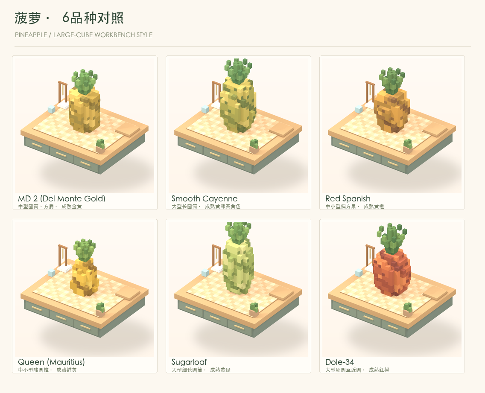

| id | name | shape 形状 | ripe colour 成熟色 | skin 果皮 | model |
| --- | --- | --- | --- | --- | --- |
| `PI-01_md2` | [MD-2 (Del Monte Gold)](https://www.uprm.edu/sea/wp-content/uploads/sites/351/2025/03/5ta_edicion-compressed.pdf) | 中型圆筒、方肩 | 成熟金黄 | 方肩、较整齐的果身 | [glb](models/PI-01_md2.glb) · [card](previews/PI-01_md2.png) · 10 × 21 × 10 cm |
| `PI-02_smooth_cayenne` | [Smooth Cayenne](https://ask.ifas.ufl.edu/publication/MG055) | 大型长圆筒 | 成熟黄绿至黄色 | 果身更大、顶部较圆 | [glb](models/PI-02_smooth_cayenne.glb) · [card](previews/PI-02_smooth_cayenne.png) · 13 × 26 × 10 cm |
| `PI-03_red_spanish` | [Red Spanish](https://ask.ifas.ufl.edu/publication/MG055) | 中小型偏方果 | 成熟黄橙 | 横截面较方、冠叶带粗刺 | [glb](models/PI-03_red_spanish.glb) · [card](previews/PI-03_red_spanish.png) · 10 × 22 × 10 cm |
| `PI-04_queen` | [Queen (Mauritius)](https://kau.edu/sites/default/files/documents/production_technology_for_vazhakulam_pineapple_mauritius.pdf) | 中小型略圆锥 | 成熟鲜黄 | 明显果眼、带刺冠叶 | [glb](models/PI-04_queen.glb) · [card](previews/PI-04_queen.png) · 10 × 19 × 7 cm |
| `PI-05_sugarloaf` | [Sugarloaf](https://ask.ifas.ufl.edu/publication/MG055) | 大型细长圆筒 | 成熟黄绿 | 更细长、冠叶较平滑 | [glb](models/PI-05_sugarloaf.glb) · [card](previews/PI-05_sugarloaf.png) · 10 × 27 × 10 cm |
| `PI-06_dole34` | [Dole-34](https://patents.google.com/patent/USPP34973P2/en) | 大型卵圆至近圆 | 成熟红橙 | 红橙果皮、较长而蓬起的冠 | [glb](models/PI-06_dole34.glb) · [card](previews/PI-06_dole34.png) · 13 × 25 × 10 cm |

## Banana · 香蕉

*Musa spp. 栽培品种* · family id `banana` · [reference](https://ask.ifas.ufl.edu/publication/MG040)

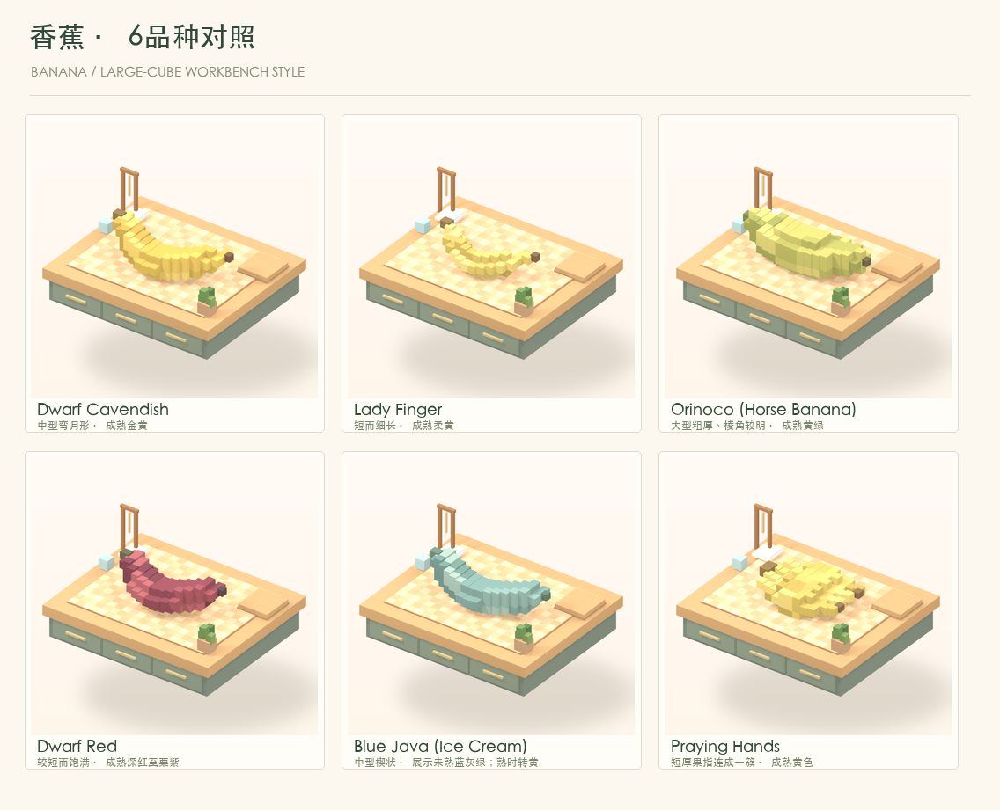

| id | name | shape 形状 | ripe colour 成熟色 | skin 果皮 | model |
| --- | --- | --- | --- | --- | --- |
| `BN-01_dwarf_cavendish` | [Dwarf Cavendish](https://aggie-horticulture.tamu.edu/fruit-nut/fact-sheets/banana/) | 中型弯月形 | 成熟金黄 | 常见甜香蕉比例 | [glb](models/BN-01_dwarf_cavendish.glb) · [card](previews/BN-01_dwarf_cavendish.png) · 23 × 6 × 10 cm |
| `BN-02_lady_finger` | [Lady Finger](https://aggie-horticulture.tamu.edu/fruit-nut/fact-sheets/banana/) | 短而细长 | 成熟柔黄 | 细果指、薄果皮 | [glb](models/BN-02_lady_finger.glb) · [card](previews/BN-02_lady_finger.png) · 19 × 5 × 7 cm |
| `BN-03_orinoco` | [Orinoco (Horse Banana)](https://aggie-horticulture.tamu.edu/fruit-nut/fact-sheets/banana/) | 大型粗厚、棱角较明 | 成熟黄绿 | 宽厚且较直的果指 | [glb](models/BN-03_orinoco.glb) · [card](previews/BN-03_orinoco.png) · 25 × 7 × 8 cm |
| `BN-04_dwarf_red` | [Dwarf Red](https://gms.ctahr.hawaii.edu/gs/handler/getmedia.ashx?dt=3&g=12&moid=3014) | 较短而饱满 | 成熟深红至栗紫 | 整面暗红果皮 | [glb](models/BN-04_dwarf_red.glb) · [card](previews/BN-04_dwarf_red.png) · 20 × 5 × 9 cm |
| `BN-05_blue_java` | [Blue Java (Ice Cream)](https://assets.echocommunity.org/publication_issue/e0921c19-62d4-49c0-a338-c29e56f2264d/en/echo-compendium-of-warm-climate-fruits.pdf) | 中型楔状 | 展示未熟蓝灰绿；熟时转黄 | 蓝灰是未熟阶段 | [glb](models/BN-05_blue_java.glb) · [card](previews/BN-05_blue_java.png) · 23 × 5 × 9 cm |
| `BN-06_praying_hands` | [Praying Hands](https://www.nparks.gov.sg/florafaunaweb/flora/3/4/3440) | 短厚果指连成一簇 | 成熟黄色 | 相邻果指融合 | [glb](models/BN-06_praying_hands.glb) · [card](previews/BN-06_praying_hands.png) · 17 × 4 × 12 cm |

## Tomato · 番茄

*Solanum lycopersicum* · family id `tomato` · [reference](https://extension.umd.edu/sites/extension.umd.edu/files/2021-03/Tomatoes.pdf)

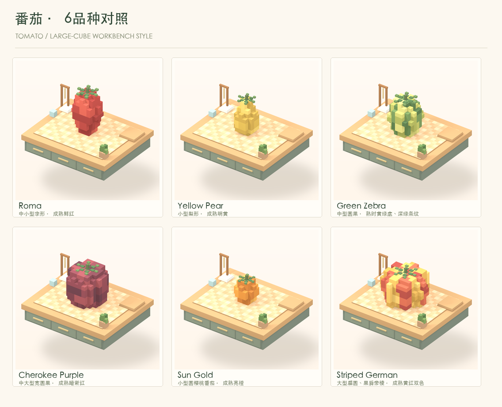

| id | name | shape 形状 | ripe colour 成熟色 | skin 果皮 | model |
| --- | --- | --- | --- | --- | --- |
| `TM-01_roma` | [Roma](https://web.extension.illinois.edu/hortanswers/plantdetail.cfm?PlantID=294&PlantTypeID=9) | 中小型李形 | 成熟鲜红 | 长椭圆、果端钝收 | [glb](models/TM-01_roma.glb) · [card](previews/TM-01_roma.png) · 10 × 17 × 7 cm |
| `TM-02_yellow_pear` | [Yellow Pear](https://extension.umd.edu/sites/extension.umd.edu/files/2021-03/Tomatoes.pdf) | 小型梨形 | 成熟明黄 | 下圆上窄的果腹 | [glb](models/TM-02_yellow_pear.glb) · [card](previews/TM-02_yellow_pear.png) · 7 × 14 × 7 cm |
| `TM-03_green_zebra` | [Green Zebra](https://extension.umd.edu/sites/extension.umd.edu/files/2021-03/Tomatoes.pdf) | 中型圆果 | 熟时黄绿底、深绿条纹 | 纵向宽绿纹 | [glb](models/TM-03_green_zebra.glb) · [card](previews/TM-03_green_zebra.png) · 10 × 14 × 10 cm |
| `TM-04_cherokee_purple` | [Cherokee Purple](https://extension.umd.edu/sites/extension.umd.edu/files/2021-03/Tomatoes.pdf) | 中大型宽圆果 | 成熟暗紫红 | 宽果肩、深酒红色面 | [glb](models/TM-04_cherokee_purple.glb) · [card](previews/TM-04_cherokee_purple.png) · 13 × 14 × 13 cm |
| `TM-05_sun_gold` | [Sun Gold](https://extension.umd.edu/sites/extension.umd.edu/files/2021-03/Tomatoes.pdf) | 小型圆樱桃番茄 | 成熟亮橙 | 果面较统一 | [glb](models/TM-05_sun_gold.glb) · [card](previews/TM-05_sun_gold.png) · 7 × 10 × 7 cm |
| `TM-06_striped_german` | [Striped German](https://southcenters.osu.edu/sites/southc/files/site-library/site-documents/HORT/vegetables/tomatoes/heirloom-tomato-1998.pdf) | 大型扁圆、果肩带棱 | 成熟黄红双色 | 宽红纹覆在黄色果皮上 | [glb](models/TM-06_striped_german.glb) · [card](previews/TM-06_striped_german.png) · 15 × 13 × 15 cm |

## Mandarin · 橘子

*Citrus reticulata、Citrus unshiu 及近缘杂交种* · family id `mandarin` · [reference](https://citrusvariety.ucr.edu/citrus-varieties/category-or-type/mandarins)

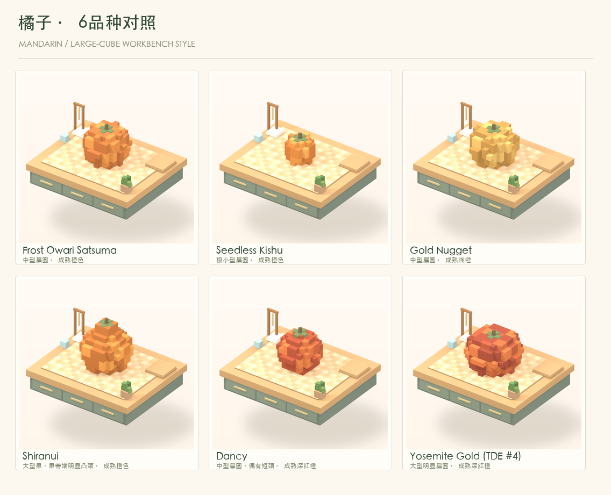

| id | name | shape 形状 | ripe colour 成熟色 | skin 果皮 | model |
| --- | --- | --- | --- | --- | --- |
| `MD-01_frost_owari` | [Frost Owari Satsuma](https://citrusvariety.ucr.edu/crc3178) | 中型扁圆 | 成熟橙色 | 薄而平滑的果皮 | [glb](models/MD-01_frost_owari.glb) · [card](previews/MD-01_frost_owari.png) · 13 × 11 × 13 cm |
| `MD-02_seedless_kishu` | [Seedless Kishu](https://citrusvariety.ucr.edu/crc3906) | 极小型扁圆 | 成熟橙色 | 两端微凹、表面较光亮 | [glb](models/MD-02_seedless_kishu.glb) · [card](previews/MD-02_seedless_kishu.png) · 7 × 9 × 7 cm |
| `MD-03_gold_nugget` | [Gold Nugget](https://citrusvariety.ucr.edu/crc3913) | 中型扁圆 | 成熟浅橙 | 较粗糙、略凸起的果皮 | [glb](models/MD-03_gold_nugget.glb) · [card](previews/MD-03_gold_nugget.png) · 13 × 11 × 13 cm |
| `MD-04_shiranui` | [Shiranui](https://citrusvariety.ucr.edu/crc4249) | 大型果、果蒂端明显凸颈 | 成熟橙色 | 顶部宽而突出的果颈 | [glb](models/MD-04_shiranui.glb) · [card](previews/MD-04_shiranui.png) · 13 × 15 × 13 cm |
| `MD-05_dancy` | [Dancy](https://citrusvariety.ucr.edu/crc3026) | 中型扁圆、偶有短颈 | 成熟深红橙 | 薄而较平滑 | [glb](models/MD-05_dancy.glb) · [card](previews/MD-05_dancy.png) · 13 × 12 × 13 cm |
| `MD-06_yosemite_gold` | [Yosemite Gold (TDE #4)](https://citrusvariety.ucr.edu/crc3975) | 大型明显扁圆 | 成熟深红橙 | 平滑、果颈不明显 | [glb](models/MD-06_yosemite_gold.glb) · [card](previews/MD-06_yosemite_gold.png) · 15 × 11 × 15 cm |

## Peach · 桃子

*Prunus persica* · family id `peach` · [reference](https://njaes.rutgers.edu/pubs/download.php?strPubID=FS1074)

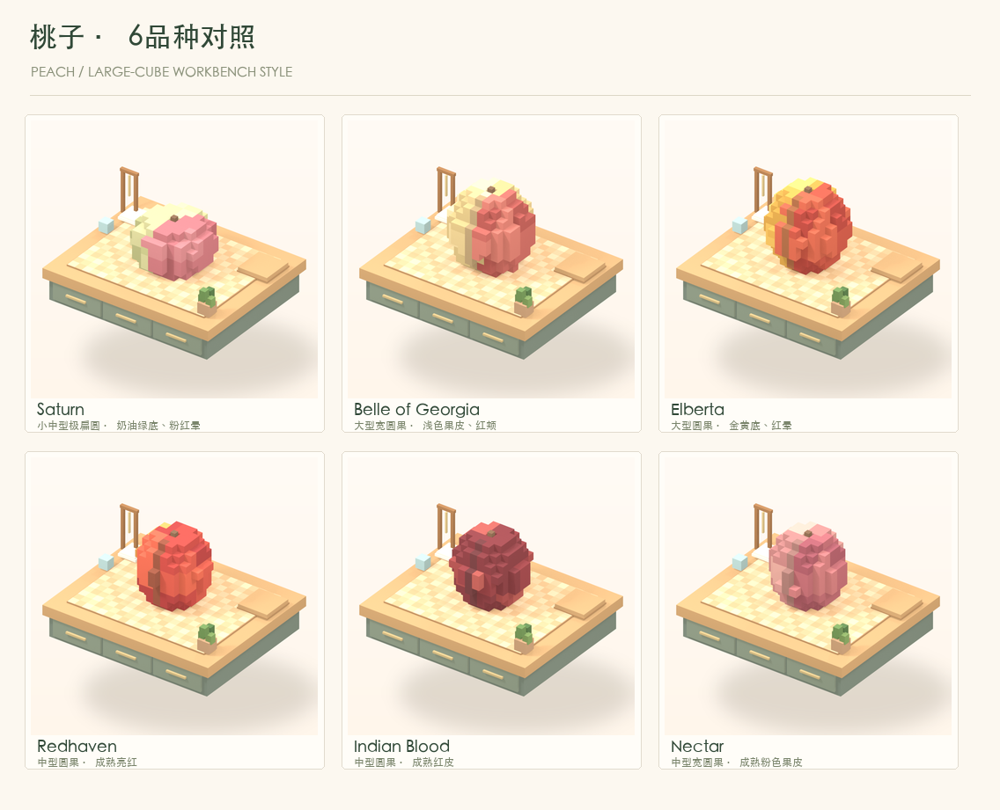

| id | name | shape 形状 | ripe colour 成熟色 | skin 果皮 | model |
| --- | --- | --- | --- | --- | --- |
| `PC-01_saturn` | [Saturn](https://njaes.rutgers.edu/pubs/download.php?strPubID=FS1074) | 小中型极扁圆 | 奶油绿底、粉红晕 | 极扁果身，中央浅凹；约四分之一至六成果面有粉红晕 | [glb](models/PC-01_saturn.glb) · [card](previews/PC-01_saturn.png) · 13 × 9 × 13 cm |
| `PC-02_belle_of_georgia` | [Belle of Georgia](https://extension.uga.edu/county-offices/madison/4-h-youth-development/FruitTreeSale.html) | 大型宽圆果 | 浅色果皮、红颊 | 浅奶黄底上的一片红色果颊 | [glb](models/PC-02_belle_of_georgia.glb) · [card](previews/PC-02_belle_of_georgia.png) · 13 × 15 × 13 cm |
| `PC-03_elberta` | [Elberta](https://extension.uga.edu/county-offices/madison/4-h-youth-development/FruitTreeSale.html) | 大型圆果 | 金黄底、红晕 | 明黄果皮与宽红色晕面 | [glb](models/PC-03_elberta.glb) · [card](previews/PC-03_elberta.png) · 13 × 15 × 13 cm |
| `PC-04_redhaven` | [Redhaven](https://extension.uga.edu/content/dam/extension-county-offices/elbert-county/plant-sale/Plant%20Sale%20Brochure%202024.pdf) | 中型圆果 | 成熟亮红 | 大面积亮红果皮 | [glb](models/PC-04_redhaven.glb) · [card](previews/PC-04_redhaven.png) · 13 × 13 × 13 cm |
| `PC-05_indian_blood` | [Indian Blood](https://ucanr.edu/node/152238/printable/print) | 中型圆果 | 成熟红皮 | 整体深红果皮 | [glb](models/PC-05_indian_blood.glb) · [card](previews/PC-05_indian_blood.png) · 13 × 13 × 13 cm |
| `PC-06_nectar` | [Nectar](https://ucanr.edu/node/152238/printable/print) | 中型宽圆果 | 成熟粉色果皮 | 柔粉果面、少量深粉颊 | [glb](models/PC-06_nectar.glb) · [card](previews/PC-06_nectar.png) · 13 × 13 × 13 cm |

## Melon · 甜瓜

*Cucumis melo* · family id `melon` · [reference](https://www.johnnyseeds.com/on/demandware.static/-/Library-Sites-JSSSharedLibrary/default/dwd7515c44/assets/information/melon-varieties-comparison-chart.pdf)

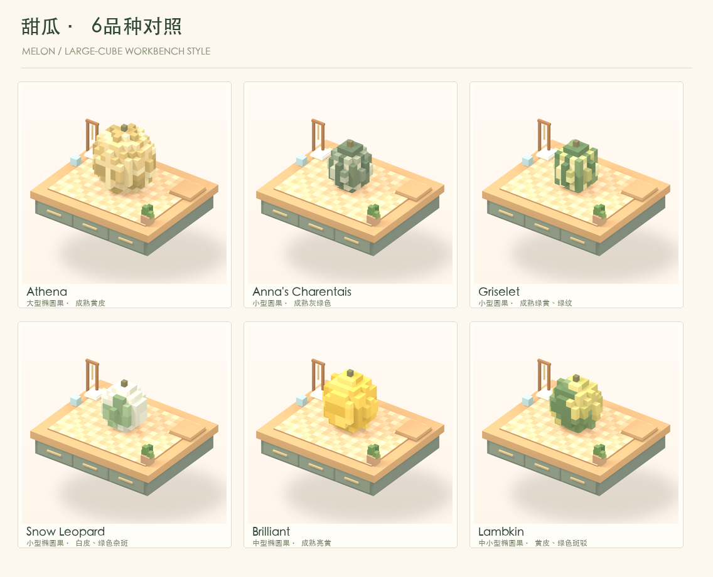

| id | name | shape 形状 | ripe colour 成熟色 | skin 果皮 | model |
| --- | --- | --- | --- | --- | --- |
| `ML-01_athena` | [Athena](https://www.johnnyseeds.com/on/demandware.static/-/Library-Sites-JSSSharedLibrary/default/dwd7515c44/assets/information/melon-varieties-comparison-chart.pdf) | 大型椭圆果 | 成熟黄皮 | 密集浅色网纹、轻微纵沟 | [glb](models/ML-01_athena.glb) · [card](previews/ML-01_athena.png) · 15 × 17 × 13 cm |
| `ML-02_annas_charentais` | [Anna's Charentais](https://www.johnnyseeds.com/on/demandware.static/-/Library-Sites-JSSSharedLibrary/default/dwd7515c44/assets/information/melon-varieties-comparison-chart.pdf) | 小型圆果 | 成熟灰绿色 | 中等网纹与深色纵沟 | [glb](models/ML-02_annas_charentais.glb) · [card](previews/ML-02_annas_charentais.png) · 10 × 13 × 10 cm |
| `ML-03_griselet` | [Griselet](https://www.johnnyseeds.com/on/demandware.static/-/Library-Sites-JSSSharedLibrary/default/dwd7515c44/assets/information/melon-varieties-comparison-chart.pdf) | 小型圆果 | 成熟绿黄、绿纹 | 绿黄底、绿色宽纵纹与中等网纹 | [glb](models/ML-03_griselet.glb) · [card](previews/ML-03_griselet.png) · 10 × 13 × 10 cm |
| `ML-04_snow_leopard` | [Snow Leopard](https://www.johnnyseeds.com/on/demandware.static/-/Library-Sites-JSSSharedLibrary/default/dwd7515c44/assets/information/melon-varieties-comparison-chart.pdf) | 小型椭圆果 | 白皮、绿色杂斑 | 平滑乳白果皮上有不规则绿斑 | [glb](models/ML-04_snow_leopard.glb) · [card](previews/ML-04_snow_leopard.png) · 10 × 13 × 10 cm |
| `ML-05_brilliant` | [Brilliant](https://www.johnnyseeds.com/on/demandware.static/-/Library-Sites-JSSSharedLibrary/default/dwd7515c44/assets/information/melon-varieties-comparison-chart.pdf) | 中型椭圆果 | 成熟亮黄 | 平滑亮黄果面 | [glb](models/ML-05_brilliant.glb) · [card](previews/ML-05_brilliant.png) · 13 × 15 × 10 cm |
| `ML-06_lambkin` | [Lambkin](https://www.johnnyseeds.com/on/demandware.static/-/Library-Sites-JSSSharedLibrary/default/dwd7515c44/assets/information/melon-varieties-comparison-chart.pdf) | 中小型椭圆果 | 黄皮、绿色斑驳 | 黄色外皮上有宽绿斑、少量生长纹 | [glb](models/ML-06_lambkin.glb) · [card](previews/ML-06_lambkin.png) · 13 × 14 × 10 cm |

## Pomegranate · 石榴

*Punica granatum* · family id `pomegranate` · [reference](https://crfg.org/homepage/library/fruitfacts/pomegranate/)

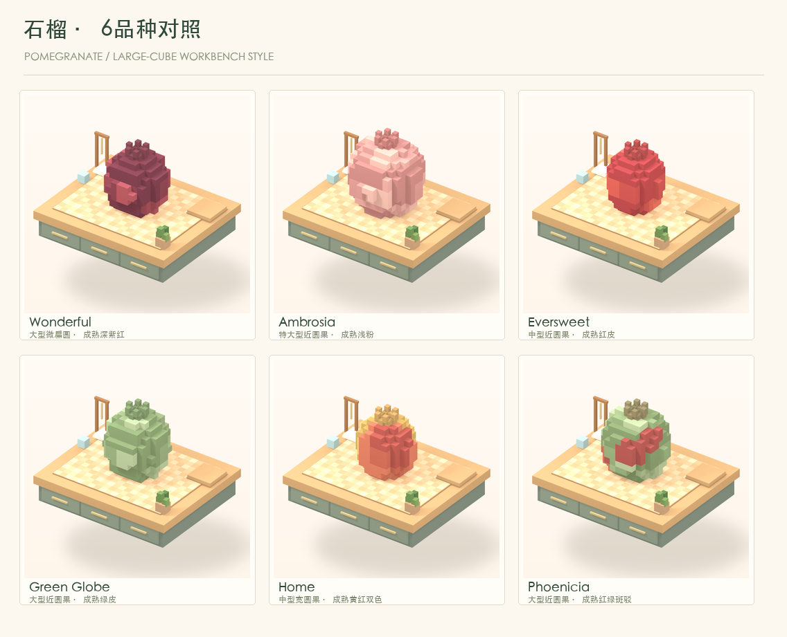

| id | name | shape 形状 | ripe colour 成熟色 | skin 果皮 | model |
| --- | --- | --- | --- | --- | --- |
| `PG-01_wonderful` | [Wonderful](https://ucanr.edu/sites/default/files/2010-06/19305.pdf) | 大型微扁圆 | 成熟深紫红 | 整体深紫红色果皮 | [glb](models/PG-01_wonderful.glb) · [card](previews/PG-01_wonderful.png) · 13 × 15 × 13 cm |
| `PG-02_ambrosia` | [Ambrosia](https://ucanr.edu/sites/default/files/2010-06/19305.pdf) | 特大型近圆果 | 成熟浅粉 | 宽阔的浅粉果面 | [glb](models/PG-02_ambrosia.glb) · [card](previews/PG-02_ambrosia.png) · 15 × 18 × 15 cm |
| `PG-03_eversweet` | [Eversweet](https://ucanr.edu/sites/default/files/2010-06/19305.pdf) | 中型近圆果 | 成熟红皮 | 红色整果、短冠萼 | [glb](models/PG-03_eversweet.glb) · [card](previews/PG-03_eversweet.png) · 13 × 15 × 10 cm |
| `PG-04_green_globe` | [Green Globe](https://crfg.org/homepage/library/fruitfacts/pomegranate/) | 大型近圆果 | 成熟绿皮 | 大面积柔绿果皮 | [glb](models/PG-04_green_globe.glb) · [card](previews/PG-04_green_globe.png) · 13 × 16 × 13 cm |
| `PG-05_home` | [Home](https://crfg.org/homepage/library/fruitfacts/pomegranate/) | 中型宽圆果 | 成熟黄红双色 | 黄色底色与一侧宽红晕 | [glb](models/PG-05_home.glb) · [card](previews/PG-05_home.png) · 13 × 15 × 10 cm |
| `PG-06_phoenicia` | [Phoenicia](https://crfg.org/homepage/library/fruitfacts/pomegranate/) | 大型近圆果 | 成熟红绿斑驳 | 宽块红绿交错的果面 | [glb](models/PG-06_phoenicia.glb) · [card](previews/PG-06_phoenicia.png) · 15 × 16 × 13 cm |

## Lime & related citrus · 青柠与近缘柑橘

*Citrus spp. 与 Microcitrus australasica；按俗名与用途归组* · family id `lime` · [reference](https://citrusvariety.ucr.edu/citrus-varieties/category-or-type/limes)

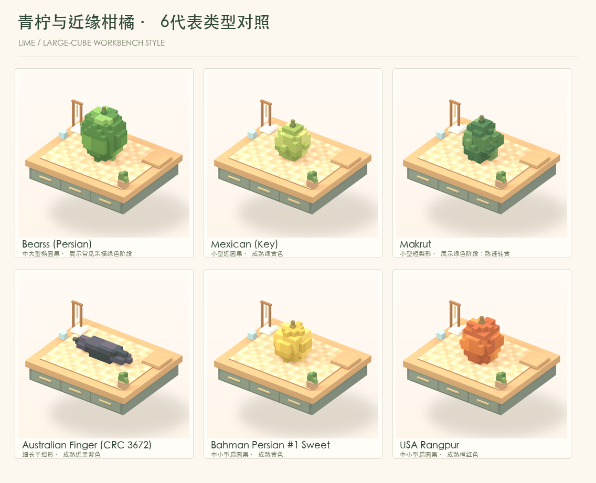

| id | name | shape 形状 | ripe colour 成熟色 | skin 果皮 | model |
| --- | --- | --- | --- | --- | --- |
| `LI-01_bearss` | [Bearss (Persian)](https://citrusvariety.ucr.edu/crc3772) | 中大型椭圆果 | 展示常见采摘绿色阶段 | 平滑深绿果皮 | [glb](models/LI-01_bearss.glb) · [card](previews/LI-01_bearss.png) · 13 × 16 × 10 cm |
| `LI-02_mexican` | [Mexican (Key)](https://citrusvariety.ucr.edu/crc1710) | 小型近圆果 | 成熟绿黄色 | 薄而平滑、果身小巧 | [glb](models/LI-02_mexican.glb) · [card](previews/LI-02_mexican.png) · 10 × 12 × 10 cm |
| `LI-03_makrut` | [Makrut](https://citrusvariety.ucr.edu/crc2454) | 小型短梨形 | 展示绿色阶段；熟透转黄 | 深绿、不规则宽块起伏的果皮 | [glb](models/LI-03_makrut.glb) · [card](previews/LI-03_makrut.png) · 10 × 13 × 10 cm |
| `LI-04_finger` | [Australian Finger (CRC 3672)](https://citrusvariety.ucr.edu/crc3672) | 细长手指形 | 成熟近黑紫色 | 长而窄的深紫黑外皮 | [glb](models/LI-04_finger.glb) · [card](previews/LI-04_finger.png) · 19 × 4 × 4 cm |
| `LI-05_bahman_sweet` | [Bahman Persian #1 Sweet](https://citrusvariety.ucr.edu/crc4174) | 中小型扁圆果 | 成熟黄色 | 平滑中黄果皮、低矮果脐 | [glb](models/LI-05_bahman_sweet.glb) · [card](previews/LI-05_bahman_sweet.png) · 10 × 12 × 10 cm |
| `LI-06_rangpur` | [USA Rangpur](https://citrusvariety.ucr.edu/usa-rangpur-lime) | 中小型扁圆果 | 成熟橙红色 | 薄而较平滑、偶有短果颈 | [glb](models/LI-06_rangpur.glb) · [card](previews/LI-06_rangpur.png) · 10 × 14 × 10 cm |

## Dragon fruit · 火龙果

*Hylocereus spp. 与 Selenicereus megalanthus（依资料原称）* · family id `dragonfruit` · [reference](https://ucanr.edu/sites/default/files/2017-11/274664.pdf)

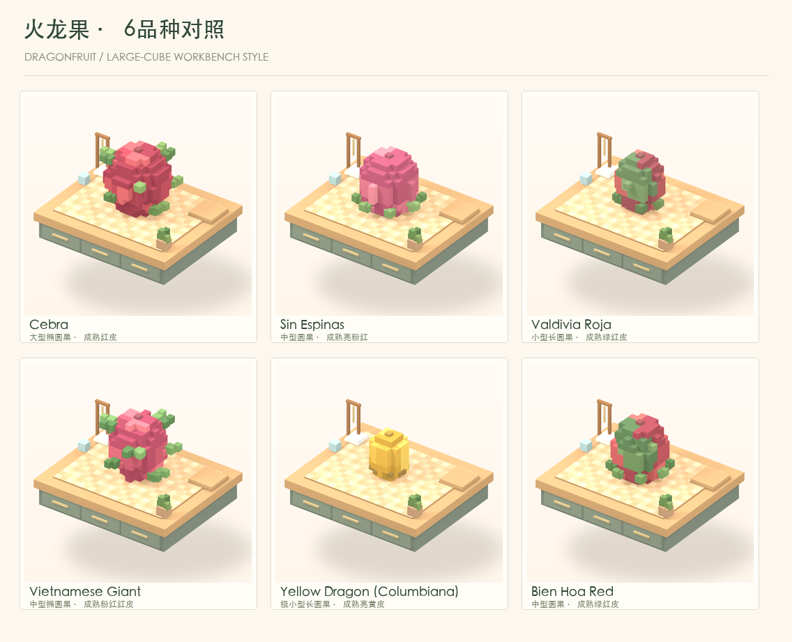

| id | name | shape 形状 | ripe colour 成熟色 | skin 果皮 | model |
| --- | --- | --- | --- | --- | --- |
| `DF-01_cebra` | [Cebra](https://ucanr.edu/site/san-diego-county-small-farms/h-polyrhizus-cebra) | 大型椭圆果 | 成熟红皮 | 厚果皮、稀疏绿色苞片 | [glb](models/DF-01_cebra.glb) · [card](previews/DF-01_cebra.png) · 17 × 15 × 16 cm |
| `DF-02_sin_espinas` | [Sin Espinas](https://ucanr.edu/site/san-diego-county-small-farms/h-sp-sin-espinas) | 中型圆果 | 成熟亮粉红 | 光亮粉红果面 | [glb](models/DF-02_sin_espinas.glb) · [card](previews/DF-02_sin_espinas.png) · 15 × 13 × 15 cm |
| `DF-03_valdivia_roja` | [Valdivia Roja](https://ucanr.edu/site/san-diego-county-small-farms/h-ocamponis-valdivia-roja) | 小型长圆果 | 成熟绿红皮 | 少量短苞片、绿红斑块 | [glb](models/DF-03_valdivia_roja.glb) · [card](previews/DF-03_valdivia_roja.png) · 11 × 13 × 10 cm |
| `DF-04_vietnamese_giant` | [Vietnamese Giant](https://ucanr.edu/site/san-diego-county-small-farms/h-undatus-vietnamese-giant) | 中型椭圆果 | 成熟粉红红皮 | 从粉红果皮伸出的较长绿苞片 | [glb](models/DF-04_vietnamese_giant.glb) · [card](previews/DF-04_vietnamese_giant.png) · 17 × 15 × 16 cm |
| `DF-05_yellow_dragon` | [Yellow Dragon (Columbiana)](https://ucanr.edu/site/san-diego-county-small-farms/h-megalanthus-columbiana) | 极小型长圆果 | 成熟亮黄皮 | 带短刺的黄皮，没有长苞片 | [glb](models/DF-05_yellow_dragon.glb) · [card](previews/DF-05_yellow_dragon.png) · 8 × 10 × 7 cm |
| `DF-06_bien_hoa_red` | [Bien Hoa Red](https://ucanr.edu/node/135051/printable/print) | 中型圆果 | 成熟绿红皮 | 绿红皮与散生短苞片 | [glb](models/DF-06_bien_hoa_red.glb) · [card](previews/DF-06_bien_hoa_red.png) · 14 × 13 × 13 cm |

## Passion fruit & Passiflora · 百香果与西番莲果

*Passiflora spp.；本册比较六种代表类型* · family id `passionfruit` · [reference](https://ucanr.edu/county/cooperative-extension-ventura-county/passion-fruit)

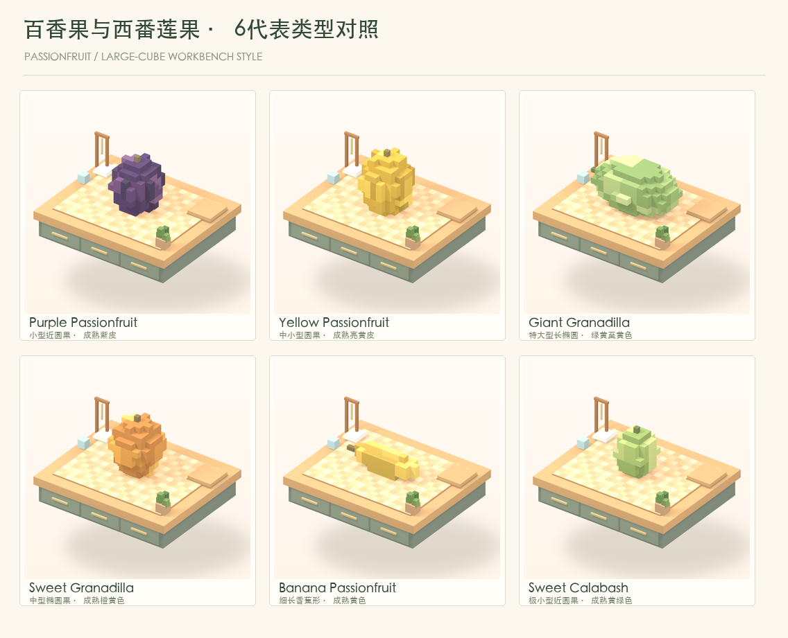

| id | name | shape 形状 | ripe colour 成熟色 | skin 果皮 | model |
| --- | --- | --- | --- | --- | --- |
| `PF-01_purple_edulis` | [Purple Passionfruit](https://ucanr.edu/county/cooperative-extension-ventura-county/passion-fruit) | 小型近圆果 | 成熟紫皮 | 深紫色、成熟时宽皱褶 | [glb](models/PF-01_purple_edulis.glb) · [card](previews/PF-01_purple_edulis.png) · 10 × 13 × 10 cm |
| `PF-02_yellow_edulis` | [Yellow Passionfruit](https://ucanr.edu/county/cooperative-extension-ventura-county/passion-fruit) | 中小型圆果 | 成熟亮黄皮 | 黄皮、成熟时浅皱褶 | [glb](models/PF-02_yellow_edulis.glb) · [card](previews/PF-02_yellow_edulis.png) · 10 × 14 × 10 cm |
| `PF-03_giant_granadilla` | [Giant Granadilla](https://ucanr.edu/county/cooperative-extension-ventura-county/passion-fruit) | 特大型长椭圆 | 绿黄至黄色 | 宽长的黄绿果身 | [glb](models/PF-03_giant_granadilla.glb) · [card](previews/PF-03_giant_granadilla.png) · 20 × 10 × 13 cm |
| `PF-04_sweet_granadilla` | [Sweet Granadilla](https://ucanr.edu/county/cooperative-extension-ventura-county/passion-fruit) | 中型椭圆果 | 成熟橙黄色 | 平滑、较硬的橙黄果壳 | [glb](models/PF-04_sweet_granadilla.glb) · [card](previews/PF-04_sweet_granadilla.png) · 10 × 14 × 10 cm |
| `PF-05_banana_passionfruit` | [Banana Passionfruit](https://ucanr.edu/county/cooperative-extension-ventura-county/passion-fruit) | 细长香蕉形 | 成熟黄色 | 长而窄、轻微弯曲的黄果 | [glb](models/PF-05_banana_passionfruit.glb) · [card](previews/PF-05_banana_passionfruit.png) · 18 × 6 × 4 cm |
| `PF-06_sweet_calabash` | [Sweet Calabash](https://ucanr.edu/county/cooperative-extension-ventura-county/passion-fruit) | 极小型近圆果 | 成熟黄绿色 | 平滑黄绿果皮 | [glb](models/PF-06_sweet_calabash.glb) · [card](previews/PF-06_sweet_calabash.png) · 7 × 11 × 7 cm |

## Lychee · 荔枝

*Litchi chinensis* · family id `lychee` · [reference](https://ask.ifas.ufl.edu/publication/MG051)

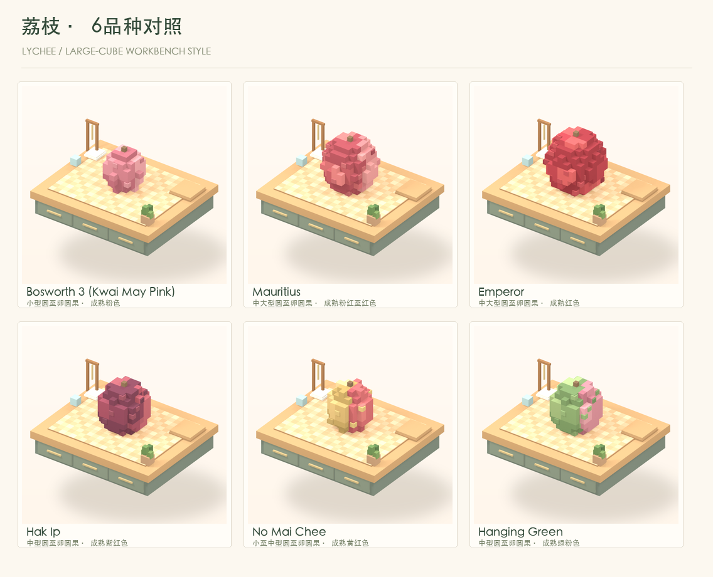

| id | name | shape 形状 | ripe colour 成熟色 | skin 果皮 | model |
| --- | --- | --- | --- | --- | --- |
| `LY-01_bosworth_3` | [Bosworth 3 (Kwai May Pink)](https://ask.ifas.ufl.edu/publication/MG051) | 小型圆至卵圆果 | 成熟粉色 | 粉色短钝凸纹 | [glb](models/LY-01_bosworth_3.glb) · [card](previews/LY-01_bosworth_3.png) · 10 × 11 × 10 cm |
| `LY-02_mauritius` | [Mauritius](https://ask.ifas.ufl.edu/publication/MG051) | 中大型圆至卵圆果 | 成熟粉红至红色 | 粉红与红色宽块面 | [glb](models/LY-02_mauritius.glb) · [card](previews/LY-02_mauritius.png) · 13 × 14 × 13 cm |
| `LY-03_emperor` | [Emperor](https://ask.ifas.ufl.edu/publication/MG051) | 中大型圆至卵圆果 | 成熟红色 | 红色短钝凸纹 | [glb](models/LY-03_emperor.glb) · [card](previews/LY-03_emperor.png) · 13 × 15 × 13 cm |
| `LY-04_hak_ip` | [Hak Ip](https://ask.ifas.ufl.edu/publication/MG051) | 中型圆至卵圆果 | 成熟紫红色 | 深紫红短钝凸纹 | [glb](models/LY-04_hak_ip.glb) · [card](previews/LY-04_hak_ip.png) · 10 × 12 × 10 cm |
| `LY-05_no_mai_chee` | [No Mai Chee](https://ask.ifas.ufl.edu/publication/MG051) | 小至中型圆至卵圆果 | 成熟黄红色 | 黄底与红色宽面 | [glb](models/LY-05_no_mai_chee.glb) · [card](previews/LY-05_no_mai_chee.png) · 10 × 12 × 10 cm |
| `LY-06_hanging_green` | [Hanging Green](https://ask.ifas.ufl.edu/publication/MG051) | 中型圆至卵圆果 | 成熟绿粉色 | 绿底与粉红宽面 | [glb](models/LY-06_hanging_green.glb) · [card](previews/LY-06_hanging_green.png) · 10 × 12 × 10 cm |

## Carambola · 杨桃

*Averrhoa carambola* · family id `carambola` · [reference](https://ucanr.edu/county/cooperative-extension-ventura-county/star-fruit)

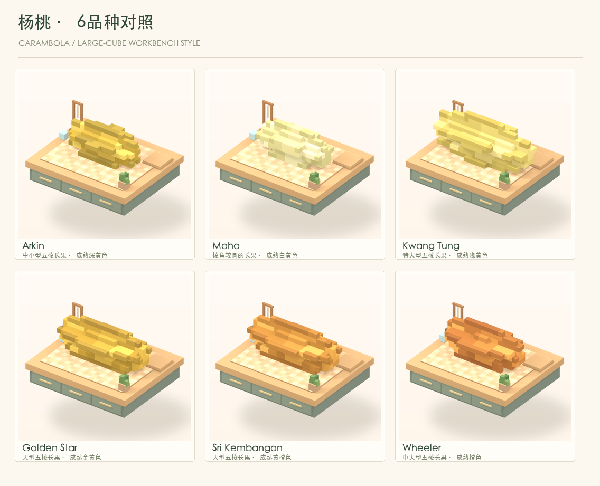

| id | name | shape 形状 | ripe colour 成熟色 | skin 果皮 | model |
| --- | --- | --- | --- | --- | --- |
| `CA-01_arkin` | [Arkin](https://ucanr.edu/county/cooperative-extension-ventura-county/star-fruit) | 中小型五棱长果 | 成熟深黄色 | 五条宽纵棱、薄亮果皮 | [glb](models/CA-01_arkin.glb) · [card](previews/CA-01_arkin.png) · 22 × 10 × 13 cm |
| `CA-02_maha` | [Maha](https://ucanr.edu/county/cooperative-extension-ventura-county/star-fruit) | 棱角较圆的长果 | 成熟白黄色 | 较圆钝的纵棱 | [glb](models/CA-02_maha.glb) · [card](previews/CA-02_maha.png) · 22 × 10 × 10 cm |
| `CA-03_kwang_tung` | [Kwang Tung](https://ucanr.edu/county/cooperative-extension-ventura-county/star-fruit) | 特大型五棱长果 | 成熟浅黄色 | 大体量、浅黄果皮 | [glb](models/CA-03_kwang_tung.glb) · [card](previews/CA-03_kwang_tung.png) · 30 × 13 × 13 cm |
| `CA-04_golden_star` | [Golden Star](https://ucanr.edu/county/cooperative-extension-ventura-county/star-fruit) | 大型五棱长果 | 成熟金黄色 | 饱满金黄果皮 | [glb](models/CA-04_golden_star.glb) · [card](previews/CA-04_golden_star.png) · 28 × 11 × 13 cm |
| `CA-05_sri_kembangan` | [Sri Kembangan](https://ucanr.edu/county/cooperative-extension-ventura-county/star-fruit) | 大型五棱长果 | 成熟黄橙色 | 黄橙果皮与宽纵棱 | [glb](models/CA-05_sri_kembangan.glb) · [card](previews/CA-05_sri_kembangan.png) · 28 × 11 × 13 cm |
| `CA-06_wheeler` | [Wheeler](https://ucanr.edu/county/cooperative-extension-ventura-county/star-fruit) | 中大型五棱长果 | 成熟橙色 | 橙色果皮与明显棱线 | [glb](models/CA-06_wheeler.glb) · [card](previews/CA-06_wheeler.png) · 25 × 11 × 13 cm |

## Cherry · 樱桃

*Prunus avium（甜樱桃）与 Prunus cerasus（酸樱桃）* · family id `cherry` · [reference](https://extension.wsu.edu/pnw-gardeners-handbook/chapter-8-home-orchards/)

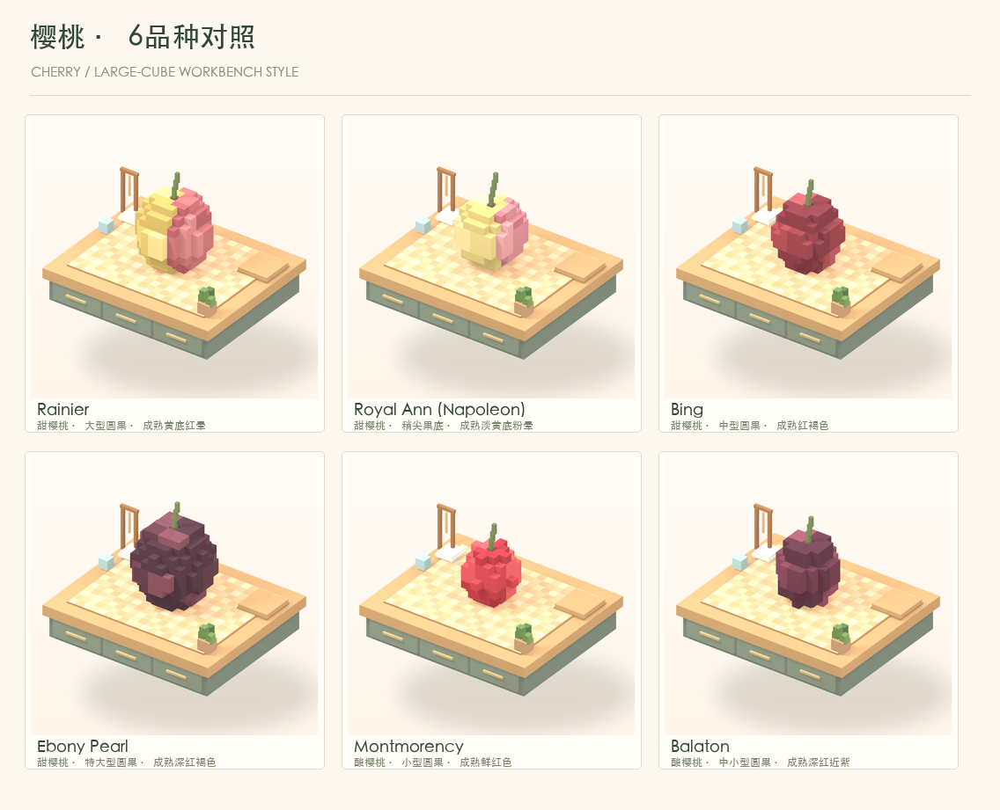

| id | name | shape 形状 | ripe colour 成熟色 | skin 果皮 | model |
| --- | --- | --- | --- | --- | --- |
| `CH-01_rainier` | [Rainier](https://extension.oregonstate.edu/catalog/pnw-604-sweet-cherry-cultivars-fresh-market) | 甜樱桃 · 大型圆果 | 成熟黄底红晕 | 浅黄果皮带宽红晕 | [glb](models/CH-01_rainier.glb) · [card](previews/CH-01_rainier.png) · 13 × 18 × 13 cm |
| `CH-02_royal_ann` | [Royal Ann (Napoleon)](https://extension.oregonstate.edu/sites/extd8/files/documents/em9056.pdf) | 甜樱桃 · 稍尖果底 | 成熟淡黄底粉晕 | 浅黄薄皮、粉色宽晕 | [glb](models/CH-02_royal_ann.glb) · [card](previews/CH-02_royal_ann.png) · 10 × 18 × 10 cm |
| `CH-03_bing` | [Bing](https://extension.oregonstate.edu/catalog/pnw-604-sweet-cherry-cultivars-fresh-market) | 甜樱桃 · 中型圆果 | 成熟红褐色 | 宽块面红褐果皮 | [glb](models/CH-03_bing.glb) · [card](previews/CH-03_bing.png) · 10 × 16 × 10 cm |
| `CH-04_ebony_pearl` | [Ebony Pearl](https://extension.oregonstate.edu/catalog/pnw-604-sweet-cherry-cultivars-fresh-market) | 甜樱桃 · 特大型圆果 | 成熟深红褐色 | 深红褐整片果皮 | [glb](models/CH-04_ebony_pearl.glb) · [card](previews/CH-04_ebony_pearl.png) · 13 × 19 × 13 cm |
| `CH-05_montmorency` | [Montmorency](https://msutoday.msu.edu/news/2021/02/perfecting-michigan-cherries) | 酸樱桃 · 小型圆果 | 成熟鲜红色 | 明亮鲜红果皮 | [glb](models/CH-05_montmorency.glb) · [card](previews/CH-05_montmorency.png) · 10 × 15 × 10 cm |
| `CH-06_balaton` | [Balaton](https://www.canr.msu.edu/uploads/files/Research_Center/NW_Mich_Hort/Training_Pruning_Varities/GrowingBalaton.pdf) | 酸樱桃 · 中小型圆果 | 成熟深红近紫 | 浓深红至紫红果皮 | [glb](models/CH-06_balaton.glb) · [card](previews/CH-06_balaton.png) · 10 × 16 × 10 cm |

## Loquat · 枇杷

*Eriobotrya japonica* · family id `loquat` · [reference](https://ask.ifas.ufl.edu/publication/MG050)

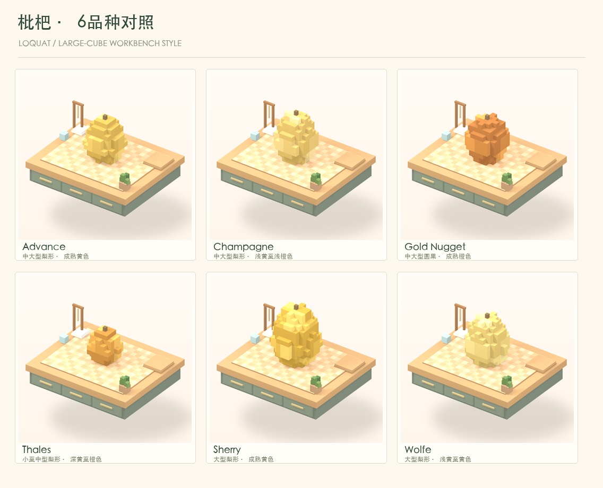

| id | name | shape 形状 | ripe colour 成熟色 | skin 果皮 | model |
| --- | --- | --- | --- | --- | --- |
| `LO-01_advance` | [Advance](https://ask.ifas.ufl.edu/publication/MG050) | 中大型梨形 | 成熟黄色 | 平滑黄皮 | [glb](models/LO-01_advance.glb) · [card](previews/LO-01_advance.png) · 10 × 14 × 10 cm |
| `LO-02_champagne` | [Champagne](https://ask.ifas.ufl.edu/publication/MG050) | 中大型梨形 | 浅黄至浅橙色 | 柔和浅黄橙果皮 | [glb](models/LO-02_champagne.glb) · [card](previews/LO-02_champagne.png) · 10 × 15 × 10 cm |
| `LO-03_gold_nugget` | [Gold Nugget](https://ask.ifas.ufl.edu/publication/MG050) | 中大型圆果 | 成熟橙色 | 平滑橙皮 | [glb](models/LO-03_gold_nugget.glb) · [card](previews/LO-03_gold_nugget.png) · 10 × 14 × 10 cm |
| `LO-04_thales` | [Thales](https://ask.ifas.ufl.edu/publication/MG050) | 小至中型梨形 | 深黄至橙色 | 深黄橙果皮 | [glb](models/LO-04_thales.glb) · [card](previews/LO-04_thales.png) · 10 × 11 × 7 cm |
| `LO-05_sherry` | [Sherry](https://ask.ifas.ufl.edu/publication/MG050) | 大型梨形 | 成熟黄色 | 饱满黄皮 | [glb](models/LO-05_sherry.glb) · [card](previews/LO-05_sherry.png) · 13 × 18 × 13 cm |
| `LO-06_wolfe` | [Wolfe](https://ask.ifas.ufl.edu/publication/MG050) | 大型梨形 | 浅黄至黄色 | 浅黄果皮 | [glb](models/LO-06_wolfe.glb) · [card](previews/LO-06_wolfe.png) · 13 × 15 × 10 cm |

## Sapodilla · 人心果

*Manilkara zapota* · family id `sapodilla` · [reference](https://ask.ifas.ufl.edu/publication/MG057)

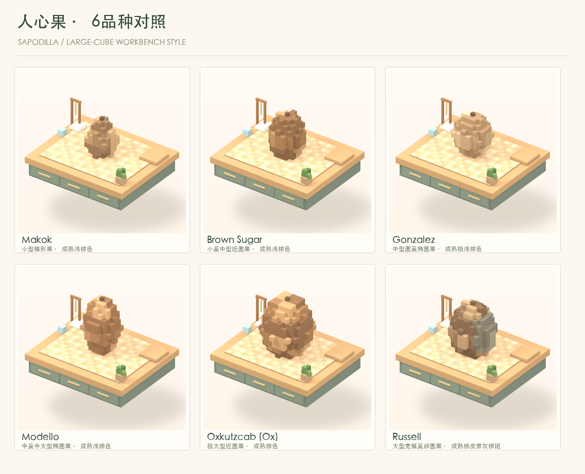

| id | name | shape 形状 | ripe colour 成熟色 | skin 果皮 | model |
| --- | --- | --- | --- | --- | --- |
| `SA-01_makok` | [Makok](https://ask.ifas.ufl.edu/publication/MG057) | 小型锥形果 | 成熟浅棕色 | 浅棕皮、轻微粗糙 | [glb](models/SA-01_makok.glb) · [card](previews/SA-01_makok.png) · 7 × 12 × 7 cm |
| `SA-02_brown_sugar` | [Brown Sugar](https://ask.ifas.ufl.edu/publication/MG057) | 小至中型近圆果 | 成熟浅棕色 | 浅棕皮、中等粗糙 | [glb](models/SA-02_brown_sugar.glb) · [card](previews/SA-02_brown_sugar.png) · 10 × 14 × 10 cm |
| `SA-03_gonzalez` | [Gonzalez](https://ask.ifas.ufl.edu/publication/MG057) | 中型圆至椭圆果 | 成熟极浅棕色 | 极浅棕皮、轻微粗糙 | [glb](models/SA-03_gonzalez.glb) · [card](previews/SA-03_gonzalez.png) · 10 × 14 × 10 cm |
| `SA-04_modello` | [Modello](https://ask.ifas.ufl.edu/publication/MG057) | 中至中大型椭圆果 | 成熟浅棕色 | 浅棕皮、中等粗糙 | [glb](models/SA-04_modello.glb) · [card](previews/SA-04_modello.png) · 10 × 18 × 10 cm |
| `SA-05_oxkutzcab` | [Oxkutzcab (Ox)](https://ask.ifas.ufl.edu/publication/MG057) | 极大型近圆果 | 成熟棕色 | 近圆棕皮，资料未指定专属皮色 | [glb](models/SA-05_oxkutzcab.glb) · [card](previews/SA-05_oxkutzcab.png) · 15 × 18 × 15 cm |
| `SA-06_russell` | [Russell](https://ask.ifas.ufl.edu/publication/MG057) | 大型宽锥至卵圆果 | 成熟棕皮带灰棕斑 | 棕皮、灰棕宽斑 | [glb](models/SA-06_russell.glb) · [card](previews/SA-06_russell.png) · 13 × 16 × 13 cm |

## Jackfruit · 菠萝蜜

*Artocarpus heterophyllus* · family id `jackfruit` · [reference](https://ask.ifas.ufl.edu/publication/MG370)

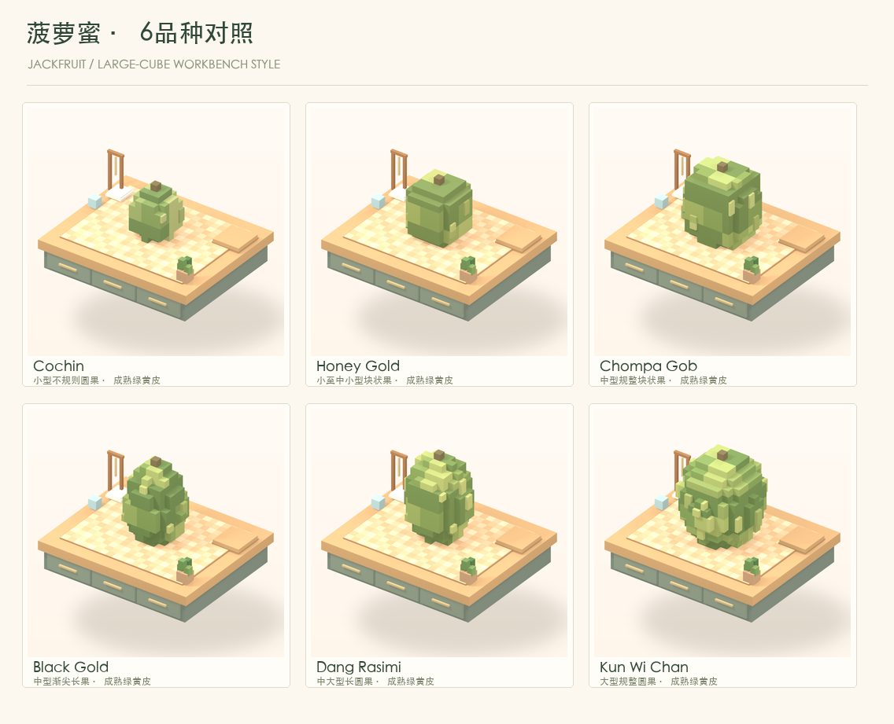

| id | name | shape 形状 | ripe colour 成熟色 | skin 果皮 | model |
| --- | --- | --- | --- | --- | --- |
| `JF-01_cochin` | [Cochin](https://ask.ifas.ufl.edu/publication/MG370) | 小型不规则圆果 | 成熟绿黄皮 | 粗皮、成熟时表面突起变平 | [glb](models/JF-01_cochin.glb) · [card](previews/JF-01_cochin.png) · 8 × 11 × 7 cm |
| `JF-02_honey_gold` | [Honey Gold](https://ask.ifas.ufl.edu/publication/MG370) | 小至中小型块状果 | 成熟绿黄皮 | 粗皮、成熟时表面突起变平 | [glb](models/JF-02_honey_gold.glb) · [card](previews/JF-02_honey_gold.png) · 11 × 13 × 10 cm |
| `JF-03_chompa_gob` | [Chompa Gob](https://ask.ifas.ufl.edu/publication/MG370) | 中型规整块状果 | 成熟绿黄皮 | 宽块粗皮、成熟时刺突变平 | [glb](models/JF-03_chompa_gob.glb) · [card](previews/JF-03_chompa_gob.png) · 13 × 15 × 11 cm |
| `JF-04_black_gold` | [Black Gold](https://ask.ifas.ufl.edu/publication/MG370) | 中型渐尖长果 | 成熟绿黄皮 | 粗皮、成熟时突起未变平 | [glb](models/JF-04_black_gold.glb) · [card](previews/JF-04_black_gold.png) · 13 × 17 × 10 cm |
| `JF-05_dang_rasimi` | [Dang Rasimi](https://ask.ifas.ufl.edu/publication/MG370) | 中大型长圆果 | 成熟绿黄皮 | 粗皮、成熟时突起未变平 | [glb](models/JF-05_dang_rasimi.glb) · [card](previews/JF-05_dang_rasimi.png) · 14 × 18 × 10 cm |
| `JF-06_kun_wi_chan` | [Kun Wi Chan](https://ask.ifas.ufl.edu/publication/MG370) | 大型规整圆果 | 成熟绿黄皮 | 粗皮、成熟时突起未变平 | [glb](models/JF-06_kun_wi_chan.glb) · [card](previews/JF-06_kun_wi_chan.png) · 17 × 18 × 16 cm |

## Coconut · 椰子

*Cocos nucifera* · family id `coconut` · [reference](https://cpcri.gov.in/page/article/Coconut_Varieties)

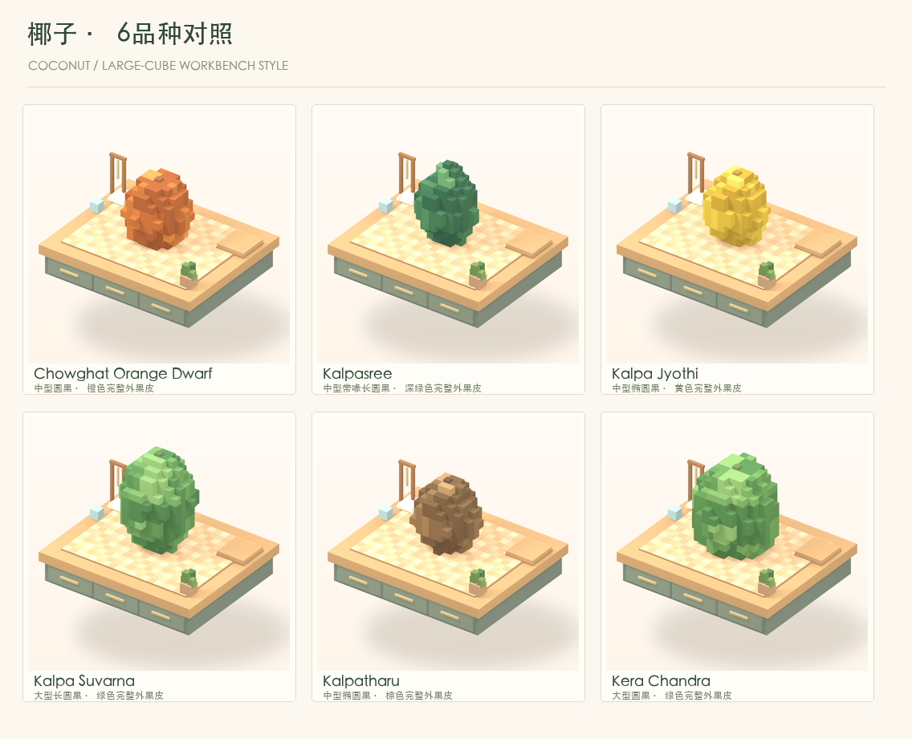

| id | name | shape 形状 | ripe colour 成熟色 | skin 果皮 | model |
| --- | --- | --- | --- | --- | --- |
| `CO-01_chowghat_orange_dwarf` | [Chowghat Orange Dwarf](https://cpcri.gov.in/page/article/Coconut_Varieties) | 中型圆果 | 橙色完整外果皮 | 圆形橙色整果、宽纵棱 | [glb](models/CO-01_chowghat_orange_dwarf.glb) · [card](previews/CO-01_chowghat_orange_dwarf.png) · 11 × 13 × 13 cm |
| `CO-02_kalpasree` | [Kalpasree](https://cpcri.gov.in/page/article/Coconut_Varieties) | 中型带喙长圆果 | 深绿色完整外果皮 | 深绿长圆果、成熟果喙 | [glb](models/CO-02_kalpasree.glb) · [card](previews/CO-02_kalpasree.png) · 11 × 16 × 10 cm |
| `CO-03_kalpa_jyothi` | [Kalpa Jyothi](https://cpcri.gov.in/page/article/Coconut_Varieties) | 中型椭圆果 | 黄色完整外果皮 | 椭圆黄皮、宽纵棱 | [glb](models/CO-03_kalpa_jyothi.glb) · [card](previews/CO-03_kalpa_jyothi.png) · 11 × 14 × 10 cm |
| `CO-04_kalpa_suvarna` | [Kalpa Suvarna](https://cpcri.gov.in/page/article/Coconut_Varieties) | 大型长圆果 | 绿色完整外果皮 | 较大长圆绿果、宽纵棱 | [glb](models/CO-04_kalpa_suvarna.glb) · [card](previews/CO-04_kalpa_suvarna.png) · 14 × 20 × 13 cm |
| `CO-05_kalpatharu` | [Kalpatharu](https://cpcri.gov.in/page/article/Coconut_Varieties) | 中型椭圆果 | 棕色完整外果皮 | 棕至棕绿外皮、宽纵棱 | [glb](models/CO-05_kalpatharu.glb) · [card](previews/CO-05_kalpatharu.png) · 11 × 14 × 11 cm |
| `CO-06_kera_chandra` | [Kera Chandra](https://cpcri.gov.in/page/article/Coconut_Varieties) | 大型圆果 | 绿色完整外果皮 | 大型圆形绿果、宽纵棱 | [glb](models/CO-06_kera_chandra.glb) · [card](previews/CO-06_kera_chandra.png) · 14 × 17 × 15 cm |

## Raspberry & relatives · 树莓与近缘类型

*Rubus idaeus、Rubus occidentalis 及红黑树莓杂交类型* · family id `raspberry` · [reference](https://extension.psu.edu/home-fruit-gardens-raspberry-varieties-for-pennsylvania)

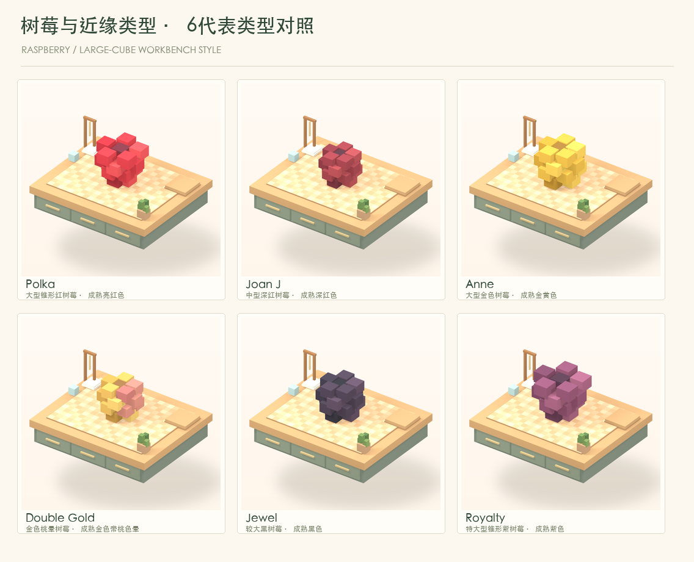

| id | name | shape 形状 | ripe colour 成熟色 | skin 果皮 | model |
| --- | --- | --- | --- | --- | --- |
| `RB-01_polka` | [Polka](https://extension.psu.edu/home-fruit-gardens-raspberry-varieties-for-pennsylvania) | 大型锥形红树莓 | 成熟亮红色 | 大块果粒、空心果口 | [glb](models/RB-01_polka.glb) · [card](previews/RB-01_polka.png) · 11 × 9 × 11 cm |
| `RB-02_joan_j` | [Joan J](https://extension.psu.edu/home-fruit-gardens-raspberry-varieties-for-pennsylvania) | 中型深红树莓 | 成熟深红色 | 光亮深红果粒、空心果口 | [glb](models/RB-02_joan_j.glb) · [card](previews/RB-02_joan_j.png) · 9 × 8 × 9 cm |
| `RB-03_anne` | [Anne](https://extension.psu.edu/home-fruit-gardens-raspberry-varieties-for-pennsylvania) | 大型金色树莓 | 成熟金黄色 | 金色大果粒、空心果口 | [glb](models/RB-03_anne.glb) · [card](previews/RB-03_anne.png) · 11 × 10 × 11 cm |
| `RB-04_double_gold` | [Double Gold](https://extension.psu.edu/home-fruit-gardens-raspberry-varieties-for-pennsylvania) | 金色桃晕树莓 | 成熟金色带桃色晕 | 宽片桃色晕、空心果口 | [glb](models/RB-04_double_gold.glb) · [card](previews/RB-04_double_gold.png) · 10 × 9 × 10 cm |
| `RB-05_jewel` | [Jewel](https://extension.psu.edu/home-fruit-gardens-raspberry-varieties-for-pennsylvania) | 较大黑树莓 | 成熟黑色 | 深色大果粒、空心果口 | [glb](models/RB-05_jewel.glb) · [card](previews/RB-05_jewel.png) · 10 × 9 × 10 cm |
| `RB-06_royalty` | [Royalty](https://extension.psu.edu/home-fruit-gardens-raspberry-varieties-for-pennsylvania) | 特大型锥形紫树莓 | 成熟紫色 | 宽块紫色果粒、空心果口 | [glb](models/RB-06_royalty.glb) · [card](previews/RB-06_royalty.png) · 13 × 10 × 12 cm |

## Chinese jujube · 中国枣

*Ziziphus jujuba* · family id `jujube` · [reference](https://ask.ifas.ufl.edu/publication/HS1477)

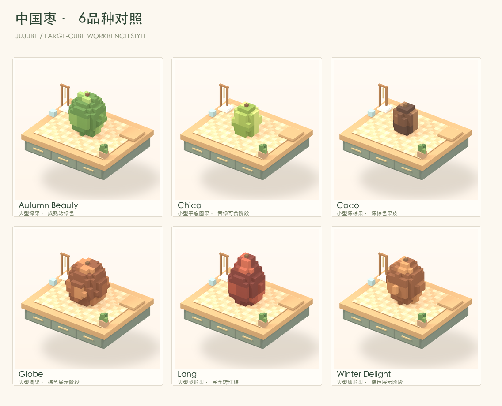

| id | name | shape 形状 | ripe colour 成熟色 | skin 果皮 | model |
| --- | --- | --- | --- | --- | --- |
| `JZ-01_autumn_beauty` | [Autumn Beauty](https://ask.ifas.ufl.edu/publication/HS1477) | 大型绿果 | 成熟转绿色 | 平滑绿皮、短果梗 | [glb](models/JZ-01_autumn_beauty.glb) · [card](previews/JZ-01_autumn_beauty.png) · 13 × 15 × 10 cm |
| `JZ-02_chico` | [Chico](https://ask.ifas.ufl.edu/publication/HS1477) | 小型平底圆果 | 青绿可食阶段 | 平滑青绿皮、平底 | [glb](models/JZ-02_chico.glb) · [card](previews/JZ-02_chico.png) · 7 × 11 × 7 cm |
| `JZ-03_coco` | [Coco](https://ask.ifas.ufl.edu/publication/HS1477) | 小型深棕果 | 深棕色果皮 | 平滑深棕皮 | [glb](models/JZ-03_coco.glb) · [card](previews/JZ-03_coco.png) · 7 × 11 × 7 cm |
| `JZ-04_globe` | [Globe](https://ask.ifas.ufl.edu/publication/HS1477) | 大型圆果 | 棕色展示阶段 | 宽圆平滑果皮 | [glb](models/JZ-04_globe.glb) · [card](previews/JZ-04_globe.png) · 13 × 15 × 13 cm |
| `JZ-05_lang` | [Lang](https://ask.ifas.ufl.edu/publication/HS1477) | 大型梨形果 | 完全转红棕 | 梨形红棕皮、短果梗 | [glb](models/JZ-05_lang.glb) · [card](previews/JZ-05_lang.png) · 13 × 18 × 10 cm |
| `JZ-06_winter_delight` | [Winter Delight](https://ask.ifas.ufl.edu/publication/HS1477) | 大型卵形果 | 棕色展示阶段 | 长卵圆平滑果皮 | [glb](models/JZ-06_winter_delight.glb) · [card](previews/JZ-06_winter_delight.png) · 13 × 16 × 13 cm |

## Kiwifruit & kiwiberry · 猕猴桃与奇异莓

*Actinidia deliciosa、A. chinensis、A. arguta 等* · family id `kiwifruit` · [reference](https://extension.oregonstate.edu/catalog/pnw-507-growing-kiwifruit-guide-kiwiberries-fuzzy-kiwifruit-pacific-northwest-producers)

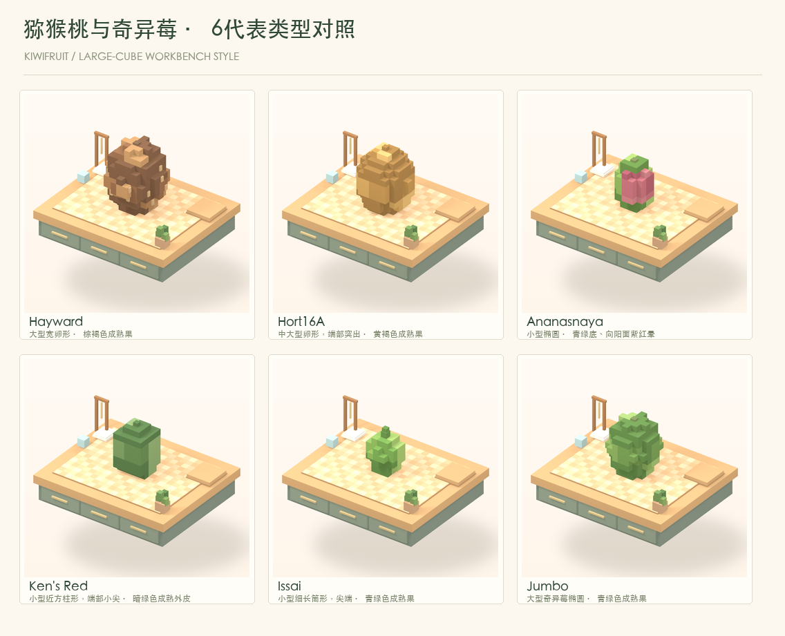

| id | name | shape 形状 | ripe colour 成熟色 | skin 果皮 | model |
| --- | --- | --- | --- | --- | --- |
| `KI-01_hayward` | [Hayward](https://extension.oregonstate.edu/catalog/pnw-507-growing-kiwifruit-guide-kiwiberries-fuzzy-kiwifruit-pacific-northwest-producers) | 大型宽卵形 | 棕褐色成熟果 | 绒毛明显的棕色果皮 | [glb](models/KI-01_hayward.glb) · [card](previews/KI-01_hayward.png) · 13 × 16 × 13 cm |
| `KI-02_hort16a` | [Hort16A](https://patents.google.com/patent/USPP11066P/en) | 中大型卵形，端部突出 | 黄褐色成熟果 | 细软绒毛易脱落，表皮较光滑 | [glb](models/KI-02_hort16a.glb) · [card](previews/KI-02_hort16a.png) · 13 × 15 × 10 cm |
| `KI-03_ananasnaya` | [Ananasnaya](https://extension.oregonstate.edu/catalog/pnw-507-growing-kiwifruit-guide-kiwiberries-fuzzy-kiwifruit-pacific-northwest-producers) | 小型椭圆 | 青绿底、向阳面紫红晕 | 平滑薄果皮 | [glb](models/KI-03_ananasnaya.glb) · [card](previews/KI-03_ananasnaya.png) · 7 × 12 × 7 cm |
| `KI-04_kens_red` | [Ken's Red](https://extension.oregonstate.edu/catalog/pnw-507-growing-kiwifruit-guide-kiwiberries-fuzzy-kiwifruit-pacific-northwest-producers) | 小型近方柱形，端部小尖 | 暗绿色成熟外皮 | 平滑绿皮 | [glb](models/KI-04_kens_red.glb) · [card](previews/KI-04_kens_red.png) · 7 × 12 × 7 cm |
| `KI-05_issai` | [Issai](https://extension.oregonstate.edu/catalog/pnw-507-growing-kiwifruit-guide-kiwiberries-fuzzy-kiwifruit-pacific-northwest-producers) | 小型细长筒形，尖端 | 青绿色成熟果 | 平滑无绒毛 | [glb](models/KI-05_issai.glb) · [card](previews/KI-05_issai.png) · 7 × 11 × 7 cm |
| `KI-06_jumbo` | [Jumbo](https://extension.oregonstate.edu/catalog/pnw-507-growing-kiwifruit-guide-kiwiberries-fuzzy-kiwifruit-pacific-northwest-producers) | 大型奇异莓椭圆 | 青绿色成熟果 | 平滑无绒毛 | [glb](models/KI-06_jumbo.glb) · [card](previews/KI-06_jumbo.png) · 10 × 13 × 10 cm |

## Papaya · 番木瓜

*Carica papaya* · family id `papaya` · [reference](https://cms.ctahr.hawaii.edu/ckm/Home/Crops/Fruits-and-Nuts/Papaya/Papaya-General-Information)

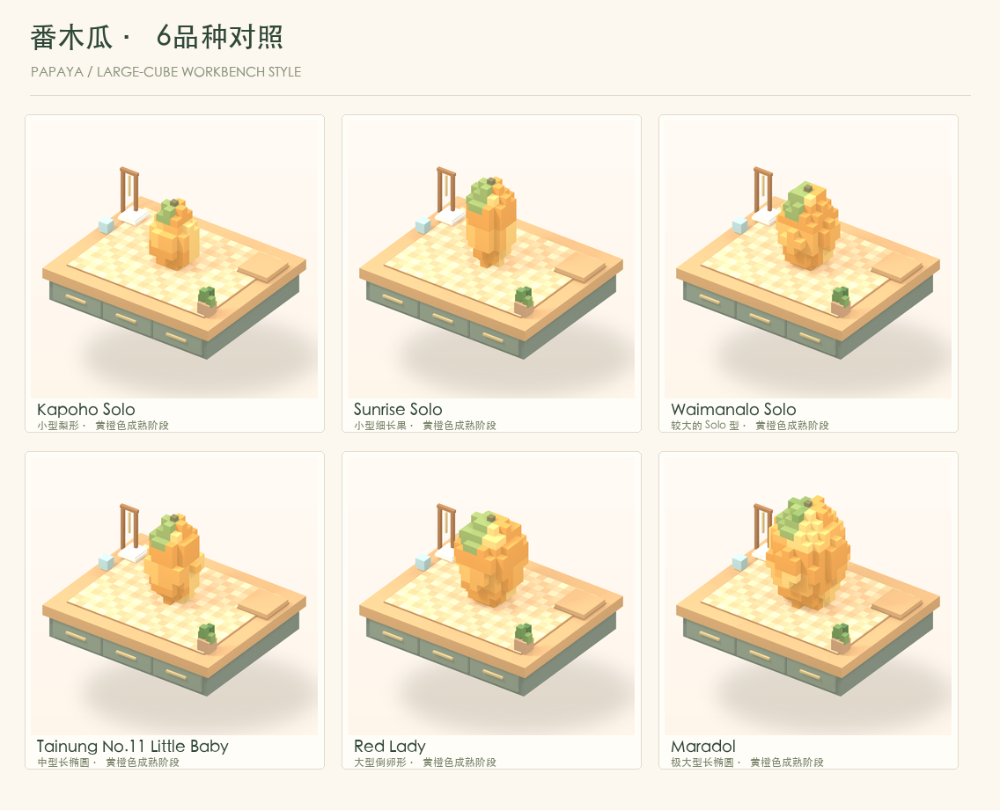

| id | name | shape 形状 | ripe colour 成熟色 | skin 果皮 | model |
| --- | --- | --- | --- | --- | --- |
| `PA-01_kapoho` | [Kapoho Solo](https://www.upov.int/edocs/mdocs/upov/en/tc/46/tg_papaya_proj_6.pdf) | 小型梨形 | 黄橙色成熟阶段 | 光滑的黄橙色果皮，果肩留少量青绿 | [glb](models/PA-01_kapoho.glb) · [card](previews/PA-01_kapoho.png) · 7 × 12 × 7 cm |
| `PA-02_sunrise` | [Sunrise Solo](https://www.upov.int/edocs/mdocs/upov/en/tc/46/tg_papaya_proj_6.pdf) | 小型细长果 | 黄橙色成熟阶段 | 光滑的黄橙色果皮，果肩留少量青绿 | [glb](models/PA-02_sunrise.glb) · [card](previews/PA-02_sunrise.png) · 7 × 16 × 7 cm |
| `PA-03_waimanalo` | [Waimanalo Solo](https://cms.ctahr.hawaii.edu/ckm/Home/Crops/Fruits-and-Nuts/Papaya/Papaya-General-Information) | 较大的 Solo 型 | 黄橙色成熟阶段 | 光滑的黄橙色果皮，果肩留少量青绿 | [glb](models/PA-03_waimanalo.glb) · [card](previews/PA-03_waimanalo.png) · 10 × 15 × 10 cm |
| `PA-04_tainung_11` | [Tainung No.11 Little Baby](https://tatm.moa.gov.tw/EnglishHome/TechData.aspx?tecno=14905) | 中型长椭圆 | 黄橙色成熟阶段 | 光滑的黄橙色果皮，果肩留少量青绿 | [glb](models/PA-04_tainung_11.glb) · [card](previews/PA-04_tainung_11.png) · 10 × 16 × 7 cm |
| `PA-05_red_lady` | [Red Lady](https://www.upov.int/edocs/mdocs/upov/en/tc/46/tg_papaya_proj_6.pdf) | 大型倒卵形 | 黄橙色成熟阶段 | 光滑的黄橙色果皮，果肩留少量青绿 | [glb](models/PA-05_red_lady.glb) · [card](previews/PA-05_red_lady.png) · 10 × 16 × 10 cm |
| `PA-06_maradol` | [Maradol](https://www.scielo.sa.cr/scielo.php?pid=S0377-94242015000100013&script=sci_arttext) | 极大型长椭圆 | 黄橙色成熟阶段 | 光滑的黄橙色果皮，果肩留少量青绿 | [glb](models/PA-06_maradol.glb) · [card](previews/PA-06_maradol.png) · 13 × 19 × 13 cm |

## Apricot · 杏

*Prunus armeniaca* · family id `apricot` · [reference](https://extension.usu.edu/boxelder/agriculture/fruit-trees/apricots)

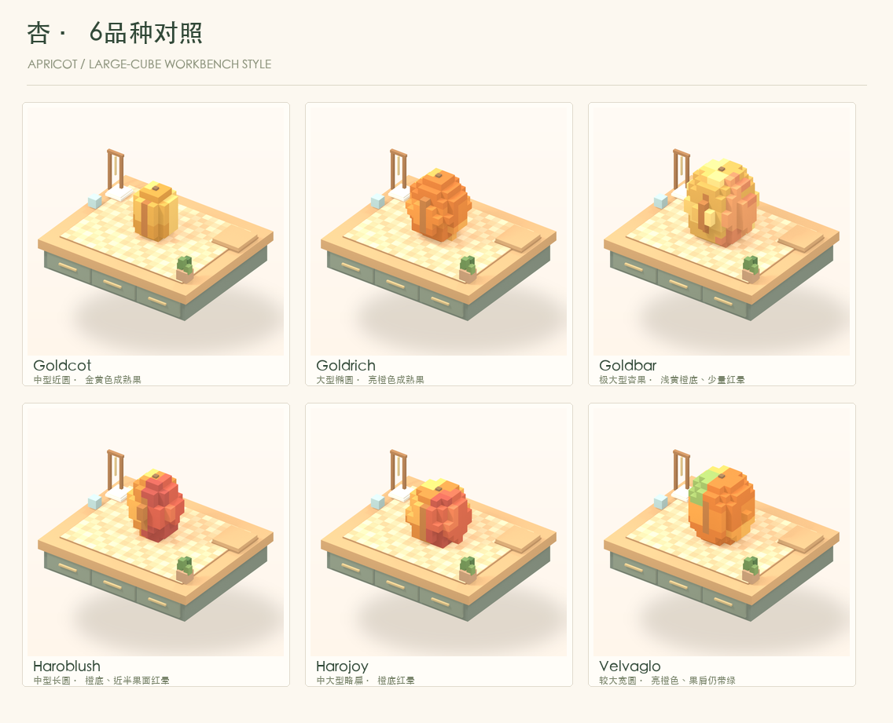

| id | name | shape 形状 | ripe colour 成熟色 | skin 果皮 | model |
| --- | --- | --- | --- | --- | --- |
| `AP-01_goldcot` | [Goldcot](https://extension.usu.edu/boxelder/agriculture/fruit-trees/apricots) | 中型近圆 | 金黄色成熟果 | 金黄果皮，红晕不明显 | [glb](models/AP-01_goldcot.glb) · [card](previews/AP-01_goldcot.png) · 7 × 10 × 7 cm |
| `AP-02_goldrich` | [Goldrich](https://extension.usu.edu/boxelder/agriculture/fruit-trees/apricots) | 大型椭圆 | 亮橙色成熟果 | 明亮橙色果皮 | [glb](models/AP-02_goldrich.glb) · [card](previews/AP-02_goldrich.png) · 10 × 13 × 10 cm |
| `AP-03_goldbar` | [Goldbar](https://extension.usu.edu/boxelder/agriculture/fruit-trees/apricots) | 极大型杏果 | 浅黄橙底、少量红晕 | 浅黄橙果皮，局部日照面红晕 | [glb](models/AP-03_goldbar.glb) · [card](previews/AP-03_goldbar.png) · 13 × 14 × 13 cm |
| `AP-04_haroblush` | [Haroblush](https://www.ontario.ca/page/apricot-cultivars) | 中型长圆 | 橙底、近半果面红晕 | 橙皮上的大片红色日照面 | [glb](models/AP-04_haroblush.glb) · [card](previews/AP-04_haroblush.png) · 10 × 13 × 10 cm |
| `AP-05_harojoy` | [Harojoy](https://www.ontario.ca/page/apricot-cultivars) | 中大型略扁 | 橙底红晕 | 橙色果皮与红色果颊 | [glb](models/AP-05_harojoy.glb) · [card](previews/AP-05_harojoy.png) · 10 × 10 × 10 cm |
| `AP-06_velvaglo` | [Velvaglo](https://www.ontario.ca/page/apricot-cultivars) | 较大宽圆 | 亮橙色、果肩仍带绿 | 亮橙果皮，果柄端局部青绿 | [glb](models/AP-06_velvaglo.glb) · [card](previews/AP-06_velvaglo.png) · 13 × 13 × 10 cm |

## Gooseberry · 醋栗（鹅莓）

*Ribes spp.（欧洲醋栗及相关杂交类型）* · family id `gooseberry` · [reference](https://extension.psu.edu/home-fruit-plantings-gooseberry-and-currant-variety-selection)

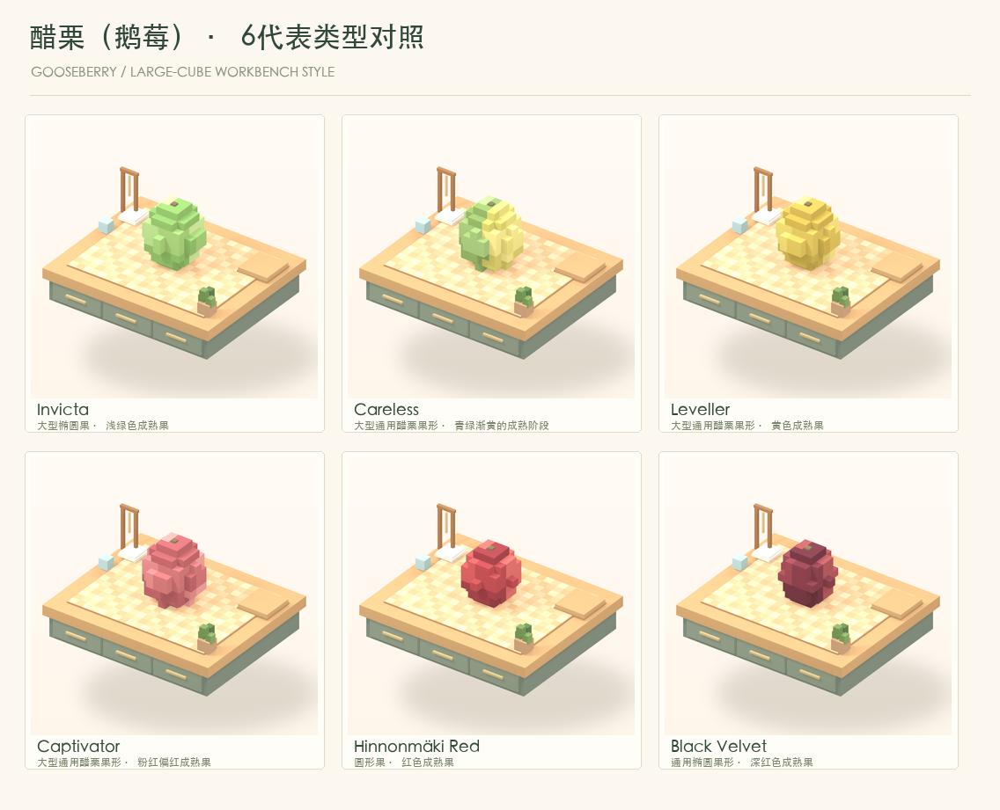

| id | name | shape 形状 | ripe colour 成熟色 | skin 果皮 | model |
| --- | --- | --- | --- | --- | --- |
| `GO-01_invicta` | [Invicta](https://extension.psu.edu/home-fruit-plantings-gooseberry-and-currant-variety-selection) | 大型椭圆果 | 浅绿色成熟果 | 浅绿色完整果皮 | [glb](models/GO-01_invicta.glb) · [card](previews/GO-01_invicta.png) · 10 × 12 × 10 cm |
| `GO-02_careless` | [Careless](https://www.rhs.org.uk/fruit/gooseberries/grow-your-own) | 大型通用醋栗果形 | 青绿渐黄的成熟阶段 | 绿黄过渡果皮 | [glb](models/GO-02_careless.glb) · [card](previews/GO-02_careless.png) · 10 × 12 × 10 cm |
| `GO-03_leveller` | [Leveller](https://www.rhs.org.uk/fruit/gooseberries/grow-your-own) | 大型通用醋栗果形 | 黄色成熟果 | 金黄色果皮 | [glb](models/GO-03_leveller.glb) · [card](previews/GO-03_leveller.png) · 10 × 12 × 10 cm |
| `GO-04_captivator` | [Captivator](https://extension.psu.edu/home-fruit-plantings-gooseberry-and-currant-variety-selection) | 大型通用醋栗果形 | 粉红偏红成熟果 | 粉红红色果皮 | [glb](models/GO-04_captivator.glb) · [card](previews/GO-04_captivator.png) · 10 × 12 × 10 cm |
| `GO-05_hinnonmaki_red` | [Hinnonmäki Red](https://www.rhs.org.uk/plants/136975/ribes-uva-crispa-var-reclinatum-hino-red/details) | 圆形果 | 红色成熟果 | 红色果皮 | [glb](models/GO-05_hinnonmaki_red.glb) · [card](previews/GO-05_hinnonmaki_red.png) · 10 × 10 × 10 cm |
| `GO-06_black_velvet` | [Black Velvet](https://extension.psu.edu/home-fruit-plantings-gooseberry-and-currant-variety-selection) | 通用椭圆果形 | 深红色成熟果 | 深红果皮 | [glb](models/GO-06_black_velvet.glb) · [card](previews/GO-06_black_velvet.png) · 10 × 10 × 7 cm |

## Date · 椰枣

*Phoenix dactylifera* · family id `date_palm` · [reference](https://storymaps.arcgis.com/stories/6a58a489cc724373818d258b17aad820)

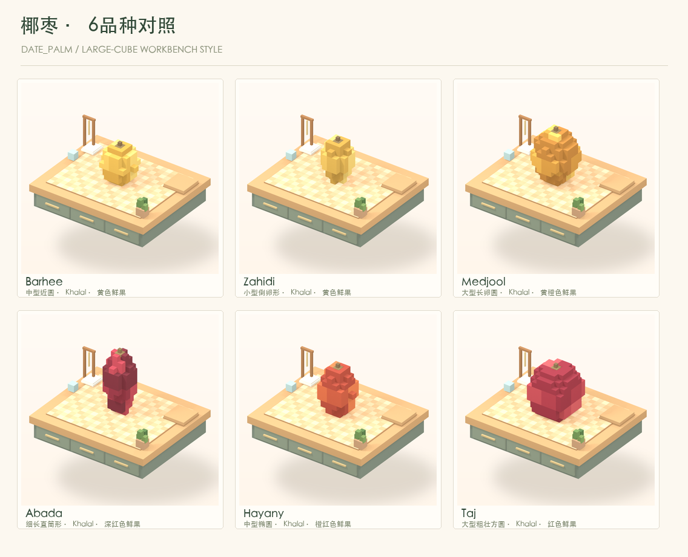

| id | name | shape 形状 | ripe colour 成熟色 | skin 果皮 | model |
| --- | --- | --- | --- | --- | --- |
| `DT-01_barhee` | [Barhee](https://storymaps.arcgis.com/stories/6a58a489cc724373818d258b17aad820) | 中型近圆 | Khalal · 黄色鲜果 | 平滑黄色果皮 | [glb](models/DT-01_barhee.glb) · [card](previews/DT-01_barhee.png) · 10 × 11 × 7 cm |
| `DT-02_zahidi` | [Zahidi](https://storymaps.arcgis.com/stories/6a58a489cc724373818d258b17aad820) | 小型倒卵形 | Khalal · 黄色鲜果 | 平滑黄皮 | [glb](models/DT-02_zahidi.glb) · [card](previews/DT-02_zahidi.png) · 7 × 12 × 7 cm |
| `DT-03_medjool` | [Medjool](https://www.fao.org/4/Y4360E/y4360e05.htm) | 大型长卵圆 | Khalal · 黄橙色鲜果 | 黄橙色果皮 | [glb](models/DT-03_medjool.glb) · [card](previews/DT-03_medjool.png) · 10 × 15 × 10 cm |
| `DT-04_abada` | [Abada](https://storymaps.arcgis.com/stories/6a58a489cc724373818d258b17aad820) | 细长直筒形 | Khalal · 深红色鲜果 | 深红色平滑果皮 | [glb](models/DT-04_abada.glb) · [card](previews/DT-04_abada.png) · 7 × 18 × 7 cm |
| `DT-05_hayany` | [Hayany](https://storymaps.arcgis.com/stories/6a58a489cc724373818d258b17aad820) | 中型椭圆 | Khalal · 橙红色鲜果 | 橙至红色果皮 | [glb](models/DT-05_hayany.glb) · [card](previews/DT-05_hayany.png) · 10 × 14 × 7 cm |
| `DT-06_taj` | [Taj](https://storymaps.arcgis.com/stories/6a58a489cc724373818d258b17aad820) | 大型粗壮方圆 | Khalal · 红色鲜果 | 红色平滑果皮 | [glb](models/DT-06_taj.glb) · [card](previews/DT-06_taj.png) · 10 × 14 × 10 cm |

## Kumquat & relatives · 金桔与近缘类型

*Fortunella spp.（亦归入 Citrus，含杂交类型）* · family id `kumquat` · [reference](https://citrusvariety.ucr.edu/citrus-varieties/category-or-type/kumquats/species)

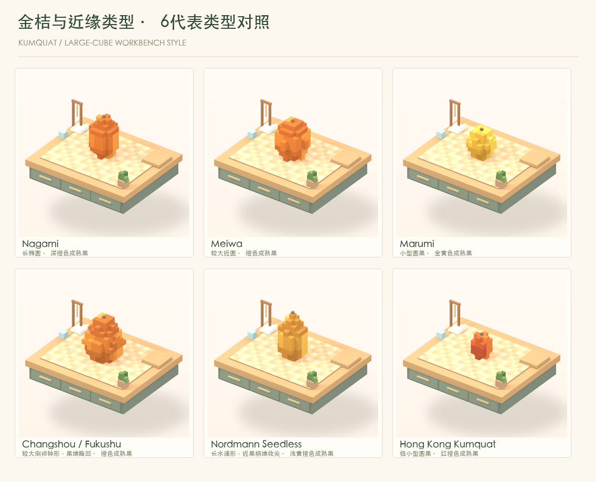

| id | name | shape 形状 | ripe colour 成熟色 | skin 果皮 | model |
| --- | --- | --- | --- | --- | --- |
| `KQ-01_nagami` | [Nagami](https://citrusvariety.ucr.edu/crc3877) | 长椭圆 | 深橙色成熟果 | 平滑深橙皮 | [glb](models/KQ-01_nagami.glb) · [card](previews/KQ-01_nagami.png) · 7 × 13 × 7 cm |
| `KQ-02_meiwa` | [Meiwa](https://citrusvariety.ucr.edu/crc3818) | 较大近圆 | 橙色成熟果 | 较厚的橙色外皮 | [glb](models/KQ-02_meiwa.glb) · [card](previews/KQ-02_meiwa.png) · 10 × 12 × 10 cm |
| `KQ-03_marumi` | [Marumi](https://citrusvariety.ucr.edu/crc3237) | 小型圆果 | 金黄色成熟果 | 平滑金黄外皮 | [glb](models/KQ-03_marumi.glb) · [card](previews/KQ-03_marumi.png) · 7 × 9 × 7 cm |
| `KQ-04_changshou` | [Changshou / Fukushu](https://citrusvariety.ucr.edu/crc3475) | 较大倒卵钟形，果端略凹 | 橙色成熟果 | 平滑橙皮 | [glb](models/KQ-04_changshou.glb) · [card](previews/KQ-04_changshou.png) · 10 × 13 × 10 cm |
| `KQ-05_nordmann` | [Nordmann Seedless](https://citrusvariety.ucr.edu/crc4070) | 长水滴形，近果柄端收尖 | 浅黄橙色成熟果 | 较浅的黄橙果皮 | [glb](models/KQ-05_nordmann.glb) · [card](previews/KQ-05_nordmann.png) · 7 × 15 × 7 cm |
| `KQ-06_hong_kong` | [Hong Kong Kumquat](https://citrusvariety.ucr.edu/crc3789) | 极小型圆果 | 红橙色成熟果 | 平滑红橙外皮 | [glb](models/KQ-06_hong_kong.glb) · [card](previews/KQ-06_hong_kong.png) · 4 × 8 × 4 cm |

## Sweet orange · 甜橙

*Citrus sinensis* · family id `sweet_orange` · [reference](https://citrusvariety.ucr.edu/citrus-varieties/category-or-type/sweet-oranges)

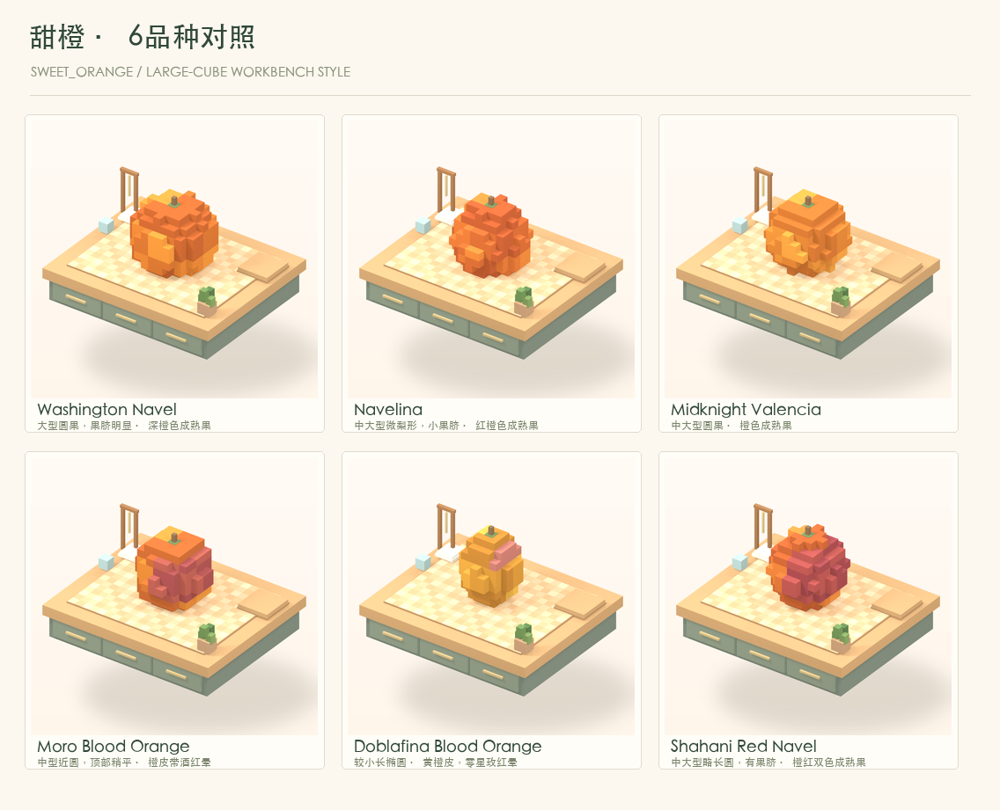

| id | name | shape 形状 | ripe colour 成熟色 | skin 果皮 | model |
| --- | --- | --- | --- | --- | --- |
| `OR-01_washington_navel` | [Washington Navel](https://citrusvariety.ucr.edu/crc1241B) | 大型圆果，果脐明显 | 深橙色成熟果 | 略有起伏的深橙果皮 | [glb](models/OR-01_washington_navel.glb) · [card](previews/OR-01_washington_navel.png) · 13 × 13 × 13 cm |
| `OR-02_navelina` | [Navelina](https://citrusvariety.ucr.edu/crc4015) | 中大型微梨形，小果脐 | 红橙色成熟果 | 平滑红橙果皮 | [glb](models/OR-02_navelina.glb) · [card](previews/OR-02_navelina.png) · 13 × 13 × 13 cm |
| `OR-03_midknight_valencia` | [Midknight Valencia](https://citrusvariety.ucr.edu/crc3955) | 中大型圆果 | 橙色成熟果 | 平滑橙色果皮 | [glb](models/OR-03_midknight_valencia.glb) · [card](previews/OR-03_midknight_valencia.png) · 13 × 13 × 13 cm |
| `OR-04_moro` | [Moro Blood Orange](https://citrusvariety.ucr.edu/crc3811) | 中型近圆，顶部稍平 | 橙皮带酒红晕 | 橙色外皮与局部酒红晕 | [glb](models/OR-04_moro.glb) · [card](previews/OR-04_moro.png) · 13 × 13 × 13 cm |
| `OR-05_doblafina` | [Doblafina Blood Orange](https://citrusvariety.ucr.edu/crc3152) | 较小长椭圆 | 黄橙皮，零星玫红晕 | 平滑黄橙皮与少量粉红斑 | [glb](models/OR-05_doblafina.glb) · [card](previews/OR-05_doblafina.png) · 10 × 14 × 10 cm |
| `OR-06_shahani_red` | [Shahani Red Navel](https://citrusvariety.ucr.edu/crc4258) | 中大型略长圆，有果脐 | 橙红双色成熟果 | 平滑橙皮与大块暗红着色 | [glb](models/OR-06_shahani_red.glb) · [card](previews/OR-06_shahani_red.png) · 13 × 14 × 13 cm |

## Chinese bayberry (yangmei) · 杨梅

*Morella rubra（异名 Myrica rubra）* · family id `bayberry` · [reference](https://lyj.hunan.gov.cn/lyj/tslm_71206/lykp/syjs/201710/t20171028_4626970.html)

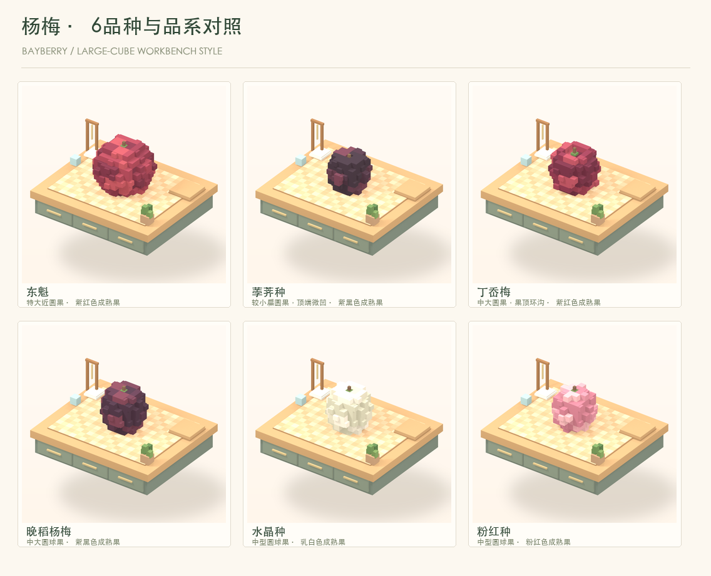

| id | name | shape 形状 | ripe colour 成熟色 | skin 果皮 | model |
| --- | --- | --- | --- | --- | --- |
| `YM-01_dongkui` | [东魁](https://lyj.hunan.gov.cn/lyj/tslm_71206/lykp/syjs/201710/t20171028_4626970.html) | 特大近圆果 | 紫红色成熟果 | 粗钝肉柱、紫红果面 | [glb](models/YM-01_dongkui.glb) · [card](previews/YM-01_dongkui.png) · 14 × 12 × 14 cm |
| `YM-02_biqi` | [荸荠种](https://lyj.hunan.gov.cn/lyj/tslm_71206/lykp/syjs/201710/t20171028_4626970.html) | 较小扁圆果，顶端微凹 | 紫黑色成熟果 | 圆钝肉柱、深紫黑果面 | [glb](models/YM-02_biqi.glb) · [card](previews/YM-02_biqi.png) · 10 × 9 × 10 cm |
| `YM-03_dingao` | [丁岙梅](https://lyj.hunan.gov.cn/lyj/tslm_71206/lykp/syjs/201710/t20171028_4626970.html) | 中大圆果，果顶环沟 | 紫红色成熟果 | 圆钝肉柱、紫红果面 | [glb](models/YM-03_dingao.glb) · [card](previews/YM-03_dingao.png) · 11 × 11 × 11 cm |
| `YM-04_wandao` | [晚稻杨梅](https://lyj.hunan.gov.cn/lyj/tslm_71206/lykp/syjs/201710/t20171028_4626970.html) | 中大圆球果 | 紫黑色成熟果 | 细钝肉柱、紫黑果面 | [glb](models/YM-04_wandao.glb) · [card](previews/YM-04_wandao.png) · 11 × 11 × 11 cm |
| `YM-05_shuijing` | [水晶种](https://www.cnipa.gov.cn/attach/0/20250826010509.pdf) | 中型圆球果 | 乳白色成熟果 | 乳白至淡黄白肉柱 | [glb](models/YM-05_shuijing.glb) · [card](previews/YM-05_shuijing.png) · 11 × 11 × 11 cm |
| `YM-06_fenhong` | [粉红种](https://www.cnipa.gov.cn/attach/0/20250826010509.pdf) | 中型圆球果 | 粉红色成熟果 | 柔粉红色圆钝肉柱 | [glb](models/YM-06_fenhong.glb) · [card](previews/YM-06_fenhong.png) · 11 × 11 × 11 cm |

## Durian · 榴莲

*Durio zibethinus* · family id `durian` · [reference](https://www.doae.go.th/en/durian/)

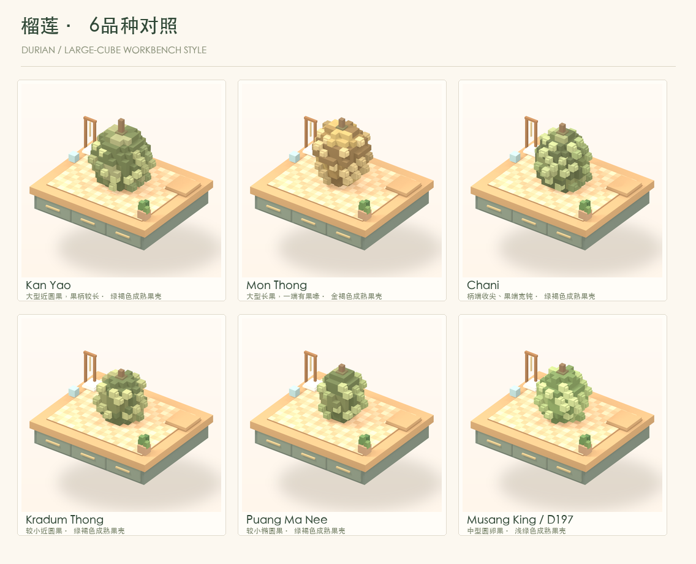

| id | name | shape 形状 | ripe colour 成熟色 | skin 果皮 | model |
| --- | --- | --- | --- | --- | --- |
| `DU-01_kan_yao` | [Kan Yao](https://www.doae.go.th/en/durian/) | 大型近圆果，果柄较长 | 绿褐色成熟果壳 | 绿褐壳与宽块刺 | [glb](models/DU-01_kan_yao.glb) · [card](previews/DU-01_kan_yao.png) · 15 × 18 × 15 cm |
| `DU-02_mon_thong` | [Mon Thong](https://www.doae.go.th/en/durian/) | 大型长果，一端有果喙 | 金褐色成熟果壳 | 金褐壳与宽块刺 | [glb](models/DU-02_mon_thong.glb) · [card](previews/DU-02_mon_thong.png) · 15 × 18 × 13 cm |
| `DU-03_chani` | [Chani](https://www.doae.go.th/en/durian/) | 柄端收尖、果端宽钝 | 绿褐色成熟果壳 | 绿褐壳与宽块刺 | [glb](models/DU-03_chani.glb) · [card](previews/DU-03_chani.png) · 15 × 16 × 15 cm |
| `DU-04_kradum_thong` | [Kradum Thong](https://www.doae.go.th/en/durian/) | 较小近圆果 | 绿褐色成熟果壳 | 绿褐壳与宽块刺 | [glb](models/DU-04_kradum_thong.glb) · [card](previews/DU-04_kradum_thong.png) · 12 × 13 × 12 cm |
| `DU-05_puang_ma_nee` | [Puang Ma Nee](https://www.doae.go.th/en/durian/) | 较小椭圆果 | 绿褐色成熟果壳 | 绿褐壳与宽块刺 | [glb](models/DU-05_puang_ma_nee.glb) · [card](previews/DU-05_puang_ma_nee.png) · 12 × 15 × 10 cm |
| `DU-06_musang_king` | [Musang King / D197](https://www.doa.gov.my/doa/resources/aktiviti_sumber/sumber_awam/penerbitan/pakej_teknologi/buah/pt_durian_2012.pdf) | 中型圆卵果 | 浅绿色成熟果壳 | 浅绿壳与宽块刺 | [glb](models/DU-06_musang_king.glb) · [card](previews/DU-06_musang_king.png) · 12 × 15 × 12 cm |

## Sugar apple & relatives · 番荔枝与近缘果

*Annona spp.（含 A. squamosa × A. cherimola 杂交类型）* · family id `annona` · [reference](https://ask.ifas.ufl.edu/publication/MG332)

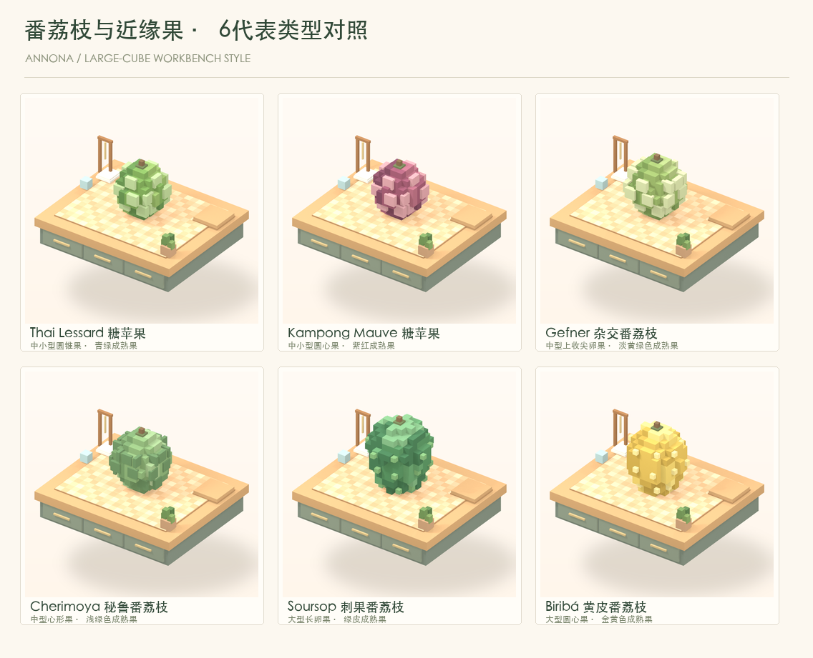

| id | name | shape 形状 | ripe colour 成熟色 | skin 果皮 | model |
| --- | --- | --- | --- | --- | --- |
| `AN-01_thai_lessard` | [Thai Lessard 糖苹果](https://ask.ifas.ufl.edu/publication/MG330) | 中小型圆锥果 | 青绿成熟果 | 宽圆分瓣与浅色缝线 | [glb](models/AN-01_thai_lessard.glb) · [card](previews/AN-01_thai_lessard.png) · 11 × 13 × 11 cm |
| `AN-02_kampong_mauve` | [Kampong Mauve 糖苹果](https://ask.ifas.ufl.edu/publication/MG330) | 中小型圆心果 | 紫红成熟果 | 宽圆分瓣与浅红缝线 | [glb](models/AN-02_kampong_mauve.glb) · [card](previews/AN-02_kampong_mauve.png) · 11 × 13 × 11 cm |
| `AN-03_gefner_atemoya` | [Gefner 杂交番荔枝](https://ask.ifas.ufl.edu/publication/MG332) | 中型上收尖卵果 | 淡黄绿色成熟果 | 连体果皮与宽钝凸纹 | [glb](models/AN-03_gefner_atemoya.glb) · [card](previews/AN-03_gefner_atemoya.png) · 11 × 14 × 11 cm |
| `AN-04_cherimoya` | [Cherimoya 秘鲁番荔枝](https://ucanr.edu/sites/sdsmallfarms/files/216533.pdf) | 中型心形果 | 浅绿色成熟果 | 平缓果皮与宽浅指纹状压痕 | [glb](models/AN-04_cherimoya.glb) · [card](previews/AN-04_cherimoya.png) · 11 × 14 × 11 cm |
| `AN-05_soursop` | [Soursop 刺果番荔枝](https://powo.science.kew.org/taxon/urn%3Alsid%3Aipni.org%3Anames%3A14308-2/general-information) | 大型长卵果 | 绿皮成熟果 | 稀疏柔性短刺 | [glb](models/AN-05_soursop.glb) · [card](previews/AN-05_soursop.png) · 14 × 17 × 15 cm |
| `AN-06_biriba` | [Biribá 黄皮番荔枝](https://ask.ifas.ufl.edu/publication/HS1523) | 大型圆心果 | 金黄色成熟果 | 少量软锥状凸起 | [glb](models/AN-06_biriba.glb) · [card](previews/AN-06_biriba.png) · 13 × 15 × 11 cm |

## Jaboticaba & relatives · 嘉宝果与近缘类型

*Plinia spp. 与 Myrciaria spp.（含杂交类型）* · family id `jaboticaba` · [reference](https://ask.ifas.ufl.edu/publication/HS1519)

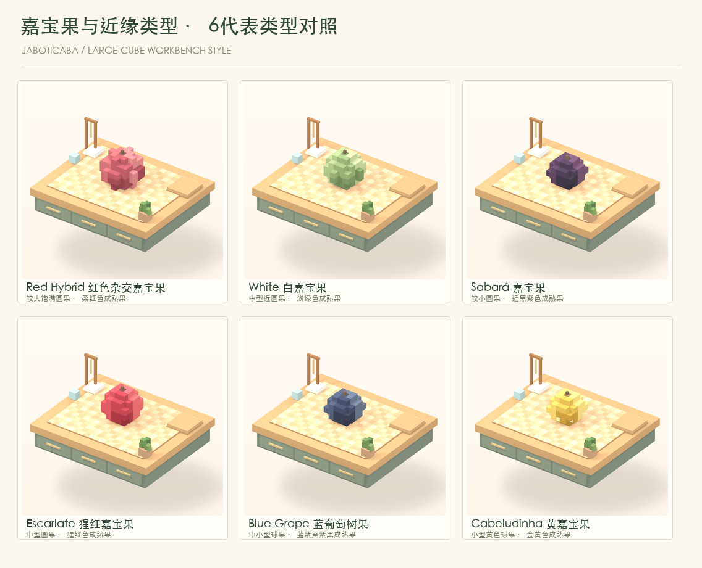

| id | name | shape 形状 | ripe colour 成熟色 | skin 果皮 | model |
| --- | --- | --- | --- | --- | --- |
| `JB-01_red_hybrid` | [Red Hybrid 红色杂交嘉宝果](https://ask.ifas.ufl.edu/publication/HS1519) | 较大饱满圆果 | 柔红色成熟果 | 宽块柔红果皮 | [glb](models/JB-01_red_hybrid.glb) · [card](previews/JB-01_red_hybrid.png) · 10 × 9 × 10 cm |
| `JB-02_white` | [White 白嘉宝果](https://ask.ifas.ufl.edu/publication/HS1519) | 中型近圆果 | 浅绿色成熟果 | 平滑浅绿果皮 | [glb](models/JB-02_white.glb) · [card](previews/JB-02_white.png) · 10 × 9 × 10 cm |
| `JB-03_sabara` | [Sabará 嘉宝果](https://www.unifal-mg.edu.br/agriculturaurbana/jabuticaba-sabara-2/) | 较小圆果 | 近黑紫色成熟果 | 平滑深紫果皮 | [glb](models/JB-03_sabara.glb) · [card](previews/JB-03_sabara.png) · 7 × 8 × 7 cm |
| `JB-04_escarlate` | [Escarlate 猩红嘉宝果](https://doi.org/10.3390/molecules25194543) | 中型圆果 | 猩红色成熟果 | 鲜红果皮 | [glb](models/JB-04_escarlate.glb) · [card](previews/JB-04_escarlate.png) · 7 × 9 × 7 cm |
| `JB-05_blue_grape` | [Blue Grape 蓝葡萄树果](https://www.nparks.gov.sg/florafaunaweb/flora/7/2/7291) | 中小型球果 | 蓝紫至紫黑成熟果 | 平滑蓝紫果皮 | [glb](models/JB-05_blue_grape.glb) · [card](previews/JB-05_blue_grape.png) · 7 × 8 × 7 cm |
| `JB-06_cabeludinha` | [Cabeludinha 黄嘉宝果](https://portais.santoandre.sp.gov.br/roteirobotanicoandreense/2025/05/21/cabeludinha/) | 小型黄色球果 | 金黄色成熟果 | 少量短柔毛 | [glb](models/JB-06_cabeludinha.glb) · [card](previews/JB-06_cabeludinha.png) · 7 × 8 × 7 cm |

## Longan · 龙眼

*Dimocarpus longan* · family id `longan` · [reference](https://ask.ifas.ufl.edu/publication/MG049)

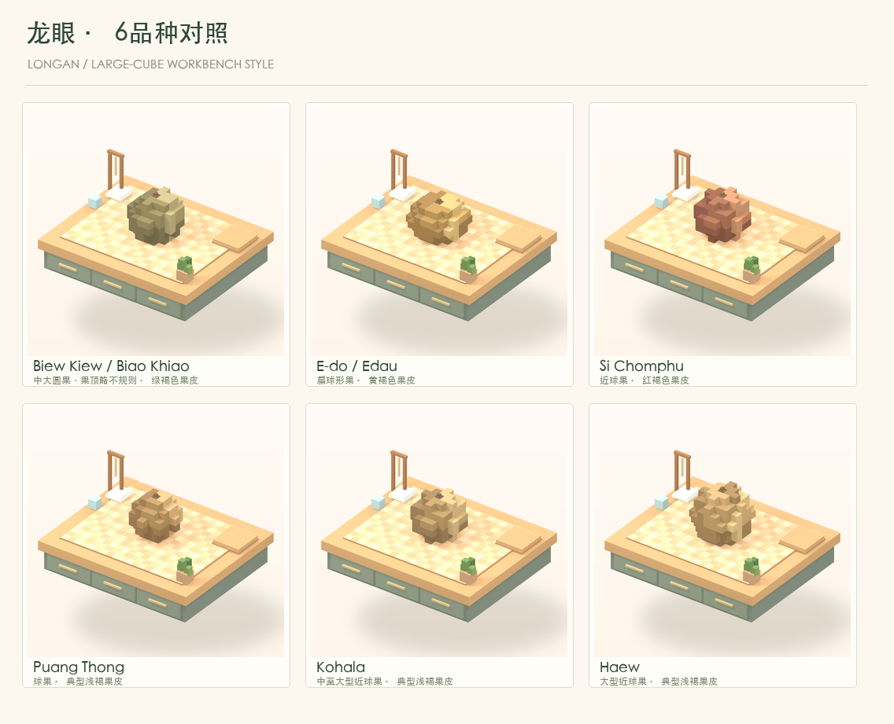

| id | name | shape 形状 | ripe colour 成熟色 | skin 果皮 | model |
| --- | --- | --- | --- | --- | --- |
| `LG-01_biew_kiew` | [Biew Kiew / Biao Khiao](https://www.doae.go.th/en/longan-2/) | 中大圆果，果顶略不规则 | 绿褐色果皮 | 平滑革质外壳 | [glb](models/LG-01_biew_kiew.glb) · [card](previews/LG-01_biew_kiew.png) · 10 × 9 × 10 cm |
| `LG-02_e_do` | [E-do / Edau](https://www.doae.go.th/en/longan-2/) | 扁球形果 | 黄褐色果皮 | 平滑革质外壳 | [glb](models/LG-02_e_do.glb) · [card](previews/LG-02_e_do.png) · 10 × 8 × 10 cm |
| `LG-03_si_chomphu` | [Si Chomphu](https://www.doae.go.th/en/longan-2/) | 近球果 | 红褐色果皮 | 平滑红褐外壳 | [glb](models/LG-03_si_chomphu.glb) · [card](previews/LG-03_si_chomphu.png) · 10 × 9 × 10 cm |
| `LG-04_puang_thong` | [Puang Thong](https://www.doae.go.th/en/longan-2/) | 球果 | 典型浅褐果皮 | 平滑革质外壳 | [glb](models/LG-04_puang_thong.glb) · [card](previews/LG-04_puang_thong.png) · 10 × 9 × 10 cm |
| `LG-05_kohala` | [Kohala](https://ask.ifas.ufl.edu/publication/MG049) | 中至大型近球果 | 典型浅褐果皮 | 平滑革质外壳 | [glb](models/LG-05_kohala.glb) · [card](previews/LG-05_kohala.png) · 10 × 9 × 10 cm |
| `LG-06_haew` | [Haew](https://ask.ifas.ufl.edu/publication/MG049) | 大型近球果 | 典型浅褐果皮 | 平滑革质外壳 | [glb](models/LG-06_haew.glb) · [card](previews/LG-06_haew.png) · 10 × 11 × 10 cm |

## Rambutan · 红毛丹

*Nephelium lappaceum* · family id `rambutan` · [reference](https://www.doae.go.th/en/rambutan/)

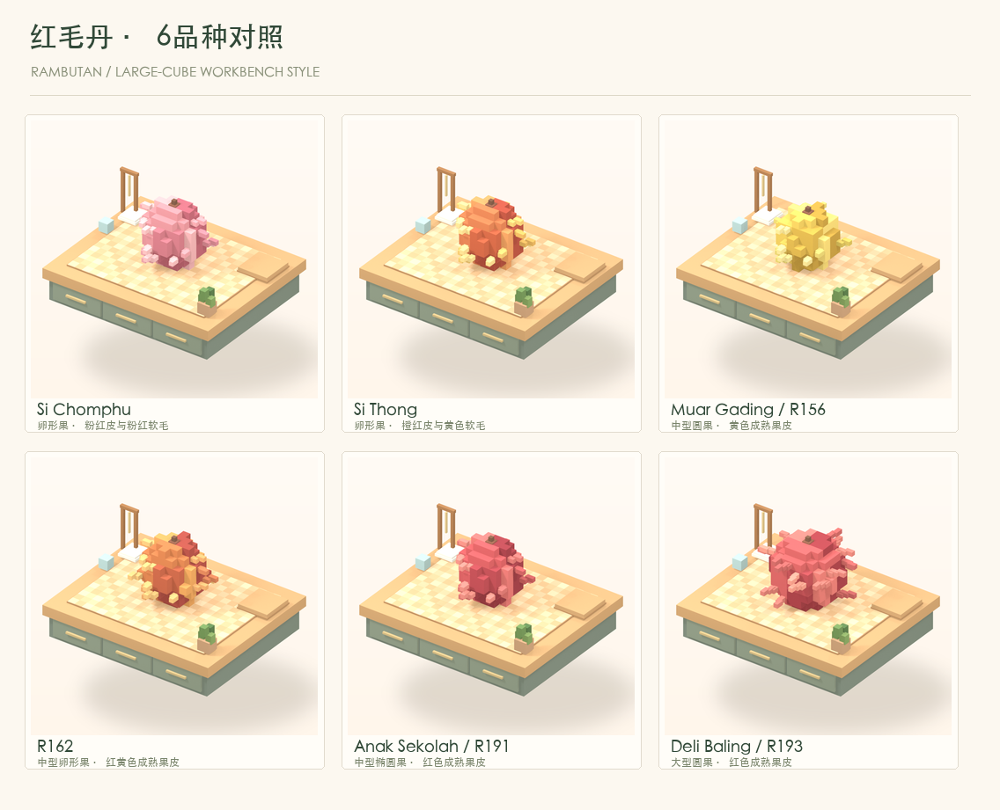

| id | name | shape 形状 | ripe colour 成熟色 | skin 果皮 | model |
| --- | --- | --- | --- | --- | --- |
| `RB-01_si_chomphu` | [Si Chomphu](https://www.doae.go.th/en/rambutan/) | 卵形果 | 粉红皮与粉红软毛 | 粉红皮、稀疏弯曲软毛 | [glb](models/RB-01_si_chomphu.glb) · [card](previews/RB-01_si_chomphu.png) · 14 × 12 × 13 cm |
| `RB-02_si_thong` | [Si Thong](https://www.doae.go.th/en/rambutan/) | 卵形果 | 橙红皮与黄色软毛 | 橙红皮、黄色弯曲软毛 | [glb](models/RB-02_si_thong.glb) · [card](previews/RB-02_si_thong.png) · 14 × 12 × 13 cm |
| `RB-03_muar_gading` | [Muar Gading / R156](https://www.doa.gov.my/doa/resources/perkhidmatan/skim_pensijilan/SPBT/pamplet_mengenali_varieti_rambutan_popular_di_Malaysia.pdf) | 中型圆果 | 黄色成熟果皮 | 黄皮、稀疏软毛 | [glb](models/RB-03_muar_gading.glb) · [card](previews/RB-03_muar_gading.png) · 14 × 11 × 13 cm |
| `RB-04_r162` | [R162](https://jpn.penang.gov.my/index.php?Itemid=43&id=71&lang=ms&option=com_content&view=article) | 中型卵形果 | 红黄色成熟果皮 | 红黄过渡皮、稀疏软毛 | [glb](models/RB-04_r162.glb) · [card](previews/RB-04_r162.png) · 14 × 12 × 13 cm |
| `RB-05_anak_sekolah` | [Anak Sekolah / R191](https://www.doa.gov.my/doa/resources/perkhidmatan/skim_pensijilan/SPBT/pamplet_mengenali_varieti_rambutan_popular_di_Malaysia.pdf) | 中型椭圆果 | 红色成熟果皮 | 红皮、稀疏软毛 | [glb](models/RB-05_anak_sekolah.glb) · [card](previews/RB-05_anak_sekolah.png) · 14 × 12 × 13 cm |
| `RB-06_deli_baling` | [Deli Baling / R193](https://www.doa.gov.my/doa/resources/perkhidmatan/skim_pensijilan/SPBT/pamplet_mengenali_varieti_rambutan_popular_di_Malaysia.pdf) | 大型圆果 | 红色成熟果皮 | 长而稀疏的柔软外毛 | [glb](models/RB-06_deli_baling.glb) · [card](previews/RB-06_deli_baling.png) · 17 × 12 × 16 cm |

## Pomelo · 柚子

*Citrus maxima* · family id `pomelo` · [reference](https://www.doae.go.th/en/pummelo-2/)

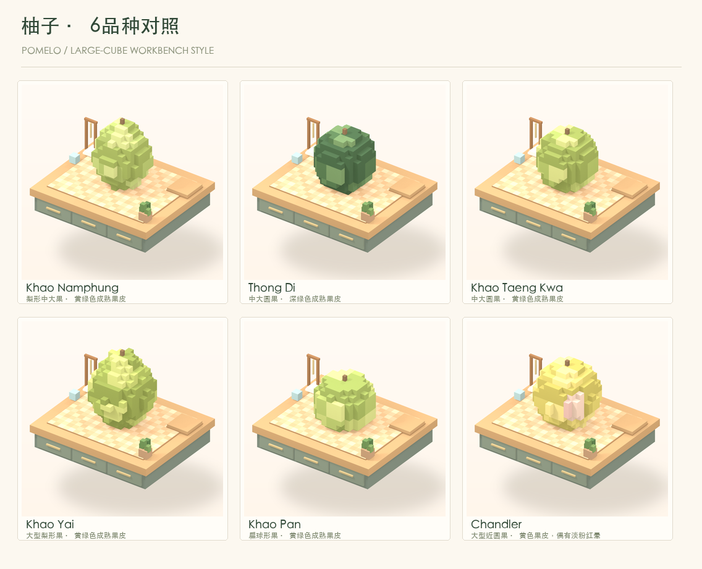

| id | name | shape 形状 | ripe colour 成熟色 | skin 果皮 | model |
| --- | --- | --- | --- | --- | --- |
| `PM-01_khao_namphung` | [Khao Namphung](https://www.doae.go.th/en/pummelo-2/) | 梨形中大果 | 黄绿色成熟果皮 | 黄绿色整果、上部收窄 | [glb](models/PM-01_khao_namphung.glb) · [card](previews/PM-01_khao_namphung.png) · 13 × 18 × 13 cm |
| `PM-02_thong_di` | [Thong Di](https://www.doae.go.th/en/pummelo-2/) | 中大圆果 | 深绿色成熟果皮 | 深绿圆果 | [glb](models/PM-02_thong_di.glb) · [card](previews/PM-02_thong_di.png) · 13 × 15 × 13 cm |
| `PM-03_khao_taeng_kwa` | [Khao Taeng Kwa](https://www.doae.go.th/en/pummelo-2/) | 中大圆果 | 黄绿色成熟果皮 | 黄绿圆果 | [glb](models/PM-03_khao_taeng_kwa.glb) · [card](previews/PM-03_khao_taeng_kwa.png) · 13 × 15 × 13 cm |
| `PM-04_khao_yai` | [Khao Yai](https://www.doae.go.th/en/pummelo-2/) | 大型梨形果 | 黄绿色成熟果皮 | 高身梨形、大型黄绿果 | [glb](models/PM-04_khao_yai.glb) · [card](previews/PM-04_khao_yai.png) · 15 × 20 × 15 cm |
| `PM-05_khao_pan` | [Khao Pan](https://www.doae.go.th/en/pummelo-2/) | 扁球形果 | 黄绿色成熟果皮 | 低矮扁圆黄绿果 | [glb](models/PM-05_khao_pan.glb) · [card](previews/PM-05_khao_pan.png) · 13 × 13 × 13 cm |
| `PM-06_chandler` | [Chandler](https://citrusvariety.ucr.edu/crc3244) | 大型近圆果 | 黄色果皮，偶有淡粉红晕 | 黄色圆果、局部淡粉晕 | [glb](models/PM-06_chandler.glb) · [card](previews/PM-06_chandler.png) · 15 × 17 × 15 cm |

## Guava · 番石榴

*Psidium guajava* · family id `guava` · [reference](https://fae.moa.gov.tw/map/food_item.php?id=86&type=AS01)

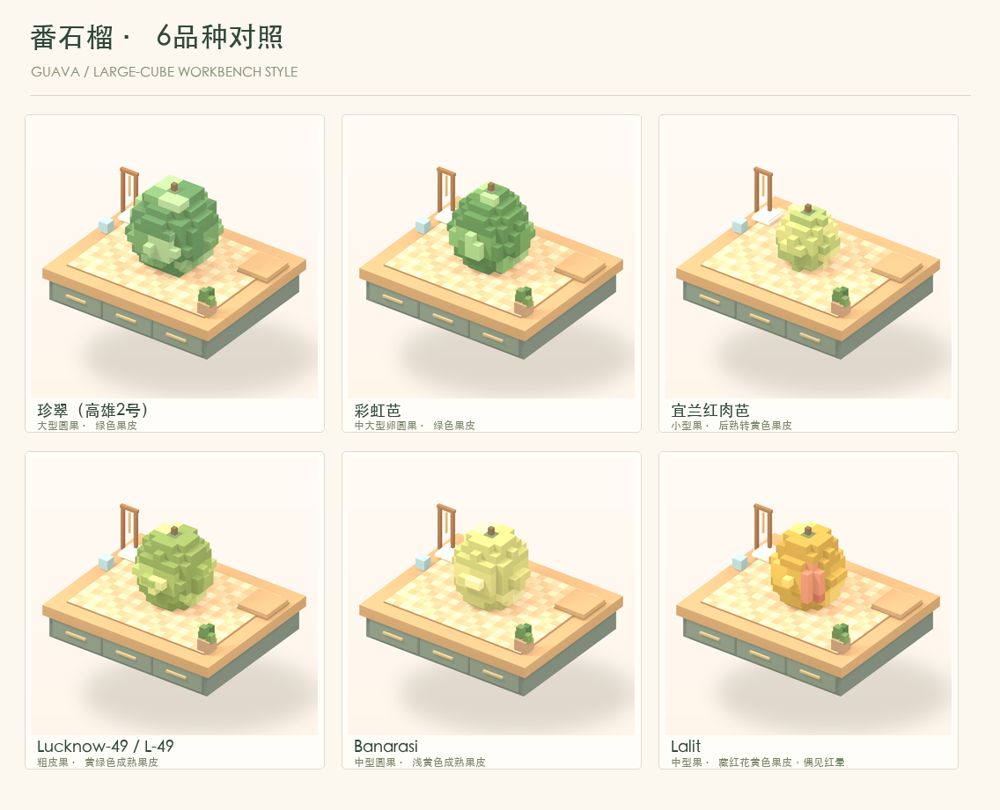

| id | name | shape 形状 | ripe colour 成熟色 | skin 果皮 | model |
| --- | --- | --- | --- | --- | --- |
| `GV-01_kaohsiung_2` | [珍翠（高雄2号）](https://www.moa.gov.tw/ws.php?id=2504332) | 大型圆果 | 绿色果皮 | 圆形绿果、少量宽钝凸起 | [glb](models/GV-01_kaohsiung_2.glb) · [card](previews/GV-01_kaohsiung_2.png) · 15 × 15 × 15 cm |
| `GV-02_rainbow` | [彩虹芭](https://kmweb.moa.gov.tw/subject/subject.php?id=11946&print=Y) | 中大型卵圆果 | 绿色果皮 | 上窄下宽的绿色卵圆果 | [glb](models/GV-02_rainbow.glb) · [card](previews/GV-02_rainbow.png) · 13 × 15 × 13 cm |
| `GV-03_yilan_red` | [宜兰红肉芭](https://fae.moa.gov.tw/theme_data.php?id=1816&sub_theme=material&theme=topics) | 小型果 | 后熟转黄色果皮 | 小型黄绿至黄色整果 | [glb](models/GV-03_yilan_red.glb) · [card](previews/GV-03_yilan_red.png) · 10 × 11 × 10 cm |
| `GV-04_lucknow_49` | [Lucknow-49 / L-49](https://nhb.gov.in/bulletin_files/fruits/guava/gua012.pdf) | 粗皮果 | 黄绿色成熟果皮 | 黄绿皮、稀疏宽钝粗面 | [glb](models/GV-04_lucknow_49.glb) · [card](previews/GV-04_lucknow_49.png) · 13 × 14 × 13 cm |
| `GV-05_banarasi` | [Banarasi](https://nhb.gov.in/bulletin_files/fruits/guava/gua012.pdf) | 中型圆果 | 浅黄色成熟果皮 | 平滑浅黄圆果 | [glb](models/GV-05_banarasi.glb) · [card](previews/GV-05_banarasi.png) · 13 × 14 × 13 cm |
| `GV-06_lalit` | [Lalit](https://icar.gov.in/sites/default/files/2023-02/Horticulturevolume-IIreadytocomm.pdf) | 中型果 | 藏红花黄色果皮，偶见红晕 | 金黄果皮、一侧局部红晕 | [glb](models/GV-06_lalit.glb) · [card](previews/GV-06_lalit.png) · 13 × 14 × 13 cm |

## Wax apple · 莲雾

*Syzygium samarangense* · family id `wax_apple` · [reference](https://fae.moa.gov.tw/map/food_item.php?id=126&type=AS01)

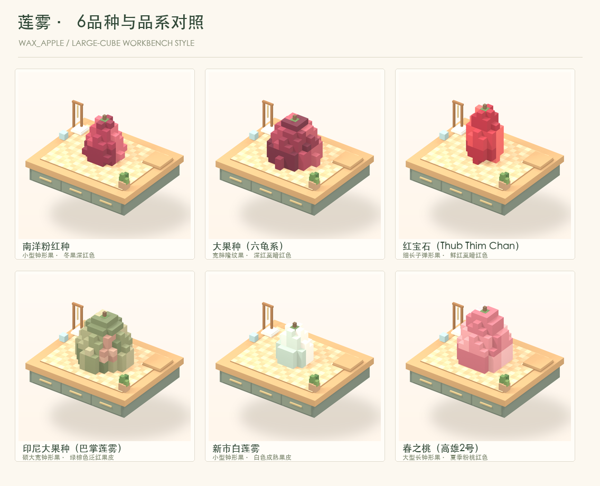

| id | name | shape 形状 | ripe colour 成熟色 | skin 果皮 | model |
| --- | --- | --- | --- | --- | --- |
| `WA-01_nanyang_pink` | [南洋粉红种](https://fae.moa.gov.tw/map/food_item.php?id=126&type=AS01) | 小型钟形果 | 冬果深红色 | 深红小钟形、平阔果底 | [glb](models/WA-01_nanyang_pink.glb) · [card](previews/WA-01_nanyang_pink.png) · 12 × 14 × 9 cm |
| `WA-02_large_fruit` | [大果种（六龟系）](https://fae.moa.gov.tw/map/food_item.php?id=126&type=AS01) | 宽胖隆纹果 | 深红至暗红色 | 宽胖深红钟形、四道宽隆纹 | [glb](models/WA-02_large_fruit.glb) · [card](previews/WA-02_large_fruit.png) · 16 × 14 × 16 cm |
| `WA-03_thub_thim_chan` | [红宝石（Thub Thim Chan）](https://fae.moa.gov.tw/map/food_item.php?id=126&type=AS01) | 细长子弹形果 | 鲜红至暗红色 | 细长鲜红果身 | [glb](models/WA-03_thub_thim_chan.glb) · [card](previews/WA-03_thub_thim_chan.png) · 9 × 17 × 9 cm |
| `WA-04_indonesian_large` | [印尼大果种（巴掌莲雾）](https://fae.moa.gov.tw/map/food_item.php?id=126&type=AS01) | 硕大宽钟形果 | 绿棕色泛红果皮 | 绿棕宽果、局部暖红面 | [glb](models/WA-04_indonesian_large.glb) · [card](previews/WA-04_indonesian_large.png) · 16 × 15 × 16 cm |
| `WA-05_xinshi_white` | [新市白莲雾](https://fae.moa.gov.tw/map/food_item.php?id=126&type=AS01) | 小型钟形果 | 白色成熟果皮 | 小型乳白果身 | [glb](models/WA-05_xinshi_white.glb) · [card](previews/WA-05_xinshi_white.png) · 9 × 12 × 9 cm |
| `WA-06_kaohsiung_2` | [春之桃（高雄2号）](https://kmweb.moa.gov.tw/theme_data.php?id=57813&sub_theme=variety&theme=news) | 大型长钟形果 | 夏季粉桃红色 | 大型长钟形、粉桃红果皮 | [glb](models/WA-06_kaohsiung_2.glb) · [card](previews/WA-06_kaohsiung_2.png) · 12 × 17 × 12 cm |

## Prickly pear & relatives · 仙人掌果与近缘类型

*Opuntia spp.* · family id `prickly_pear` · [reference](https://www.frontiersin.org/journals/sustainable-food-systems/articles/10.3389/fsufs.2020.00133/full)

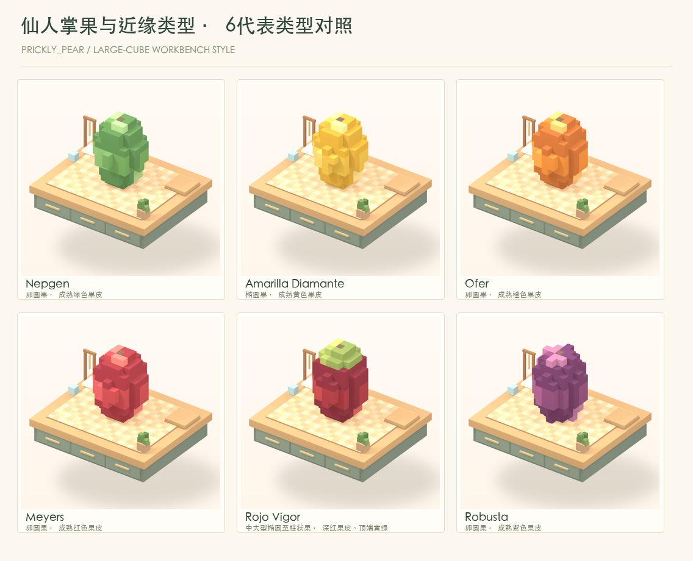

| id | name | shape 形状 | ripe colour 成熟色 | skin 果皮 | model |
| --- | --- | --- | --- | --- | --- |
| `PP-01_nepgen` | [Nepgen](https://www.frontiersin.org/journals/sustainable-food-systems/articles/10.3389/fsufs.2020.00133/full) | 卵圆果 | 成熟绿色果皮 | 绿色表皮，点状刺座 | [glb](models/PP-01_nepgen.glb) · [card](previews/PP-01_nepgen.png) · 12 × 18 × 12 cm |
| `PP-02_amarilla_diamante` | [Amarilla Diamante](https://www.scielo.org.mx/scielo.php?pid=S1405-31952010000700003&script=sci_arttext) | 椭圆果 | 成熟黄色果皮 | 金黄外皮，稀疏刺座 | [glb](models/PP-02_amarilla_diamante.glb) · [card](previews/PP-02_amarilla_diamante.png) · 12 × 18 × 12 cm |
| `PP-03_ofer` | [Ofer](https://www.frontiersin.org/journals/sustainable-food-systems/articles/10.3389/fsufs.2020.00133/full) | 卵圆果 | 成熟橙色果皮 | 橙色外皮，少量钝刺座 | [glb](models/PP-03_ofer.glb) · [card](previews/PP-03_ofer.png) · 12 × 18 × 12 cm |
| `PP-04_meyers` | [Meyers](https://www.frontiersin.org/journals/sustainable-food-systems/articles/10.3389/fsufs.2020.00133/full) | 卵圆果 | 成熟红色果皮 | 暖红外皮，少量点状刺座 | [glb](models/PP-04_meyers.glb) · [card](previews/PP-04_meyers.png) · 12 × 18 × 12 cm |
| `PP-05_rojo_vigor` | [Rojo Vigor](https://sidof.segob.gob.mx/notas/docFuente/5778500) | 中大型椭圆至柱状果 | 深红果皮、顶端黄绿 | 深红果腹与黄绿色果顶，光滑表面 | [glb](models/PP-05_rojo_vigor.glb) · [card](previews/PP-05_rojo_vigor.png) · 12 × 19 × 12 cm |
| `PP-06_robusta` | [Robusta](https://www.frontiersin.org/journals/sustainable-food-systems/articles/10.3389/fsufs.2020.00133/full) | 卵圆果 | 成熟紫色果皮 | 紫色外皮，点状刺座 | [glb](models/PP-06_robusta.glb) · [card](previews/PP-06_robusta.png) · 12 × 18 × 12 cm |

## Mulberry · 桑葚（果桑）

*Morus spp.* · family id `mulberry` · [reference](https://www.ttbz.org.cn/Home/PdfFileStreamGet/c3QsMTQ3ODAz)

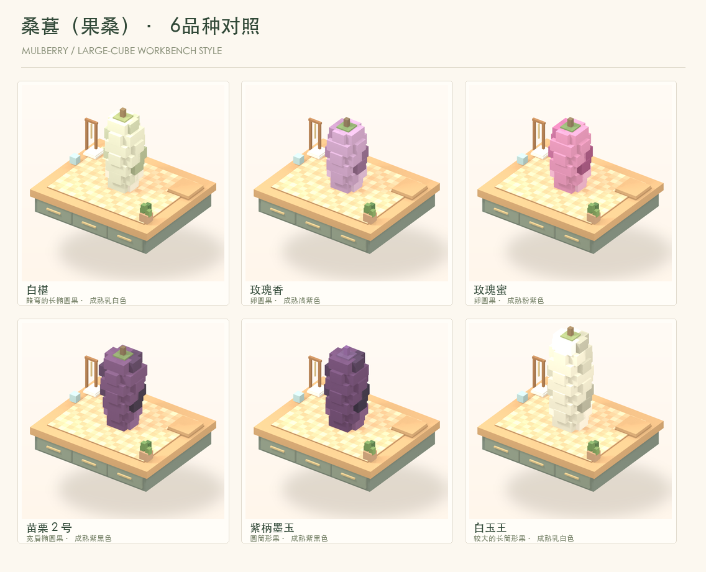

| id | name | shape 形状 | ripe colour 成熟色 | skin 果皮 | model |
| --- | --- | --- | --- | --- | --- |
| `MB-01_bai_shen` | [白椹](https://www.ttbz.org.cn/Home/PdfFileStreamGet/c3QsMTQ3ODAz) | 略弯的长椭圆果 | 成熟乳白色 | 乳白果粒、略弯果身 | [glb](models/MB-01_bai_shen.glb) · [card](previews/MB-01_bai_shen.png) · 8 × 21 × 9 cm |
| `MB-02_mei_gui_xiang` | [玫瑰香](https://www.ttbz.org.cn/Home/PdfFileStreamGet/c3QsMTQ3ODAz) | 卵圆果 | 成熟浅紫色 | 浅紫色聚合果粒 | [glb](models/MB-02_mei_gui_xiang.glb) · [card](previews/MB-02_mei_gui_xiang.png) · 9 × 18 × 9 cm |
| `MB-03_mei_gui_mi` | [玫瑰蜜](https://www.ttbz.org.cn/Home/PdfFileStreamGet/c3QsMTQ3ODAz) | 卵圆果 | 成熟粉紫色 | 粉紫色聚合果粒 | [glb](models/MB-03_mei_gui_mi.glb) · [card](previews/MB-03_mei_gui_mi.png) · 9 × 18 × 9 cm |
| `MB-04_miaoli_2` | [苗栗 2 号](https://www.moa.gov.tw/ws.php?id=2445709) | 宽肩椭圆果 | 成熟紫黑色 | 较宽果肩、紫黑色果粒 | [glb](models/MB-04_miaoli_2.glb) · [card](previews/MB-04_miaoli_2.png) · 10 × 21 × 10 cm |
| `MB-05_zi_bing_mo_yu` | [紫柄墨玉](https://www.ttbz.org.cn/Home/PdfFileStreamGet/c3QsMTQ3ODAz) | 圆筒形果 | 成熟紫黑色 | 紫黑果粒、紫色短果柄 | [glb](models/MB-05_zi_bing_mo_yu.glb) · [card](previews/MB-05_zi_bing_mo_yu.png) · 9 × 21 × 9 cm |
| `MB-06_bai_yu_wang` | [白玉王](https://www.ttbz.org.cn/Home/PdfFileStreamGet/c3QsMTQ3ODAz) | 较大的长筒形果 | 成熟乳白色 | 长筒形乳白聚合果 | [glb](models/MB-06_bai_yu_wang.glb) · [card](previews/MB-06_bai_yu_wang.png) · 10 × 26 × 9 cm |

## Blueberry · 蓝莓

*Vaccinium spp. and hybrids* · family id `blueberry` · [reference](https://extension.oregonstate.edu/catalog/pnw-656-blueberry-cultivars-pacific-northwest)

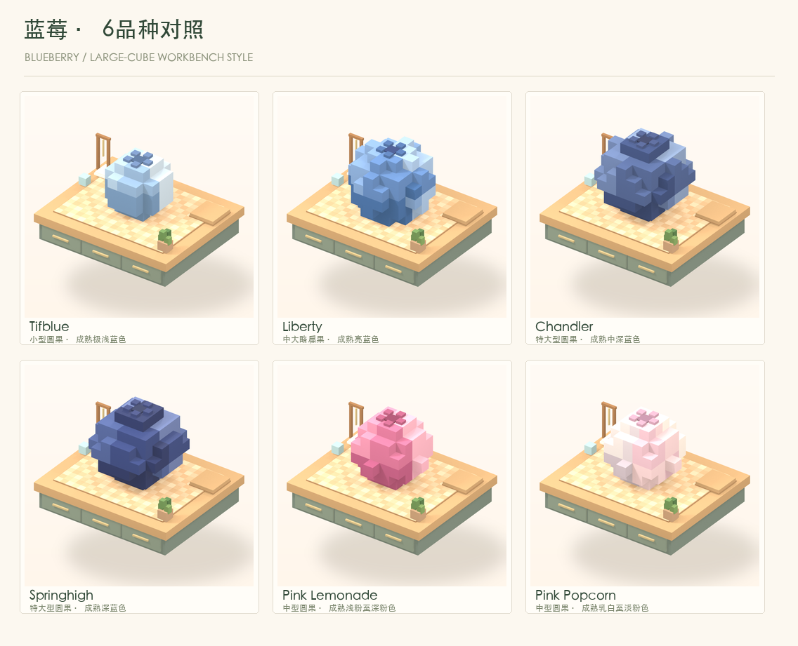

| id | name | shape 形状 | ripe colour 成熟色 | skin 果皮 | model |
| --- | --- | --- | --- | --- | --- |
| `BB-01_tifblue` | [Tifblue](https://extension.oregonstate.edu/catalog/pnw-656-blueberry-cultivars-pacific-northwest) | 小型圆果 | 成熟极浅蓝色 | 小果、浅蓝果粉与短萼冠 | [glb](models/BB-01_tifblue.glb) · [card](previews/BB-01_tifblue.png) · 12 × 13 × 12 cm |
| `BB-02_liberty` | [Liberty](https://extension.oregonstate.edu/catalog/pnw-656-blueberry-cultivars-pacific-northwest) | 中大略扁果 | 成熟亮蓝色 | 略扁亮蓝果身、短萼冠 | [glb](models/BB-02_liberty.glb) · [card](previews/BB-02_liberty.png) · 17 × 15 × 17 cm |
| `BB-03_chandler` | [Chandler](https://extension.oregonstate.edu/catalog/pnw-656-blueberry-cultivars-pacific-northwest) | 特大型圆果 | 成熟中深蓝色 | 大果、中蓝至深蓝皮色 | [glb](models/BB-03_chandler.glb) · [card](previews/BB-03_chandler.png) · 17 × 17 × 17 cm |
| `BB-04_springhigh` | [Springhigh](https://ask.ifas.ufl.edu/publication/MG359) | 特大型圆果 | 成熟深蓝色 | 果粉较少、较深的蓝色外观 | [glb](models/BB-04_springhigh.glb) · [card](previews/BB-04_springhigh.png) · 17 × 17 × 17 cm |
| `BB-05_pink_lemonade` | [Pink Lemonade](https://extension.oregonstate.edu/catalog/pnw-656-blueberry-cultivars-pacific-northwest) | 中型圆果 | 成熟浅粉至深粉色 | 粉色果皮、短萼冠 | [glb](models/BB-05_pink_lemonade.glb) · [card](previews/BB-05_pink_lemonade.png) · 17 × 15 × 17 cm |
| `BB-06_pink_popcorn` | [Pink Popcorn](https://extension.umn.edu/garden-and-home/yard-and-garden/gardening-in-minnesota/growing-blueberries-home-garden) | 中型圆果 | 成熟乳白至淡粉色 | 乳粉果皮、局部柔粉果面 | [glb](models/BB-06_pink_popcorn.glb) · [card](previews/BB-06_pink_popcorn.png) · 17 × 15 × 17 cm |

## Sea buckthorn · 沙棘

*Hippophae rhamnoides L.* · family id `sea_buckthorn` · [reference](https://www.frontiersin.org/journals/plant-science/articles/10.3389/fpls.2025.1542552/full)

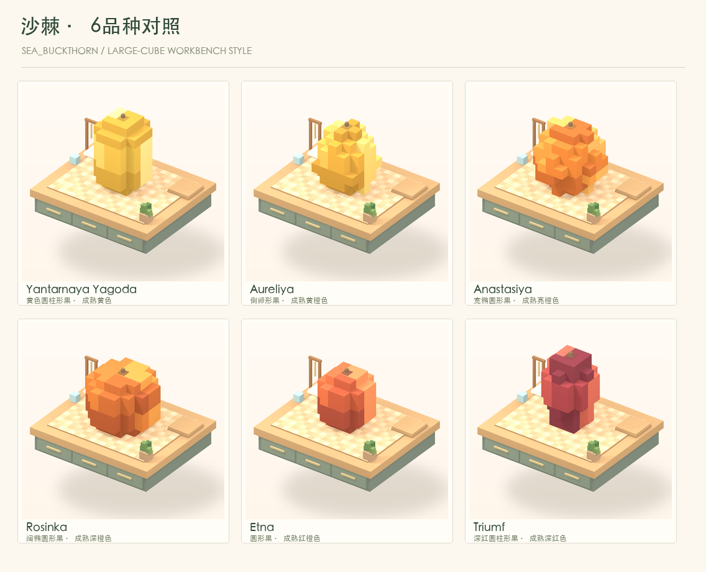

| id | name | shape 形状 | ripe colour 成熟色 | skin 果皮 | model |
| --- | --- | --- | --- | --- | --- |
| `SB-01_yantarnaya_yagoda` | [Yantarnaya Yagoda](https://www.frontiersin.org/journals/plant-science/articles/10.3389/fpls.2025.1542552/full) | 黄色圆柱形果 | 成熟黄色 | 明黄果身、短果柄 | [glb](models/SB-01_yantarnaya_yagoda.glb) · [card](previews/SB-01_yantarnaya_yagoda.png) · 12 × 20 × 12 cm |
| `SB-02_aureliya` | [Aureliya](https://www.frontiersin.org/journals/plant-science/articles/10.3389/fpls.2025.1542552/full) | 倒卵形果 | 成熟黄橙色 | 黄橙色、下部较宽 | [glb](models/SB-02_aureliya.glb) · [card](previews/SB-02_aureliya.png) · 12 × 17 × 12 cm |
| `SB-03_anastasiya` | [Anastasiya](https://www.frontiersin.org/journals/plant-science/articles/10.3389/fpls.2025.1542552/full) | 宽椭圆形果 | 成熟亮橙色 | 饱满宽椭圆、鲜亮橙皮 | [glb](models/SB-03_anastasiya.glb) · [card](previews/SB-03_anastasiya.png) · 16 × 17 × 16 cm |
| `SB-04_rosinka` | [Rosinka](https://www.frontiersin.org/journals/plant-science/articles/10.3389/fpls.2025.1542552/full) | 阔椭圆形果 | 成熟深橙色 | 较扁阔果身、深橙皮色 | [glb](models/SB-04_rosinka.glb) · [card](previews/SB-04_rosinka.png) · 16 × 15 × 16 cm |
| `SB-05_etna` | [Etna](https://www.frontiersin.org/journals/plant-science/articles/10.3389/fpls.2025.1542552/full) | 圆形果 | 成熟红橙色 | 小圆果、红橙果皮 | [glb](models/SB-05_etna.glb) · [card](previews/SB-05_etna.png) · 12 × 15 × 12 cm |
| `SB-06_triumf` | [Triumf](https://www.frontiersin.org/journals/plant-science/articles/10.3389/fpls.2025.1542552/full) | 深红圆柱形果 | 成熟深红色 | 细长深红果身 | [glb](models/SB-06_triumf.glb) · [card](previews/SB-06_triumf.png) · 12 × 20 × 12 cm |

## Hawthorn · 山楂

*Crataegus pinnatifida Bunge* · family id `hawthorn` · [reference](https://www.ccpnt.org/upload/file/20250425/20250425150212_60906.pdf)

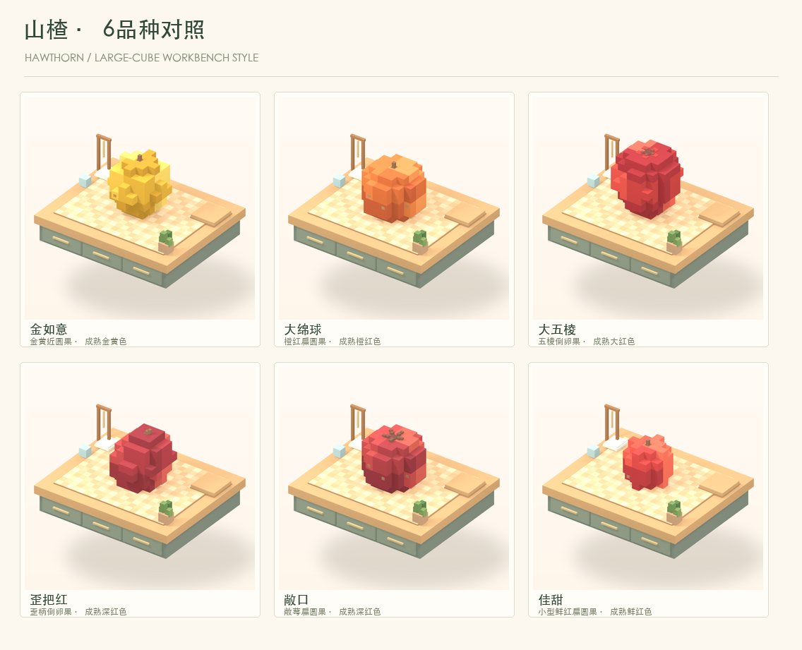

| id | name | shape 形状 | ripe colour 成熟色 | skin 果皮 | model |
| --- | --- | --- | --- | --- | --- |
| `HW-01_jin_ru_yi` | [金如意](https://www.ccpnt.org/upload/file/20250425/20250425150212_60906.pdf) | 金黄近圆果 | 成熟金黄色 | 近圆形金黄果皮，少量褐色果点 | [glb](models/HW-01_jin_ru_yi.glb) · [card](previews/HW-01_jin_ru_yi.png) · 12 × 13 × 12 cm |
| `HW-02_da_mian_qiu` | [大绵球](https://www.ccpnt.org/upload/file/20250425/20250425150212_60906.pdf) | 橙红扁圆果 | 成熟橙红色 | 较宽果肩、橙红果皮与褐色果点 | [glb](models/HW-02_da_mian_qiu.glb) · [card](previews/HW-02_da_mian_qiu.png) · 12 × 12 × 12 cm |
| `HW-03_da_wu_leng` | [大五棱](https://www.ccpnt.org/upload/file/20250425/20250425150212_60906.pdf) | 五棱倒卵果 | 成熟大红色 | 倒卵果身、果萼周围五条钝棱 | [glb](models/HW-03_da_wu_leng.glb) · [card](previews/HW-03_da_wu_leng.png) · 12 × 14 × 12 cm |
| `HW-04_wai_ba_hong` | [歪把红](https://www.ccpnt.org/upload/file/20250425/20250425150212_60906.pdf) | 歪柄倒卵果 | 成熟深红色 | 上窄下宽，偏斜果柄 | [glb](models/HW-04_wai_ba_hong.glb) · [card](previews/HW-04_wai_ba_hong.png) · 11 × 13 × 12 cm |
| `HW-05_chang_kou` | [敞口](https://www.ccpnt.org/upload/file/20250425/20250425150212_60906.pdf) | 敞萼扁圆果 | 成熟深红色 | 扁圆果身、向外展开的宿存萼片 | [glb](models/HW-05_chang_kou.glb) · [card](previews/HW-05_chang_kou.png) · 12 × 11 × 12 cm |
| `HW-06_jia_tian` | [佳甜](https://file2.foodmate.net/wenku2024/wfx202408061310.pdf) | 小型鲜红扁圆果 | 成熟鲜红色 | 小型扁圆果、稀少细果点 | [glb](models/HW-06_jia_tian.glb) · [card](previews/HW-06_jia_tian.png) · 9 × 10 × 9 cm |

## Cranberry · 蔓越莓

*Vaccinium macrocarpon Aiton* · family id `cranberry` · [reference](https://www.umass.edu/agriculture-food-environment/sites/ag.umass.edu/files/pdf-doc-ppt/cranberry_production_guide.pdf)

| id | name | shape 形状 | ripe colour 成熟色 | skin 果皮 | model |
| --- | --- | --- | --- | --- | --- |
| `CB-01_bergman` | [Bergman](https://www.umass.edu/agriculture-food-environment/sites/ag.umass.edu/files/pdf-doc-ppt/cranberry_production_guide.pdf) | 短梨形果 | 成熟亮红色 | 短梨形，亮红有光泽 | [glb](models/CB-01_bergman.glb) · [card](previews/CB-01_bergman.png) · 12 × 11 × 12 cm |
| `CB-02_crowley` | [Crowley](https://www.umass.edu/agriculture-food-environment/sites/ag.umass.edu/files/pdf-doc-ppt/cranberry_production_guide.pdf) | 扁圆果 | 成熟深红色 | 深红扁圆，果萼端较平 | [glb](models/CB-02_crowley.glb) · [card](previews/CB-02_crowley.png) · 12 × 9 × 12 cm |
| `CB-03_pilgrim` | [Pilgrim](https://www.agrifoodbc.ca/productionguide_subdomain/guides/14/section/25/) | 长椭圆果 | 成熟紫红色 | 紫红果皮、局部黄底色与明显果粉 | [glb](models/CB-03_pilgrim.glb) · [card](previews/CB-03_pilgrim.png) · 9 × 15 × 9 cm |
| `CB-04_wilcox` | [Wilcox](https://www.umass.edu/agriculture-food-environment/sites/ag.umass.edu/files/pdf-doc-ppt/cranberry_production_guide.pdf) | 尖柄椭圆果 | 成熟深红色 | 椭圆果身、尖柄端，少量纵向杂色 | [glb](models/CB-04_wilcox.glb) · [card](previews/CB-04_wilcox.png) · 9 × 13 × 9 cm |
| `CB-05_hyred` | [HyRed](https://active.inspection.gc.ca/english/plaveg/pbrpov/cropreport/cran/app00005105e.shtml) | 方肩椭圆果 | 成熟浓红色 | 椭圆至近圆，果肩方正且着色均匀 | [glb](models/CB-05_hyred.glb) · [card](previews/CB-05_hyred.png) · 12 × 13 × 12 cm |
| `CB-06_mullica_queen` | [Mullica Queen](https://archive.sebs.rutgers.edu/wp-content/uploads/2010-08-ACGA-Summaries-Summer.pdf) | 大型宽椭圆果 | 成熟深红色 | 大颗宽椭圆、光亮且果粉少 | [glb](models/CB-06_mullica_queen.glb) · [card](previews/CB-06_mullica_queen.png) · 12 × 13 × 12 cm |

## Currant & blackcurrant · 穗醋栗与黑加仑

*Ribes rubrum（红、粉、白）与 Ribes nigrum（黑）* · family id `currant` · [reference](https://extension.umn.edu/garden-and-home/yard-and-garden/gardening-in-minnesota/growing-currants-and-gooseberries-in-the-home-garden)

| id | name | shape 形状 | ripe colour 成熟色 | skin 果皮 | model |
| --- | --- | --- | --- | --- | --- |
| `CU-01_red_lake` | [Red Lake](https://extension.psu.edu/home-fruit-plantings-gooseberry-and-currant-variety-selection) | 亮红长柄果穗 | 成熟亮红色 | 大颗亮红果、长柄果穗 | [glb](models/CU-01_red_lake.glb) · [card](previews/CU-01_red_lake.png) · 8 × 16 × 5 cm |
| `CU-02_rovada` | [Rovada](https://www.rhs.org.uk/plants/73881/ribes-rubrum-rovada-r/details) | 长穗红果 | 成熟红色 | 长果穗、大颗红果 | [glb](models/CU-02_rovada.glb) · [card](previews/CU-02_rovada.png) · 8 × 19 × 5 cm |
| `CU-03_pink_champagne` | [Pink Champagne](https://extension.umn.edu/garden-and-home/yard-and-garden/gardening-in-minnesota/growing-currants-and-gooseberries-in-the-home-garden) | 粉色果穗 | 成熟粉色 | 柔粉果皮、普通穗形 | [glb](models/CU-03_pink_champagne.glb) · [card](previews/CU-03_pink_champagne.png) · 8 × 14 × 5 cm |
| `CU-04_blanka` | [Blanka](https://www.rhs.org.uk/plants/109083/ribes-rubrum-blanka-w/details) | 象牙白大果穗 | 成熟透明象牙白 | 较大乳白果、浅金阴影 | [glb](models/CU-04_blanka.glb) · [card](previews/CU-04_blanka.png) · 9 × 17 × 5 cm |
| `CU-05_white_imperial` | [White Imperial](https://extension.umn.edu/garden-and-home/yard-and-garden/gardening-in-minnesota/growing-currants-and-gooseberries-in-the-home-garden) | 粉白中果穗 | 成熟粉白色 | 中等果粒、带淡粉的白色果皮 | [glb](models/CU-05_white_imperial.glb) · [card](previews/CU-05_white_imperial.png) · 8 × 14 × 5 cm |
| `CU-06_ben_sarek` | [Ben Sarek](https://www.rhs.org.uk/fruit/blackcurrants/grow-your-own) | 短穗大黑果 | 成熟紫黑色 | 短果穗、较大近黑果 | [glb](models/CU-06_ben_sarek.glb) · [card](previews/CU-06_ben_sarek.png) · 9 × 14 × 5 cm |

## Blackberry & hybrid berries · 黑莓与杂交莓

*Rubus spp.；含黑莓与红树莓杂交类型* · family id `blackberry` · [reference](https://extension.oregonstate.edu/sites/extd8/files/documents/ec1617.pdf)

| id | name | shape 形状 | ripe colour 成熟色 | skin 果皮 | model |
| --- | --- | --- | --- | --- | --- |
| `BB-01_logan` | [Logan / Loganberry](https://extension.oregonstate.edu/sites/extd8/files/documents/ec1617.pdf) | 深红锥形聚合果 | 成熟深红色 | 中型锥果、深红大果粒 | [glb](models/BB-01_logan.glb) · [card](previews/BB-01_logan.png) · 11 × 13 × 10 cm |
| `BB-02_tayberry` | [Tayberry](https://pubs.nmsu.edu/_h/H326/) | 红紫长锥形聚合果 | 成熟红紫色 | 较长锥果、红紫光亮果粒 | [glb](models/BB-02_tayberry.glb) · [card](previews/BB-02_tayberry.png) · 10 × 15 × 10 cm |
| `BB-03_boysen` | [Boysen / Boysenberry](https://extension.oregonstate.edu/sites/extd8/files/documents/ec1617.pdf) | 大型不规则紫果 | 成熟紫色 | 大颗松软果、果粒起伏较明显 | [glb](models/BB-03_boysen.glb) · [card](previews/BB-03_boysen.png) · 13 × 13 × 13 cm |
| `BB-04_marion` | [Marion / Marionberry](https://extension.oregonstate.edu/sites/extd8/files/documents/ec1617.pdf) | 深紫不规则果 | 成熟深紫色 | 中型深紫果、轮廓略不匀 | [glb](models/BB-04_marion.glb) · [card](previews/BB-04_marion.png) · 11 × 13 × 11 cm |
| `BB-05_ouachita` | [Ouachita](https://extension.oregonstate.edu/sites/extd8/files/documents/ec1617.pdf) | 亮黑圆形果 | 成熟黑色 | 中型圆果、黑亮果粒 | [glb](models/BB-05_ouachita.glb) · [card](previews/BB-05_ouachita.png) · 11 × 11 × 10 cm |
| `BB-06_loch_ness` | [Loch Ness](https://extension.oregonstate.edu/sites/extd8/files/documents/ec1617.pdf) | 亮黑长圆果 | 成熟黑色 | 中型长圆果、光亮黑皮 | [glb](models/BB-06_loch_ness.glb) · [card](previews/BB-06_loch_ness.png) · 10 × 15 × 10 cm |

## Grapefruit & related hybrids · 葡萄柚与近缘杂交果

*Citrus × paradisi；另含其与柚的杂交种* · family id `grapefruit` · [reference](https://citrusvariety.ucr.edu/crc3832)

| id | name | shape 形状 | ripe colour 成熟色 | skin 果皮 | model |
| --- | --- | --- | --- | --- | --- |
| `GF-01_duncan` | [Duncan](https://citrusvariety.ucr.edu/crc3832) | 大型近圆葡萄柚 | 成熟浅黄色 | 大果、近圆、光滑浅黄皮 | [glb](models/GF-01_duncan.glb) · [card](previews/GF-01_duncan.png) · 15 × 15 × 15 cm |
| `GF-02_redblush` | [Redblush / Ruby](https://citrusvariety.ucr.edu/crc2850) | 局部绯红晕扁圆果 | 成熟黄皮带红晕 | 黄色外皮、接触面局部绯红 | [glb](models/GF-02_redblush.glb) · [card](previews/GF-02_redblush.png) · 13 × 14 × 13 cm |
| `GF-03_star_ruby` | [Star Ruby](https://citrusvariety.ucr.edu/crc3770) | 较小圆果带红晕 | 成熟黄皮带红晕 | 较小、光滑黄皮、局部红晕 | [glb](models/GF-03_star_ruby.glb) · [card](previews/GF-03_star_ruby.png) · 13 × 13 × 13 cm |
| `GF-04_rio_red` | [Rio Red](https://citrusvariety.ucr.edu/crc3916) | 大颗微粗面葡萄柚 | 成熟黄皮带粉晕 | 大果、略起伏黄皮、接触面粉晕 | [glb](models/GF-04_rio_red.glb) · [card](previews/GF-04_rio_red.png) · 15 × 15 × 15 cm |
| `GF-05_oroblanco` | [Oroblanco](https://citrusvariety.ucr.edu/crc3602) | 黄绿扁圆杂交果 | 成熟黄绿色 | 平滑黄绿皮、扁圆、柄端明显凹陷 | [glb](models/GF-05_oroblanco.glb) · [card](previews/GF-05_oroblanco.png) · 15 × 13 × 15 cm |
| `GF-06_melogold` | [Melogold](https://citrusvariety.ucr.edu/crc3764) | 大颗金黄杂交果 | 成熟金黄色 | 显著大于 Oroblanco、金黄皮 | [glb](models/GF-06_melogold.glb) · [card](previews/GF-06_melogold.png) · 15 × 15 × 15 cm |

## Mangosteen & Garcinia · 山竹与近缘藤黄果

*Garcinia mangostana 及藤黄属其他近缘物种* · family id `garcinia` · [reference](https://ask.ifas.ufl.edu/publication/HS1480)

| id | name | shape 形状 | ripe colour 成熟色 | skin 果皮 | model |
| --- | --- | --- | --- | --- | --- |
| `GA-01_mangosteen` | [山竹 / Mangosteen](https://postharvest.ucdavis.edu/produce-facts-sheets/mangosteen) | 紫红圆果配四枚宿萼 | 成熟紫红色 | 圆形厚皮、柄端四枚绿色宿萼 | [glb](models/GA-01_mangosteen.glb) · [card](previews/GA-01_mangosteen.png) · 13 × 15 × 13 cm |
| `GA-02_achachairu` | [阿恰恰 / Achachairu](https://ask.ifas.ufl.edu/publication/HS1462) | 橙色泪滴形果 | 成熟橙色 | 橙皮、泪滴形、中大果 | [glb](models/GA-02_achachairu.glb) · [card](previews/GA-02_achachairu.png) · 13 × 15 × 13 cm |
| `GA-03_prainiana` | [按钮山竹 / Cherapu](https://pmc.ncbi.nlm.nih.gov/articles/PMC10748532/) | 橙黄扁圆按钮果 | 成熟黄橙色 | 小型光亮扁圆果、顶端纽扣状柱头 | [glb](models/GA-03_prainiana.glb) · [card](previews/GA-03_prainiana.png) · 10 × 10 × 10 cm |
| `GA-04_madruno` | [马德鲁诺 / Madruno](https://www.mobot.org/Manual.Plantas/008714/S009071.html) | 粗面长椭圆黄果 | 成熟柠檬黄色 | 长椭圆、亮黄粗面果皮 | [glb](models/GA-04_madruno.glb) · [card](previews/GA-04_madruno.png) · 10 × 14 × 10 cm |
| `GA-05_livingstonei` | [非洲山竹 / Imbe](https://powo.science.kew.org/taxon/urn:lsid:ipni.org:names:428049-1/general-information) | 小型橙红卵圆果 | 成熟橙红色 | 小果、卵圆至圆形、橙红皮 | [glb](models/GA-05_livingstonei.glb) · [card](previews/GA-05_livingstonei.png) · 7 × 10 × 7 cm |
| `GA-06_xanthochymus` | [酸山竹果 / Sour Mangosteen](https://www.nparks.gov.sg/florafaunaweb/flora/2/9/2931) | 大型金黄尖顶果 | 成熟金黄色 | 较大、近球形、果顶小尖与宿存柱头 | [glb](models/GA-06_xanthochymus.glb) · [card](previews/GA-06_xanthochymus.png) · 15 × 14 × 15 cm |

## Pepino melon · 人参果（香瓜茄）

*Solanum muricatum Aiton* · family id `pepino` · [reference](https://crfg.org/homepage/library/fruitfacts/pepino-dulce/)

| id | name | shape 形状 | ripe colour 成熟色 | skin 果皮 | model |
| --- | --- | --- | --- | --- | --- |
| `PE-01_colossal` | [Colossal](https://crfg.org/homepage/library/fruitfacts/pepino-dulce/) | 巨型浅奶油色圆果 | 成熟奶油色带浅紫纹 | 体量大、浅奶油皮、很淡紫色纹片 | [glb](models/PE-01_colossal.glb) · [card](previews/PE-01_colossal.png) · 15 × 18 × 15 cm |
| `PE-02_el_camino` | [El Camino](https://crfg.org/homepage/library/fruitfacts/pepino-dulce/) | 规则紫纹卵形果 | 成熟黄底紫纹 | 中大卵形、规则纵向紫纹 | [glb](models/PE-02_el_camino.glb) · [card](previews/PE-02_el_camino.png) · 13 × 16 × 13 cm |
| `PE-03_miski_prolific` | [Miski Prolific](https://crfg.org/homepage/library/fruitfacts/pepino-dulce/) | 奶白果带淡粉晕 | 成熟奶白色带浅紫纹 | 乳白外皮、轻微鲑粉晕与稀疏紫纹 | [glb](models/PE-03_miski_prolific.glb) · [card](previews/PE-03_miski_prolific.png) · 13 × 14 × 13 cm |
| `PE-04_new_yorker` | [New Yorker](https://crfg.org/homepage/library/fruitfacts/pepino-dulce/) | 金黄尖端椭圆果 | 成熟金黄皮深紫纹 | 光滑金黄外皮、尖端、深紫纵纹 | [glb](models/PE-04_new_yorker.glb) · [card](previews/PE-04_new_yorker.png) · 13 × 16 × 13 cm |
| `PE-05_toma` | [Toma](https://crfg.org/homepage/library/fruitfacts/pepino-dulce/) | 奶油色尖端椭圆果 | 成熟奶油色深紫纹 | 中型椭圆、圆肩尖端、显著深紫条纹 | [glb](models/PE-05_toma.glb) · [card](previews/PE-05_toma.png) · 13 × 16 × 13 cm |
| `PE-06_cascade_gold` | [Cascade Gold](https://patents.justia.com/patent/PP7643) | 心形黄绿果带紫斑 | 成熟黄至黄绿带紫斑 | 宽心形、黄绿底、非规则紫色斑片 | [glb](models/PE-06_cascade_gold.glb) · [card](previews/PE-06_cascade_gold.png) · 13 × 16 × 13 cm |

## Tamarillo · 树番茄（Tamarillo）

*Solanum betaceum Cav.（旧称 Cyphomandra betacea）* · family id `tamarillo` · [reference](https://crfg.org/homepage/library/fruitfacts/tamarillo/)

| id | name | shape 形状 | ripe colour 成熟色 | skin 果皮 | model |
| --- | --- | --- | --- | --- | --- |
| `TA-01_ecuadorian_orange` | [Ecuadorian Orange](https://crfg.org/homepage/library/fruitfacts/tamarillo/) | 中型橙色卵形果 | 成熟橙色 | 鸡蛋大小、橙色光滑外皮 | [glb](models/TA-01_ecuadorian_orange.glb) · [card](previews/TA-01_ecuadorian_orange.png) · 10 × 17 × 10 cm |
| `TA-02_goldmine` | [Goldmine](https://crfg.org/homepage/library/fruitfacts/tamarillo/) | 巨型金黄长卵果 | 成熟金黄色 | 显著大果、金黄色外皮 | [glb](models/TA-02_goldmine.glb) · [card](previews/TA-02_goldmine.png) · 13 × 21 × 13 cm |
| `TA-03_amber` | [Amber](https://www.tamarillo.com/varieties) | 琥珀金皮带红晕 | 成熟金黄带红晕 | 中型金黄外皮、局部暖红晕 | [glb](models/TA-03_amber.glb) · [card](previews/TA-03_amber.png) · 10 × 16 × 10 cm |
| `TA-04_oratia_red` | [Oratia Red](https://crfg.org/homepage/library/fruitfacts/tamarillo/) | 大型宽圆红果 | 成熟红色 | 大果、椭圆至近圆、红色外皮 | [glb](models/TA-04_oratia_red.glb) · [card](previews/TA-04_oratia_red.png) · 13 × 16 × 13 cm |
| `TA-05_lairds_large` | [Laird’s Large](https://www.sciencedirect.com/science/article/pii/S088915752030363X) | 大型红色长卵果 | 成熟红色 | 大颗红果、常见树番茄卵形 | [glb](models/TA-05_lairds_large.glb) · [card](previews/TA-05_lairds_large.png) · 13 × 20 × 10 cm |
| `TA-06_mulligan` | [Mulligan](https://www.sciencedirect.com/science/article/pii/S088915752030363X) | 小型深紫红果 | 成熟紫红色 | 较小、浓紫红色外皮 | [glb](models/TA-06_mulligan.glb) · [card](previews/TA-06_mulligan.png) · 7 × 14 × 7 cm |

## Avocado · 牛油果

*Persea americana* · family id `avocado` · [reference](https://californiaavocado.com/avocado101/avocado-varieties/)

| id | name | shape 形状 | ripe colour 成熟色 | skin 果皮 | model |
| --- | --- | --- | --- | --- | --- |
| `AV-01_hass` | [哈斯 Hass](https://californiaavocado.com/avocado101/avocado-varieties/) | 椭圆 | 成熟紫黑果皮 | 粗颗粒 · 熟后变暗 | [glb](models/AV-01_hass.glb) · [card](previews/AV-01_hass.png) · 11 × 16 × 11 cm |
| `AV-02_fuerte` | [富尔特 Fuerte](https://californiaavocado.com/avocado101/avocado-varieties/) | 梨形 | 成熟绿色果皮 | 梨形 · 光滑绿皮 | [glb](models/AV-02_fuerte.glb) · [card](previews/AV-02_fuerte.png) · 11 × 17 × 11 cm |
| `AV-03_pinkerton` | [平克顿 Pinkerton](https://californiaavocado.com/avocado101/avocado-varieties/) | 长梨形 | 成熟深绿果皮 | 细长 · 可见长颈 | [glb](models/AV-03_pinkerton.glb) · [card](previews/AV-03_pinkerton.png) · 8 × 20 × 8 cm |
| `AV-04_reed` | [里德 Reed](https://californiaavocado.com/avocado101/avocado-varieties/) | 近圆形 | 成熟绿色果皮 | 接近球形 · 大果 | [glb](models/AV-04_reed.glb) · [card](previews/AV-04_reed.png) · 14 × 15 × 14 cm |
| `AV-05_bacon` | [培根 Bacon](https://californiaavocado.com/avocado101/avocado-varieties/) | 椭圆 | 成熟绿色果皮 | 椭圆 · 光滑绿皮 | [glb](models/AV-05_bacon.glb) · [card](previews/AV-05_bacon.png) · 11 × 16 × 8 cm |
| `AV-06_gwen` | [格温 Gwen](https://californiaavocado.com/avocado101/avocado-varieties/) | 饱满椭圆 | 成熟绿色果皮 | 饱满椭圆 · 绿颗粒皮 | [glb](models/AV-06_gwen.glb) · [card](previews/AV-06_gwen.png) · 14 × 16 × 11 cm |
| `AV-07_lamb_hass` | [兰姆哈斯 Lamb Hass](https://californiaavocado.com/avocado101/avocado-varieties/) | 宽肩椭圆 | 成熟紫黑果皮 | 果肩较宽 · 大果 | [glb](models/AV-07_lamb_hass.glb) · [card](previews/AV-07_lamb_hass.png) · 11 × 17 × 11 cm |
| `AV-08_zutano` | [祖塔诺 Zutano](https://californiaavocado.com/avocado101/avocado-varieties/) | 梨形 | 成熟黄绿果皮 | 亮黄绿 · 梨形 | [glb](models/AV-08_zutano.glb) · [card](previews/AV-08_zutano.png) · 11 × 17 × 8 cm |
| `AV-09_gem` | [吉姆 GEM](https://techtransfer.universityofcalifornia.edu/NCD/29646.html) | 椭圆 | 成熟黑色果皮 | 厚皮 · 黑色带金色皮孔 | [glb](models/AV-09_gem.glb) · [card](previews/AV-09_gem.png) · 11 × 16 × 11 cm |
| `AV-10_shepard` | [谢泼德 Shepard](https://era.dpi.qld.gov.au/1642/12/07-avo-variety.pdf) | 梨形 | 成熟绿色果皮 | 成熟仍绿 · 梨形 | [glb](models/AV-10_shepard.glb) · [card](previews/AV-10_shepard.png) · 11 × 17 × 8 cm |
| `AV-11_mexicola` | [墨西哥拉 Mexicola](https://ucanr.edu/sites/alternativefruits/files/173003.pdf) | 倒卵形 | 成熟黑色果皮 | 小果 · 薄黑皮 | [glb](models/AV-11_mexicola.glb) · [card](previews/AV-11_mexicola.png) · 8 × 13 × 8 cm |
| `AV-12_sharwil` | [夏威尔 Sharwil](https://era.dpi.qld.gov.au/1642/12/07-avo-variety.pdf) | 椭圆 | 成熟绿色果皮 | 椭圆 · 成熟仍绿 | [glb](models/AV-12_sharwil.glb) · [card](previews/AV-12_sharwil.png) · 11 × 16 × 11 cm |

## Cacao pod · 可可果

*Theobroma cacao；CATIE 记录的六个克隆系* · family id `cacao` · [reference](https://www.cacaonet.org/fileadmin/templates/CacaoNet/Uploads/publications/CatalogueofClones_ENGLISH.pdf)

| id | name | shape 形状 | ripe colour 成熟色 | skin 果皮 | model |
| --- | --- | --- | --- | --- | --- |
| `CA-01_catie_r1` | [CATIE-R1](https://www.cacaonet.org/fileadmin/templates/CacaoNet/Uploads/publications/CatalogueofClones_ENGLISH.pdf) | 长卵形、两端渐尖 | 成熟橙色带黄色区域 | 较明显的宽纵棱 | [glb](models/CA-01_catie_r1.glb) · [card](previews/CA-01_catie_r1.png) · 11 × 21 × 10 cm |
| `CA-02_catie_r4` | [CATIE-R4](https://www.cacaonet.org/fileadmin/templates/CacaoNet/Uploads/publications/CatalogueofClones_ENGLISH.pdf) | 长卵形、收尖 | 成熟黄色带橙红小斑 | 较明显的宽纵棱 | [glb](models/CA-02_catie_r4.glb) · [card](previews/CA-02_catie_r4.png) · 11 × 23 × 13 cm |
| `CA-03_catie_r6` | [CATIE-R6](https://www.cacaonet.org/fileadmin/templates/CacaoNet/Uploads/publications/CatalogueofClones_ENGLISH.pdf) | 较短长卵形 | 成熟黄色带橙红小斑 | 浅纵棱 | [glb](models/CA-03_catie_r6.glb) · [card](previews/CA-03_catie_r6.png) · 10 × 20 × 10 cm |
| `CA-04_cc137` | [CC-137](https://www.cacaonet.org/fileadmin/templates/CacaoNet/Uploads/publications/CatalogueofClones_ENGLISH.pdf) | 宽卵形 | 成熟黄色 | 浅色宽棱 | [glb](models/CA-04_cc137.glb) · [card](previews/CA-04_cc137.png) · 10 × 18 × 10 cm |
| `CA-05_ics95_t1` | [ICS-95 T1](https://www.cacaonet.org/fileadmin/templates/CacaoNet/Uploads/publications/CatalogueofClones_ENGLISH.pdf) | 修长、尖端较锐 | 成熟橙色带黄色 | 中等起伏的纵棱 | [glb](models/CA-05_ics95_t1.glb) · [card](previews/CA-05_ics95_t1.png) · 10 × 24 × 10 cm |
| `CA-06_pmct58` | [PMCT-58](https://www.cacaonet.org/fileadmin/templates/CacaoNet/Uploads/publications/CatalogueofClones_ENGLISH.pdf) | 短宽卵形、钝端 | 成熟橙色带黄色 | 浅纵棱 | [glb](models/CA-06_pmct58.glb) · [card](previews/CA-06_pmct58.png) · 10 × 18 × 10 cm |

## Breadfruit · 面包果

*Artocarpus altilis；六个栽培品种* · family id `breadfruit` · [reference](https://ntbg.org/database/breadfruit)

| id | name | shape 形状 | ripe colour 成熟色 | skin 果皮 | model |
| --- | --- | --- | --- | --- | --- |
| `BF-01_maafala` | [Ma'afala](https://ntbg.org/database/breadfruit/detail/ma-afala) | 小型椭圆 | 可烹成熟期黄绿色 | 砂面、轻微不规则凸块 | [glb](models/BF-01_maafala.glb) · [card](previews/BF-01_maafala.png) · 10 × 16 × 10 cm |
| `BF-02_puou` | [Puou](https://ntbg.org/database/breadfruit/detail/puou) | 大型近圆 | 可烹成熟期浅绿至黄绿 | 宽而平的凸起皮面 | [glb](models/BF-02_puou.glb) · [card](previews/BF-02_puou.png) · 13 × 19 × 13 cm |
| `BF-03_otea` | [Otea](https://ntbg.org/database/breadfruit/detail/otea) | 大型宽圆 | 可烹成熟期浅绿至黄绿 | 钝圆与扁平的大块皮面 | [glb](models/BF-03_otea.glb) · [card](previews/BF-03_otea.png) · 15 × 17 × 15 cm |
| `BF-04_afara` | [Afara](https://ntbg.org/database/breadfruit/detail/afara) | 宽卵至心形 | 成熟期紫粉至锈橙 | 平滑面与不规则宽斑 | [glb](models/BF-04_afara.glb) · [card](previews/BF-04_afara.png) · 13 × 14 × 13 cm |
| `BF-05_puaa` | [Puaa](https://ntbg.org/database/breadfruit/detail/puaa) | 较长的卵圆形 | 可烹成熟期浅绿至黄绿 | 宽凸块与砂面 | [glb](models/BF-05_puaa.glb) · [card](previews/BF-05_puaa.png) · 13 × 19 × 13 cm |
| `BF-06_piipiia` | [Piipiia](https://ntbg.org/database/breadfruit/detail/piipiia) | 较长椭圆形 | 可烹成熟期浅绿至黄绿 | 稀疏硬尖凸点 | [glb](models/BF-06_piipiia.glb) · [card](previews/BF-06_piipiia.png) · 13 × 19 × 13 cm |

## White sapote · 白萨波特（白柿）

*Casimiroa edulis 及近缘杂交类型；六个栽培品种* · family id `white_sapote` · [reference](https://ask.ifas.ufl.edu/publication/HS304)

| id | name | shape 形状 | ripe colour 成熟色 | skin 果皮 | model |
| --- | --- | --- | --- | --- | --- |
| `WS-01_suebelle` | [Suebelle](https://ask.ifas.ufl.edu/publication/HS304) | 小型近圆果 | 成熟绿至黄绿色 | 薄而平滑 | [glb](models/WS-01_suebelle.glb) · [card](previews/WS-01_suebelle.png) · 10 × 10 × 10 cm |
| `WS-02_golden` | [Golden（Max Golden）](https://ask.ifas.ufl.edu/publication/HS304) | 小型近圆果 | 成熟黄绿色 | 薄而平滑 | [glb](models/WS-02_golden.glb) · [card](previews/WS-02_golden.png) · 10 × 12 × 10 cm |
| `WS-03_dade` | [Dade](https://ask.ifas.ufl.edu/publication/HS304) | 中型近圆果 | 成熟金黄带绿色 | 薄而平滑 | [glb](models/WS-03_dade.glb) · [card](previews/WS-03_dade.png) · 13 × 12 × 13 cm |
| `WS-04_pike` | [Pike](https://ask.ifas.ufl.edu/publication/HS304) | 中大近圆果 | 成熟浅绿色 | 薄而平滑 | [glb](models/WS-04_pike.glb) · [card](previews/WS-04_pike.png) · 13 × 13 × 13 cm |
| `WS-05_denzler` | [Denzler](https://ask.ifas.ufl.edu/publication/HS304) | 大型近圆果 | 成熟黄色 | 薄而平滑 | [glb](models/WS-05_denzler.glb) · [card](previews/WS-05_denzler.png) · 15 × 14 × 15 cm |
| `WS-06_mcdill` | [McDill](https://ask.ifas.ufl.edu/publication/HS304) | 特大型近圆果 | 成熟绿黄色 | 薄而平滑 | [glb](models/WS-06_mcdill.glb) · [card](previews/WS-06_mcdill.png) · 15 × 16 × 15 cm |

## Canistel · 蛋黄果

*Pouteria campechiana；按 UF/IFAS 品种名录归组* · family id `canistel` · [reference](https://ask.ifas.ufl.edu/publication/HS299)

| id | name | shape 形状 | ripe colour 成熟色 | skin 果皮 | model |
| --- | --- | --- | --- | --- | --- |
| `EG-01_fitzpatrick` | [Fitzpatrick](https://ask.ifas.ufl.edu/publication/HS299) | 小型尖端卵果 | 成熟绿黄色 | 平滑薄蜡皮 | [glb](models/EG-01_fitzpatrick.glb) · [card](previews/EG-01_fitzpatrick.png) · 10 × 13 × 10 cm |
| `EG-02_ross` | [Ross](https://ask.ifas.ufl.edu/publication/HS299) | 小型尖端卵果 | 成熟绿黄色 | 平滑薄蜡皮 | [glb](models/EG-02_ross.glb) · [card](previews/EG-02_ross.png) · 10 × 14 × 10 cm |
| `EG-03_fairchild2` | [Fairchild #2](https://ask.ifas.ufl.edu/publication/HS299) | 小型尖端卵果 | 成熟黄至橙黄 | 平滑薄蜡皮 | [glb](models/EG-03_fairchild2.glb) · [card](previews/EG-03_fairchild2.png) · 10 × 14 × 10 cm |
| `EG-04_fairchild1` | [Fairchild #1](https://ask.ifas.ufl.edu/publication/HS299) | 中大尖端卵果 | 成熟黄至橙黄 | 平滑薄蜡皮 | [glb](models/EG-04_fairchild1.glb) · [card](previews/EG-04_fairchild1.png) · 10 × 15 × 10 cm |
| `EG-05_trompo` | [Trompo](https://www.growables.org/information/TropicalFruit/documents/CanistelHort.pdf) | 圆锥状、尖端 | 成熟深黄色 | 平滑薄蜡皮 | [glb](models/EG-05_trompo.glb) · [card](previews/EG-05_trompo.png) · 13 × 15 × 13 cm |
| `EG-06_oro` | [Oro](https://www.growables.org/information/TropicalFruit/documents/CanistelHort.pdf) | 大型圆锥状、尖端 | 成熟深黄色 | 平滑薄蜡皮 | [glb](models/EG-06_oro.glb) · [card](previews/EG-06_oro.png) · 13 × 17 × 13 cm |

## Feijoa · 凤梨番石榴（费约果）

*Acca sellowiana；六个栽培品种* · family id `feijoa` · [reference](https://commercial.waimeanurseries.co.nz/assets/Uploads/Comm-Feijoas/WAIMEA-Feijoa-Brochure.pdf)

| id | name | shape 形状 | ripe colour 成熟色 | skin 果皮 | model |
| --- | --- | --- | --- | --- | --- |
| `FJ-01_anatoki` | [Anatoki](https://www.waimeanurseries.co.nz/commercial-fruit-growers/products/feijoas/anatoki/) | 近圆形 | 成熟亮绿色 | 平滑 | [glb](models/FJ-01_anatoki.glb) · [card](previews/FJ-01_anatoki.png) · 13 × 12 × 13 cm |
| `FJ-02_unique` | [Unique](https://www.feijoa.org.nz/resources/varieties) | 中大椭圆形（通用轮廓） | 成熟浅绿色 | 略粗，果萼基部有裂口 | [glb](models/FJ-02_unique.glb) · [card](previews/FJ-02_unique.png) · 13 × 14 × 13 cm |
| `FJ-03_pounamu` | [Pounamu](https://commercial.waimeanurseries.co.nz/assets/Uploads/Comm-Feijoas/WAIMEA-Feijoa-Brochure.pdf) | 中型椭圆形（通用轮廓） | 成熟深绿色 | 平滑 | [glb](models/FJ-03_pounamu.glb) · [card](previews/FJ-03_pounamu.png) · 10 × 14 × 10 cm |
| `FJ-04_kakapo` | [Kakapo](https://commercial.waimeanurseries.co.nz/assets/Uploads/Comm-Feijoas/WAIMEA-Feijoa-Brochure.pdf) | 方肩椭圆形 | 成熟绿色 | 大块面 | [glb](models/FJ-04_kakapo.glb) · [card](previews/FJ-04_kakapo.png) · 13 × 14 × 13 cm |
| `FJ-05_apollo` | [Apollo](https://commercial.waimeanurseries.co.nz/assets/Uploads/Comm-Feijoas/WAIMEA-Feijoa-Brochure.pdf) | 大型长果 | 成熟浅绿色 | 略粗 | [glb](models/FJ-05_apollo.glb) · [card](previews/FJ-05_apollo.png) · 11 × 19 × 10 cm |
| `FJ-06_kaiteri` | [Kaiteri](https://www.waimeanurseries.co.nz/commercial-fruit-growers/products/feijoas/kaiteri/) | 大型椭圆形 | 成熟绿色 | 平滑薄皮 | [glb](models/FJ-06_kaiteri.glb) · [card](previews/FJ-06_kaiteri.png) · 13 × 17 × 13 cm |

## Quince · 木梨（榅桲）

*Cydonia oblonga；六个栽培品种* · family id `quince` · [reference](https://www.rhs.org.uk/fruit/quince/grow-your-own)

| id | name | shape 形状 | ripe colour 成熟色 | skin 果皮 | model |
| --- | --- | --- | --- | --- | --- |
| `QO-01_aromatnaya` | [Aromatnaya](https://www.rhs.org.uk/plants/214896/cydonia-oblonga-aromatnaya-f/details) | 近圆至卵圆 | 成熟黄色 | 宽块面 | [glb](models/QO-01_aromatnaya.glb) · [card](previews/QO-01_aromatnaya.png) · 13 × 14 × 13 cm |
| `QO-02_leskovac` | [Leskovac](https://dlv-agrar.com/en/quince-leskovacka/) | 大型苹果形 | 成熟浓黄色 | 宽果肩 | [glb](models/QO-02_leskovac.glb) · [card](previews/QO-02_leskovac.png) · 13 × 16 × 13 cm |
| `QO-03_meech` | [Meech’s Prolific](https://www.rhs.org.uk/plants/57491/cydonia-oblonga-meechs-prolific-f/details) | 梨形 | 成熟黄色 | 较窄果颈 | [glb](models/QO-03_meech.glb) · [card](previews/QO-03_meech.png) · 10 × 17 × 10 cm |
| `QO-04_vranja` | [Vranja](https://www.rhs.org.uk/plants/75108/vranja/details) | 大型梨形 | 成熟金黄色 | 宽果腹、收颈 | [glb](models/QO-04_vranja.glb) · [card](previews/QO-04_vranja.png) · 13 × 20 × 13 cm |
| `QO-05_smyrna` | [Smyrna](https://ucanr.edu/sites/default/files/2025-03/UC%20Plant_Quince.pdf) | 大型宽卵果（通用轮廓） | 成熟黄色 | 少量褐色绒面 | [glb](models/QO-05_smyrna.glb) · [card](previews/QO-05_smyrna.png) · 13 × 17 × 13 cm |
| `QO-06_van_deman` | [Van Deman](https://ucanr.edu/sites/default/files/2025-03/UC%20Plant_Quince.pdf) | 宽卵果（通用轮廓） | 成熟橙色果皮 | 平滑宽色面 | [glb](models/QO-06_van_deman.glb) · [card](previews/QO-06_van_deman.png) · 13 × 16 × 13 cm |

## Tamarind · 罗望子（酸角）

*Tamarindus indica；泰国甜酸角与印度品种试验各三种* · family id `tamarind` · [reference](https://www.doae.go.th/en/sweet-tamaring/)

| id | name | shape 形状 | ripe colour 成熟色 | skin 果皮 | model |
| --- | --- | --- | --- | --- | --- |
| `TI-01_prakai_thong` | [Prakai Thong](https://www.doae.go.th/en/sweet-tamaring/) | 大型微弯荚 | 成熟棕色果壳 | 略带粉感的宽色面 | [glb](models/TI-01_prakai_thong.glb) · [card](previews/TI-01_prakai_thong.png) · 21 × 4 × 7 cm |
| `TI-02_sri_chomphu` | [Sri Chomphu](https://www.doae.go.th/en/sweet-tamaring/) | 较直的长荚 | 成熟浅棕色果壳 | 平直轮廓 | [glb](models/TI-02_sri_chomphu.glb) · [card](previews/TI-02_sri_chomphu.png) · 21 × 4 × 7 cm |
| `TI-03_si_thong` | [Si Thong](https://www.doae.go.th/en/sweet-tamaring/) | 大型弯荚 | 成熟棕色果壳 | 明显弧线 | [glb](models/TI-03_si_thong.glb) · [card](previews/TI-03_si_thong.png) · 23 × 4 × 10 cm |
| `TI-04_dts_1` | [DTS-1](https://icar-ciah.org/include/pdf/annual_report/ar2019.pdf) | 细长荚 | 成熟棕色果壳 | 窄种室 | [glb](models/TI-04_dts_1.glb) · [card](previews/TI-04_dts_1.png) · 21 × 4 × 4 cm |
| `TI-05_pkm_1` | [PKM-1](https://icar-ciah.org/include/pdf/annual_report/ar2019.pdf) | 短宽荚 | 成熟棕色果壳 | 宽种室 | [glb](models/TI-05_pkm_1.glb) · [card](previews/TI-05_pkm_1.png) · 18 × 7 × 7 cm |
| `TI-06_goma_prateek` | [Goma Prateek](https://icar-ciah.org/include/pdf/annual_report/ar2019.pdf) | 修长大荚 | 成熟棕色果壳 | 长而较饱满 | [glb](models/TI-06_goma_prateek.glb) · [card](previews/TI-06_goma_prateek.png) · 25 × 4 × 5 cm |

## Citron (incl. Buddha's hand) · 香橼（含佛手）

*Citrus medica；六个命名品种与种质，佛手为分指类型* · family id `citron` · [reference](https://citrusvariety.ucr.edu/citrus-varieties/category-or-type/citrons)

| id | name | shape 形状 | ripe colour 成熟色 | skin 果皮 | model |
| --- | --- | --- | --- | --- | --- |
| `CT-01_buddhas_hand` | [Buddha's Hand](https://citrusvariety.ucr.edu/crc3768) | 分指长果 | 成熟亮黄色 | 五条粗指状果端 | [glb](models/CT-01_buddhas_hand.glb) · [card](previews/CT-01_buddhas_hand.png) · 19 × 7 × 15 cm |
| `CT-02_etrog` | [Etrog](https://citrusvariety.ucr.edu/crc3891) | 尖长烛焰形 | 成熟柠檬黄色 | 粗皮与显著果尖 | [glb](models/CT-02_etrog.glb) · [card](previews/CT-02_etrog.png) · 19 × 10 × 13 cm |
| `CT-03_corsican` | [Corsican](https://citrusvariety.ucr.edu/crc1795) | 大型宽椭圆 | 成熟柠檬黄色 | 宽块面与低果尖 | [glb](models/CT-03_corsican.glb) · [card](previews/CT-03_corsican.png) · 15 × 13 × 15 cm |
| `CT-04_diamante` | [Diamante](https://citrusvariety.ucr.edu/crc3523) | 大型长椭圆 | 成熟柠檬黄色 | 较平滑与宽果尖 | [glb](models/CT-04_diamante.glb) · [card](previews/CT-04_diamante.png) · 22 × 10 × 10 cm |
| `CT-05_dulcia` | [Dulcia](https://citrusvariety.ucr.edu/crc3654) | 小型扁圆 | 成熟黄色 | 两端较平 | [glb](models/CT-05_dulcia.glb) · [card](previews/CT-05_dulcia.png) · 11 × 10 × 13 cm |
| `CT-06_papuan` | [Papuan](https://citrusvariety.ucr.edu/crc3532) | 小型圆果 | 成熟中黄色 | 明显果尖与浅纵棱 | [glb](models/CT-06_papuan.glb) · [card](previews/CT-06_papuan.png) · 15 × 7 × 10 cm |

## Acerola · 针叶樱桃（Acerola）

*Malpighia emarginata；六个栽培品种* · family id `acerola` · [reference](https://www.alice.cnptia.embrapa.br/alice/bitstream/doc/656156/1/1925.pdf)

| id | name | shape 形状 | ripe colour 成熟色 | skin 果皮 | model |
| --- | --- | --- | --- | --- | --- |
| `AC-01_florida_sweet` | [Florida Sweet](https://gms.ctahr.hawaii.edu/gs/handler/getmedia.ashx?dt=3&g=12&moid=3133) | 大型近圆果 | 成熟亮红色 | 光滑大色面 | [glb](models/AC-01_florida_sweet.glb) · [card](previews/AC-01_florida_sweet.png) · 13 × 14 × 13 cm |
| `AC-02_cabocla` | [Cabocla](https://www.alice.cnptia.embrapa.br/alice/bitstream/doc/656156/1/1925.pdf) | 大型三棱凹槽果 | 成熟红色 | 明显宽凹槽 | [glb](models/AC-02_cabocla.glb) · [card](previews/AC-02_cabocla.png) · 11 × 13 × 10 cm |
| `AC-03_roxinha` | [BRS 237 Roxinha](https://www.alice.cnptia.embrapa.br/alice/bitstream/doc/656156/1/1925.pdf) | 中大型深凹槽果 | 成熟紫红色 | 深凹槽 | [glb](models/AC-03_roxinha.glb) · [card](previews/AC-03_roxinha.png) · 10 × 11 × 10 cm |
| `AC-04_cereja` | [BRS 236 Cereja](https://www.alice.cnptia.embrapa.br/alice/bitstream/doc/656156/1/1925.pdf) | 小型浅凹槽果 | 成熟紫红色 | 浅凹槽 | [glb](models/AC-04_cereja.glb) · [card](previews/AC-04_cereja.png) · 8 × 10 × 7 cm |
| `AC-05_rubra` | [Rubra](https://www.alice.cnptia.embrapa.br/alice/bitstream/doc/656156/1/1925.pdf) | 宽扁圆果 | 成熟红色 | 较平顺表面 | [glb](models/AC-05_rubra.glb) · [card](previews/AC-05_rubra.png) · 13 × 11 × 13 cm |
| `AC-06_manoa_sweet` | [Manoa Sweet](https://gms.ctahr.hawaii.edu/gs/handler/getmedia.ashx?dt=3&g=12&moid=3133) | 中型三瓣果（通用轮廓） | 成熟橙红色 | 平顺宽色面 | [glb](models/AC-06_manoa_sweet.glb) · [card](previews/AC-06_manoa_sweet.png) · 10 × 11 × 10 cm |

## Cashew apple · 腰果梨（Cashew apple）

*Anacardium occidentale；六个 Embrapa 登记克隆系，肉质果柄连同外露真果* · family id `cashew_apple` · [reference](https://www.infoteca.cnptia.embrapa.br/infoteca/bitstream/doc/1147108/1/BP-234.pdf)

| id | name | shape 形状 | ripe colour 成熟色 | skin 果皮 | model |
| --- | --- | --- | --- | --- | --- |
| `CA-01_ccp_1001` | [CCP 1001](https://www.infoteca.cnptia.embrapa.br/infoteca/bitstream/doc/1147108/1/BP-234.pdf) | 小型近圆果柄 | 成熟红橙色 | 近等宽两端 | [glb](models/CA-01_ccp_1001.glb) · [card](previews/CA-01_ccp_1001.png) · 20 × 10 × 10 cm |
| `CA-02_ccp_76` | [CCP 76](https://www.infoteca.cnptia.embrapa.br/infoteca/bitstream/doc/1147108/1/BP-234.pdf) | 中型微梨形果柄 | 成熟橙黄色 | 宽果端 | [glb](models/CA-02_ccp_76.glb) · [card](previews/CA-02_ccp_76.png) · 23 × 10 × 13 cm |
| `CA-03_embrapa_50` | [EMBRAPA 50](https://www.infoteca.cnptia.embrapa.br/infoteca/bitstream/doc/1147108/1/BP-234.pdf) | 长微梨形果柄 | 成熟黄橙色 | 细长轮廓 | [glb](models/CA-03_embrapa_50.glb) · [card](previews/CA-03_embrapa_50.png) · 26 × 10 × 13 cm |
| `CA-04_brs_189` | [BRS 189](https://www.infoteca.cnptia.embrapa.br/infoteca/bitstream/doc/1147108/1/BP-234.pdf) | 特大型梨形果柄 | 成熟红橙色 | 宽近果端 | [glb](models/CA-04_brs_189.glb) · [card](previews/CA-04_brs_189.png) · 26 × 13 × 13 cm |
| `CA-05_brs_226` | [BRS 226](https://www.infoteca.cnptia.embrapa.br/infoteca/bitstream/doc/1147108/1/BP-234.pdf) | 长收颈梨形果柄 | 成熟黄橙色 | 窄柄端 | [glb](models/CA-05_brs_226.glb) · [card](previews/CA-05_brs_226.png) · 26 × 10 × 13 cm |
| `CA-06_brs_275` | [BRS 275](https://www.infoteca.cnptia.embrapa.br/infoteca/bitstream/doc/1147108/1/BP-234.pdf) | 中型微梨形果柄 | 成熟浅黄色 | 明亮宽色面 | [glb](models/CA-06_brs_275.glb) · [card](previews/CA-06_brs_275.png) · 24 × 10 × 10 cm |

## Salak · 蛇皮果（Salak）

*Salacca zalacca；Pondoh 系与 Sari Intan 系六个命名品种* · family id `salak` · [reference](https://ijaseit.insightsociety.org/index.php/ijaseit/article/view/19175)

| id | name | shape 形状 | ripe colour 成熟色 | skin 果皮 | model |
| --- | --- | --- | --- | --- | --- |
| `SK-01_pondoh_super` | [Pondoh Super](https://ijaseit.insightsociety.org/index.php/ijaseit/article/view/19175) | 倒卵形 | 成熟深棕色 | 宽鳞片与收尖轮廓 | [glb](models/SK-01_pondoh_super.glb) · [card](previews/SK-01_pondoh_super.png) · 10 × 17 × 10 cm |
| `SK-02_pondoh_madu` | [Pondoh Madu](https://ijaseit.insightsociety.org/index.php/ijaseit/article/view/19175) | 三角椭圆形 | 成熟亮棕色 | 宽亮棕鳞片 | [glb](models/SK-02_pondoh_madu.glb) · [card](previews/SK-02_pondoh_madu.png) · 13 × 17 × 10 cm |
| `SK-03_pondoh_gading` | [Pondoh Gading](https://ijaseit.insightsociety.org/index.php/ijaseit/article/view/19175) | 三角椭圆形 | 成熟青褐色 | 偏青的鳞片色面 | [glb](models/SK-03_pondoh_gading.glb) · [card](previews/SK-03_pondoh_gading.png) · 10 × 17 × 10 cm |
| `SK-04_sari_intan_48` | [Sari Intan 48](https://ijaseit.insightsociety.org/index.php/ijaseit/article/view/19175) | 微椭圆形 | 成熟深棕色 | 圆润鳞片层 | [glb](models/SK-04_sari_intan_48.glb) · [card](previews/SK-04_sari_intan_48.png) · 13 × 17 × 10 cm |
| `SK-05_sari_intan_295` | [Sari Intan 295](https://ijaseit.insightsociety.org/index.php/ijaseit/article/view/19175) | 微椭圆形 | 成熟黑褐色 | 深色宽鳞片 | [glb](models/SK-05_sari_intan_295.glb) · [card](previews/SK-05_sari_intan_295.png) · 13 × 17 × 10 cm |
| `SK-06_sari_intan_541` | [Sari Intan 541](https://ijaseit.insightsociety.org/index.php/ijaseit/article/view/19175) | 短三角形 | 成熟深棕色 | 短宽角形果身 | [glb](models/SK-06_sari_intan_541.glb) · [card](previews/SK-06_sari_intan_541.png) · 13 × 15 × 13 cm |

## Mamey sapote · 玛梅果（Mamey sapote）

*Pouteria sapota；六个佛罗里达栽培品种的纵剖面* · family id `mamey_sapote` · [reference](https://ask.ifas.ufl.edu/publication/MG331)

| id | name | shape 形状 | ripe colour 成熟色 | skin 果皮 | model |
| --- | --- | --- | --- | --- | --- |
| `MS-01_akil_especial` | [Akil Especial](https://ask.ifas.ufl.edu/publication/MG331) | 小型椭圆剖面 | 成熟深红果肉 | 褐色厚皮；深红剖面 | [glb](models/MS-01_akil_especial.glb) · [card](previews/MS-01_akil_especial.png) · 15 × 6 × 10 cm |
| `MS-02_magana` | [Magana](https://ask.ifas.ufl.edu/publication/MG331) | 特大型椭圆剖面 | 成熟粉色果肉 | 褐色厚皮；粉色剖面 | [glb](models/MS-02_magana.glb) · [card](previews/MS-02_magana.png) · 22 × 7 × 13 cm |
| `MS-03_pantin` | [Pantin (Key West)](https://ask.ifas.ufl.edu/publication/MG331) | 中大型椭圆剖面 | 成熟粉红果肉 | 褐色厚皮；粉红剖面 | [glb](models/MS-03_pantin.glb) · [card](previews/MS-03_pantin.png) · 18 × 7 × 10 cm |
| `MS-04_pace` | [Pace](https://ask.ifas.ufl.edu/publication/MG331) | 中型椭圆剖面 | 成熟鲑粉色果肉 | 褐色厚皮；鲑粉剖面 | [glb](models/MS-04_pace.glb) · [card](previews/MS-04_pace.png) · 16 × 7 × 10 cm |
| `MS-05_lara` | [Lara](https://ask.ifas.ufl.edu/publication/MG331) | 中大型椭圆剖面 | 成熟红色果肉 | 褐色厚皮；红色剖面 | [glb](models/MS-05_lara.glb) · [card](previews/MS-05_lara.png) · 18 × 7 × 10 cm |
| `MS-06_viejo` | [Viejo](https://ask.ifas.ufl.edu/publication/MG331) | 小型椭圆剖面 | 成熟浓红果肉 | 褐色厚皮；浓红剖面 | [glb](models/MS-06_viejo.glb) · [card](previews/MS-06_viejo.png) · 15 × 6 × 10 cm |

## Star apple (caimito) · 星苹果（Caimito）

*Chrysophyllum cainito；四个越南栽培类型与两个佛罗里达命名品种* · family id `star_apple` · [reference](https://docsdrive.com/pdfs/ansinet/ajps/2021/380-388.pdf)

| id | name | shape 形状 | ripe colour 成熟色 | skin 果皮 | model |
| --- | --- | --- | --- | --- | --- |
| `CS-01_lo_ren` | [Lo Ren](https://docsdrive.com/pdfs/ansinet/ajps/2021/380-388.pdf) | 中型近圆果 | 成熟粉紫色 | 浅紫粉色光滑果皮 | [glb](models/CS-01_lo_ren.glb) · [card](previews/CS-01_lo_ren.png) · 24 × 13 × 17 cm |
| `CS-02_butter` | [Butter](https://docsdrive.com/pdfs/ansinet/ajps/2021/380-388.pdf) | 较大微扁圆果 | 成熟乳粉色 | 浅乳粉色光滑果皮 | [glb](models/CS-02_butter.glb) · [card](previews/CS-02_butter.png) · 24 × 11 × 17 cm |
| `CS-03_purple_butter` | [Purple butter](https://docsdrive.com/pdfs/ansinet/ajps/2021/380-388.pdf) | 较大微扁圆果 | 成熟炭紫色 | 深紫果皮 | [glb](models/CS-03_purple_butter.glb) · [card](previews/CS-03_purple_butter.png) · 24 × 11 × 17 cm |
| `CS-04_purple` | [Purple](https://docsdrive.com/pdfs/ansinet/ajps/2021/380-388.pdf) | 小型微扁圆果 | 成熟暗紫色 | 暗紫果皮 | [glb](models/CS-04_purple.glb) · [card](previews/CS-04_purple.png) · 23 × 11 × 16 cm |
| `CS-05_haitian_star` | [Haitian Star](https://ask.ifas.ufl.edu/publication/HS309) | 中型近圆果 | 成熟紫色 | 紫色光滑果皮 | [glb](models/CS-05_haitian_star.glb) · [card](previews/CS-05_haitian_star.png) · 24 × 13 × 17 cm |
| `CS-06_blanco_star` | [Blanco Star](https://ask.ifas.ufl.edu/publication/HS309) | 中型近圆果 | 成熟浅绿色 | 浅绿光滑果皮 | [glb](models/CS-06_blanco_star.glb) · [card](previews/CS-06_blanco_star.png) · 24 × 13 × 17 cm |

## Cherimoya · 秘鲁番荔枝（Cherimoya）

*Annona cherimola；UPOV TG/208/1 品种性状示例* · family id `cherimoya_cultivar` · [reference](https://www.upov.int/documents/d/upov/tg-documents-en-tg208.pdf)

| id | name | shape 形状 | ripe colour 成熟色 | skin 果皮 | model |
| --- | --- | --- | --- | --- | --- |
| `CHM-01_bay_ott` | [Bay Ott](https://www.upov.int/documents/d/upov/tg-documents-en-tg208.pdf) | 较小近圆果 | 成熟浅绿 | 重叠片状果面 | [glb](models/CHM-01_bay_ott.glb) · [card](previews/CHM-01_bay_ott.png) · 10 × 14 × 10 cm |
| `CHM-02_honey_hart` | [Honey Hart](https://www.upov.int/documents/d/upov/tg-documents-en-tg208.pdf) | 心形果 | 成熟浅绿 | 起伏很小的果面 | [glb](models/CHM-02_honey_hart.glb) · [card](previews/CHM-02_honey_hart.png) · 10 × 15 × 10 cm |
| `CHM-03_el_bumpo` | [El Bumpo](https://www.upov.int/documents/d/upov/tg-documents-en-tg208.pdf) | 锥形果 | 成熟浅绿 | 网状分区与中等突起 | [glb](models/CHM-03_el_bumpo.glb) · [card](previews/CHM-03_el_bumpo.png) · 13 × 17 × 11 cm |
| `CHM-04_booth` | [Booth](https://www.upov.int/documents/d/upov/tg-documents-en-tg208.pdf) | 宽锥形果 | 成熟浅绿 | 网状分区果面 | [glb](models/CHM-04_booth.glb) · [card](previews/CHM-04_booth.png) · 13 × 15 × 10 cm |
| `CHM-05_big_sister` | [Big Sister](https://www.upov.int/documents/d/upov/tg-documents-en-tg208.pdf) | 大型梯形果 | 成熟浅绿 | 重叠片状果面与小突起 | [glb](models/CHM-05_big_sister.glb) · [card](previews/CHM-05_big_sister.png) · 13 × 15 × 13 cm |
| `CHM-06_miguel` | [Miguel](https://www.upov.int/documents/d/upov/tg-documents-en-tg208.pdf) | 宽锥形果 | 成熟灰绿 | 灰绿果皮与较大表面突起 | [glb](models/CHM-06_miguel.glb) · [card](previews/CHM-06_miguel.png) · 14 × 15 × 13 cm |

## Tomatillo · 墨西哥酸浆（Tomatillo）

*Physalis ixocarpa（同物异名 P. philadelphica）；UPOV TG/236/1 示例品种* · family id `tomatillo` · [reference](https://www.upov.int/edocs/tgdocs/en/tg236.pdf)

| id | name | shape 形状 | ripe colour 成熟色 | skin 果皮 | model |
| --- | --- | --- | --- | --- | --- |
| `TL-01_mutante` | [Mutante](https://www.upov.int/edocs/tgdocs/en/tg236.pdf) | 通用近圆果母型 | 采收期白色 | 去除纸质宿萼，展示乳白果面 | [glb](models/TL-01_mutante.glb) · [card](previews/TL-01_mutante.png) · 10 × 13 × 10 cm |
| `TL-02_rendidora_precoz` | [Rendidora Precoz](https://www.upov.int/edocs/tgdocs/en/tg236.pdf) | 通用近圆果母型 | 采收期绿色 | 去除纸质宿萼，展示绿色果面 | [glb](models/TL-02_rendidora_precoz.glb) · [card](previews/TL-02_rendidora_precoz.png) · 10 × 13 × 10 cm |
| `TL-03_manzano_tepetlixpa` | [Manzano Tepetlixpa](https://www.upov.int/edocs/tgdocs/en/tg236.pdf) | 通用近圆果母型 | 采收期黄色 | 去除纸质宿萼，展示黄色果面 | [glb](models/TL-03_manzano_tepetlixpa.glb) · [card](previews/TL-03_manzano_tepetlixpa.png) · 10 × 13 × 10 cm |
| `TL-04_yema_de_huevo` | [Yema de Huevo](https://www.upov.int/edocs/tgdocs/en/tg236.pdf) | 通用近圆果母型 | 采收期橙色 | 去除纸质宿萼，展示橙色果面 | [glb](models/TL-04_yema_de_huevo.glb) · [card](previews/TL-04_yema_de_huevo.png) · 10 × 13 × 10 cm |
| `TL-05_tamazula_sm3` | [Tamazula SM3](https://www.upov.int/edocs/tgdocs/en/tg236.pdf) | 通用近圆果母型 | 采收期紫色 | 去除纸质宿萼，展示紫色果面 | [glb](models/TL-05_tamazula_sm3.glb) · [card](previews/TL-05_tamazula_sm3.png) · 10 × 13 × 10 cm |
| `TL-06_tecozautla_04` | [Tecozautla 04](https://www.upov.int/edocs/tgdocs/en/tg236.pdf) | 特大长果 | 展示绿果（皮色非品种依据） | 去除纸质宿萼，展示果身 | [glb](models/TL-06_tecozautla_04.glb) · [card](previews/TL-06_tecozautla_04.png) · 15 × 17 × 15 cm |

## Coffee cherry · 咖啡鲜果（Coffee cherry）

*Coffea arabica；六个阿拉比卡栽培品种或品种类型* · family id `coffee_cherry` · [reference](https://www.upov.int/documents/d/upov/tg-documents-en-tg249.pdf)

| id | name | shape 形状 | ripe colour 成熟色 | skin 果皮 | model |
| --- | --- | --- | --- | --- | --- |
| `CF-01_ibairi` | [Ibairi IAC 4761](https://www.infoteca.cnptia.embrapa.br/infoteca/bitstream/doc/1145722/1/v18-09-09-22-Embrapa-Cafe-Documentos-16.pdf) | 极小近圆果 | 成熟红色 | 红色光洁果皮 | [glb](models/CF-01_ibairi.glb) · [card](previews/CF-01_ibairi.png) · 7 × 11 × 7 cm |
| `CF-02_bourbon_amarelo` | [Bourbon Amarelo](https://www.upov.int/documents/d/upov/tg-documents-en-tg249.pdf) | 小型通用果形 | 成熟黄色 | 黄色光洁果皮 | [glb](models/CF-02_bourbon_amarelo.glb) · [card](previews/CF-02_bourbon_amarelo.png) · 10 × 13 × 7 cm |
| `CF-03_laurina` | [Laurina IAC 870](https://www.infoteca.cnptia.embrapa.br/infoteca/bitstream/doc/1145722/1/v18-09-09-22-Embrapa-Cafe-Documentos-16.pdf) | 小型椭圆果 | 成熟红色 | 红色光洁果皮 | [glb](models/CF-03_laurina.glb) · [card](previews/CF-03_laurina.png) · 10 × 14 × 7 cm |
| `CF-04_caturra_amarelo` | [Caturra Amarelo](https://www.upov.int/documents/d/upov/tg-documents-en-tg249.pdf) | 中型通用果形 | 成熟黄色 | 黄色光洁果皮 | [glb](models/CF-04_caturra_amarelo.glb) · [card](previews/CF-04_caturra_amarelo.png) · 10 × 14 × 10 cm |
| `CF-05_mundo_novo` | [Mundo Novo](https://www.upov.int/documents/d/upov/tg-documents-en-tg249.pdf) | 中型长圆果 | 成熟浅红 | 浅红色光洁果皮 | [glb](models/CF-05_mundo_novo.glb) · [card](previews/CF-05_mundo_novo.png) · 10 × 16 × 10 cm |
| `CF-06_maragogipe_amarelo` | [Maragogipe Amarelo](https://www.infoteca.cnptia.embrapa.br/infoteca/bitstream/doc/1145722/1/v18-09-09-22-Embrapa-Cafe-Documentos-16.pdf) | 特大型果 | 成熟黄色 | 黄色光洁果皮 | [glb](models/CF-06_maragogipe_amarelo.glb) · [card](previews/CF-06_maragogipe_amarelo.png) · 15 × 20 × 13 cm |

## Haskap (honeyberry) · 蓝靛果（Haskap）

*Lonicera caerulea 复合群；萨斯喀彻温大学六个育成品种* · family id `haskap` · [reference](https://research-groups.usask.ca/fruit/our-varieties/haskap-varieties.php)

| id | name | shape 形状 | ripe colour 成熟色 | skin 果皮 | model |
| --- | --- | --- | --- | --- | --- |
| `HK-01_honey_bee` | [Honey Bee](https://research-groups.usask.ca/fruit/our-varieties/haskap-varieties.php) | 细长圆筒果 | 成熟蓝黑 | 蓝黑果皮与宽块果粉 | [glb](models/HK-01_honey_bee.glb) · [card](previews/HK-01_honey_bee.png) · 16 × 4 × 7 cm |
| `HK-02_aurora` | [Aurora](https://research-groups.usask.ca/fruit/documents/haskap/Aurora2019.pdf) | 尖梨形果 | 成熟蓝黑 | 蓝黑果皮与宽块果粉 | [glb](models/HK-02_aurora.glb) · [card](previews/HK-02_aurora.png) · 16 × 7 × 7 cm |
| `HK-03_boreal_blizzard` | [Boreal Blizzard](https://research-groups.usask.ca/fruit/documents/haskap/Boreal-Blizzard-May-2016.pdf) | 大型扁长冲浪板形果 | 成熟蓝黑 | 蓝黑果皮与宽块果粉 | [glb](models/HK-03_boreal_blizzard.glb) · [card](previews/HK-03_boreal_blizzard.png) · 20 × 7 × 10 cm |
| `HK-04_boreal_beauty` | [Boreal Beauty](https://research-groups.usask.ca/fruit/documents/haskap/Boreal-Beauty-May-2016.pdf) | 厚椭圆至偶见心形果 | 成熟蓝黑 | 蓝黑果皮与宽块果粉 | [glb](models/HK-04_boreal_beauty.glb) · [card](previews/HK-04_boreal_beauty.png) · 14 × 10 × 10 cm |
| `HK-05_boreal_beast` | [Boreal Beast](https://research-groups.usask.ca/fruit/articles/2025-stories/boreal-bliss.php) | 扁梨形圆端果 | 成熟蓝黑 | 蓝黑果皮与宽块果粉 | [glb](models/HK-05_boreal_beast.glb) · [card](previews/HK-05_boreal_beast.png) · 16 × 7 × 7 cm |
| `HK-06_boreal_bliss` | [Boreal Bliss](https://research-groups.usask.ca/fruit/articles/2025-stories/boreal-bliss.php) | 扁平箭头形果 | 成熟蓝黑 | 蓝黑果皮与宽块果粉 | [glb](models/HK-06_boreal_bliss.glb) · [card](previews/HK-06_boreal_bliss.png) · 17 × 7 × 10 cm |
