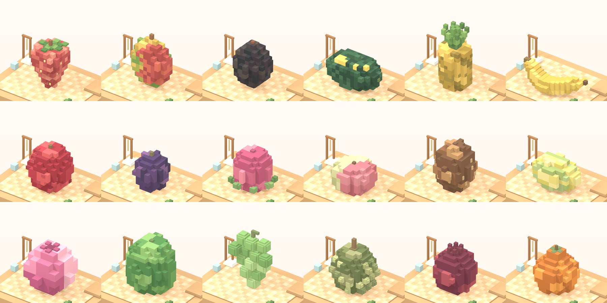

# Voxel Fruit Atlas · 方块水果图鉴



**456 chunky voxel fruit models across 75 fruit families**, from Florida strawberries and
Ataulfo mangoes to durian, salak and jaboticaba. Every fruit is a separate GLB model plus two rendered images.
Free to use in games, apps, videos and teaching under [CC BY 4.0](#license).

**75 类水果、456 个品种**的大方块（体素）风格模型：每个品种一个独立 GLB 模型，另有透明底工作台场景图和竖版立绘。
按 [CC BY 4.0](#license) 开放，可免费用于游戏、应用、视频和教学，包括商用，注明出处即可。

## What's inside · 内容

| Folder | Content | Files |
| --- | --- | --- |
| [`models/`](models) | glTF 2.0 binary models, one per fruit · 独立 GLB 模型 | 456 |
| [`standees/`](standees) | 900 × 900 PNG, transparent background, fruit on its workbench · 透明底工作台场景 | 456 |
| [`previews/`](previews) | 900 × 1200 PNG portrait card · 竖版立绘 | 456 |
| [`overviews/`](overviews) | one comparison sheet per family, plus [`all.png`](overviews/all.png) with every fruit · 每类对照图与全册长图 | 76 |
| [`catalog.json`](catalog.json) | names, families, appearance notes, reference links, palettes · 品种目录 | 1 |
| [`CATALOG.md`](CATALOG.md) | the same catalog as browsable tables with the overview sheets · 可浏览的目录 | 1 |

Files share one id, e.g. `ST-01_florida_brilliance` → `models/ST-01_florida_brilliance.glb`, `standees/ST-01_florida_brilliance.png`, `previews/ST-01_florida_brilliance.png`.
Always use the full id: short prefixes repeat across families (AP = apple and apricot) and some cultivar names repeat too.
同一品种在各文件夹用同一编号；请用完整编号，短前缀和品种名都有重复。

## Models · 模型规格

- glTF 2.0 binary (`.glb`), metres, Y up. One mesh of 4–12 primitives, 240–10,920 triangles,
  17–583 KB (median 153 KB).
- Colour-only materials (`baseColorFactor`, roughness ≈ 0.86). No UVs needed, no texture files to carry around.
- Sizes are stylised, not to scale: 4–27 cm tall. Pick a display scale per family (a blueberry
  model can be larger than a watermelon model).
- Seat models on their bounding box: a few sit up to about 1 cm off the origin, some bananas are off-centre by a few cm.
- Strawberries stand tip-down with the calyx up; grapes are flat bunches about 6 cm thick, designed to be seen from the front.

模型单位为米、Y 轴向上，只用材质颜色、不带贴图。尺寸为造型化尺寸，不按真实比例；放置时请按包围盒底部中心重新落地。

Load in three.js:

```js
import { GLTFLoader } from "three/addons/loaders/GLTFLoader.js";
new GLTFLoader().load("models/ST-01_florida_brilliance.glb", (gltf) => scene.add(gltf.scene));
```

Godot 4 and Blender (File → Import → glTF 2.0) open the files directly.

## Catalog · 品种目录

`catalog.json` has `groups` (families: `id`, Chinese `name`, `scientific`, `source`) and `assets` (one per fruit):

```json
{
  "id": "ST-01_florida_brilliance",
  "fruit": "strawberry",
  "name": "Florida Brilliance",
  "shape": "均匀锥形",
  "ripe": "亮红",
  "skin": "有光泽，籽粒略凹",
  "note": "中等大小，轮廓稳定的亮红锥形。",
  "source": "https://ask.ifas.ufl.edu/publication/HS1322"
}
```

`shape`, `ripe`, `skin` and `note` are short Chinese summaries of the linked reference. `design` holds the shape and palette
parameters the model was built from. Some families group close relatives, hybrids or types rather than cultivars of a single
species; the notes say so. The models show typical appearance for comparison and cannot identify real fruit.

外观要点均概括自条目所附资料链接；部分类别包含近缘种、杂交种或类型。模型用于比较典型外观，不能据此鉴定实物。

## License

Models, images and catalog data: **[Creative Commons Attribution 4.0 International](LICENSE)** (CC BY 4.0).
You may copy, modify and use them commercially; give credit, link the license and say if you changed them. For example:

> Voxel Fruit Atlas by Furinaaa-Cancan — https://github.com/Furinaaa-Cancan/voxel-fruit-atlas — CC BY 4.0

The reference links in the catalog point to third-party pages and are not covered by this license.

模型、图片与目录数据采用 CC BY 4.0：可复制、修改和商用，使用时注明作者与出处、附上协议链接，并说明是否做过修改。目录中的资料链接指向第三方网页，不属于本协议授权范围。
